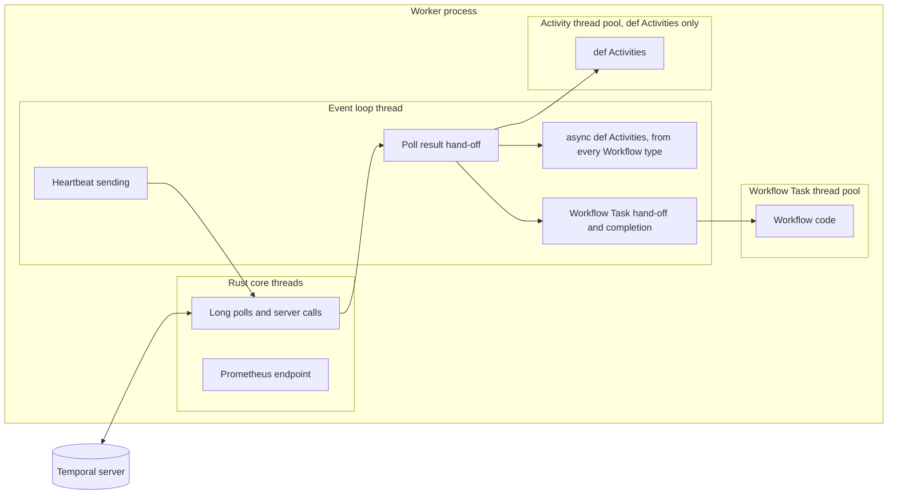

# Understanding the asyncio event loop in a Temporal Worker
<!-- TODO: venue not yet chosen. -->

### Introduction

In the demo, an `OrderReceiptWorkflow` builds a receipt in memory.
Its code does no network calls and no slow work, and each of its Activities finishes in about 10 milliseconds.
A Workflow's code runs inside a Workflow Task.
A Workflow Task is the unit of work in which the Worker runs Workflow code and reports the result to the server.
During a `just block` run, a receipt's first Workflow Task did not complete until 28.8 seconds after it started.
Nothing in the receipt code explains that number.
The asyncio event loop does.

This primer explains how the event loop runs your code and what one blocking call does to it.
It also shows which parts of a Temporal Python Worker share the loop.
This primer is optional.
The six-part series "Debugging blocking calls in Temporal async Activities" teaches by running and breaking the demo.
The series assumes the ideas on this page.
If you already know how `await` hands control back to the loop, skip to [What shares the loop in a Temporal Worker](#what-shares-the-loop-in-a-temporal-worker).
That section is the part that is specific to Temporal.

## One thread, one task at a time

An asyncio program runs on one thread.
That thread runs the event loop, and the loop runs tasks.
Calling an `async def` function returns a coroutine, an object that can pause and resume.
A task wraps one coroutine so the loop can run it, such as one call to an `async def` Activity.

The loop runs only one task at a time.
It runs a task until that task suspends itself, then it picks the next task that is ready to run.
A task suspends itself only at an `await` on something that is not ready yet, such as a timer, a network reply, or a queue.

Programmers call this model cooperative multitasking.
The loop never takes the thread away from a task.
Each task must give the thread back on its own, and it does that at an `await`.
The [Temporal Python documentation](https://docs.temporal.io/develop/python/best-practices/python-sdk-sync-vs-async) puts it this way: "the event loop can only pass the flow of control when the `await` keyword is executed."

Threads work differently.
The operating system switches between threads whenever it wants, so one slow thread cannot freeze the others.
Python's Global Interpreter Lock limits this for CPU-heavy code, as a later section shows.
That difference matters when you move blocking work off the loop.

## What `await` does

The demo's `SalesRollupWorkflow` runs one Activity, `roll_up_sales`.
It pauses for five seconds before it sums its figures, to stand in for real work.
The pause is the first line of `roll_up_sales` in `src/temporal_async_debug/rollup.py`:

```python
await asyncio.sleep(work_seconds)
```

`asyncio.sleep` does not hold the thread for five seconds.
It sets a timer on the loop and suspends the task.
The loop is free to run other tasks during those five seconds.
When the timer fires, the loop resumes the rollup task at the line after the `await`.

The following diagram shows the loop running a receipt's Workflow Task while the rollup sleeps:

```mermaid
sequenceDiagram
    participant Loop as Event loop
    participant Rollup as Rollup Activity
    participant Receipt as Receipt Workflow Task
    Loop->>Rollup: run until await asyncio.sleep(5)
    Rollup-->>Loop: suspend, resume in 5 seconds
    Loop->>Receipt: hand off the Workflow Task
    Receipt-->>Loop: completed in milliseconds
    Note over Loop: 5 seconds later
    Loop->>Rollup: resume after the sleep
    Rollup-->>Loop: return the total
```

The receipt never waits on the rollup.
This is the healthy shape.
Every task that is waiting sits at an `await`, and the loop moves between them.

## What a blocking call does

A blocking call keeps the thread busy and never returns control to the loop.
The demo's geo Activities call a helper named `_apply_mode`.
In `block` mode, the helper in `src/temporal_async_debug/activities.py` runs this line:

```python
time.sleep(block_seconds)
```

`time.sleep` puts the whole thread to sleep, for 30 seconds by default in `just block`.
The thread is the one that runs the event loop, so the loop sleeps too.
No other task can run until `time.sleep` returns, because the loop only switches at an `await`, and this line has none.

The following diagram shows a receipt arriving while a geo Activity blocks:

```mermaid
sequenceDiagram
    participant Server as Temporal server
    participant Loop as Event loop
    participant Geo as Geo Activity
    participant Receipt as Receipt Workflow Task
    Loop->>Geo: run a geo Activity
    Note over Loop,Geo: time.sleep(30) holds the thread
    Note over Receipt: ready, but the loop cannot switch to it
    Server->>Server: first Workflow Task times out after 10 seconds
    Server->>Loop: send a second Workflow Task
    Geo-->>Loop: return when the sleep ends
    Loop->>Receipt: hand off the second Workflow Task
    Receipt-->>Server: completed in milliseconds
```

The receipt code is correct, and it still waits until the freeze ends.
In the real run, the receipt arrived after the freeze had started.
The server gave up on its first Workflow Task after the 10-second Workflow Task timeout and sent a second one.
The Worker completed the second one when the freeze ended.
The 28.8 seconds runs from the start of the first Workflow Task to the completion of the second.

An `await` earlier in the same function does not help.
Exercise 2 shows this: its Activity awaits a status check, then calls `time.sleep(8)`.
The status check does suspend, so the loop gets one turn.
The sleep that follows it holds the loop for eight seconds anyway.
What matters is the line that runs right now, not whether the function is `async def`.

## Blocking is more than sleeping

`time.sleep` is the easiest blocking call to see, but anything that keeps the thread busy without an `await` blocks the loop.
Each exercise in this repository is a different way to do it:

- **A synchronous HTTP client** (exercise 1).
  The thread waits on the network inside the library, with no `await`.
- **A sleep between heartbeats** (exercise 2).
  The Activity heartbeats, then blocks.
  The heartbeat cannot leave the Worker until the sleep ends, and the heartbeat timeout fires first.
- **CPU-bound work** (exercise 3).
  A long calculation never reaches an `await`.
  It also holds Python's Global Interpreter Lock (GIL), the lock that lets only one thread run Python code at a time.
  `time.sleep` releases the GIL, so `top` reads near 0 percent CPU for a sleep and near 100 percent for a calculation.
  Both freeze the loop the same way, because releasing the GIL does not give the loop its thread back.
- **Work that outlives its attempt** (exercise 4).
  Moving blocking work to a thread with `asyncio.to_thread` frees the loop.
  When the attempt times out on the server, the SDK cancels the coroutine that awaits the thread, but the thread itself runs on.
- **A short blocking call** (exercise 5).
  Compressing an audit trail with `zlib` takes about 350 milliseconds.
  Nothing times out, but every other task on the loop waits for those 350 milliseconds on every call.

## What shares the loop in a Temporal Worker

If the blocked Activity were alone on the loop, only it would suffer.
In a Temporal Python Worker, other work always shares the loop.

The Temporal Python SDK has two layers.
A core written in Rust does the network work with the Temporal server on its own threads.
The Python layer runs on your event loop, and it connects the core to your code.

The following diagram shows where each piece runs:



Every poll result passes through the event loop thread, even when the work then runs somewhere else.
These run on the event loop thread:

- Handing poll results from the core to your code.
  This includes dispatching `def` Activities to their thread pool.
- Every `async def` Activity, from every Workflow type the Worker serves.
- Sending heartbeats.
  In an `async def` Activity, `activity.heartbeat()` schedules the send as a task on the loop.
  That is why exercise 2's heartbeat waits for the sleep to end.
- The Python side of Workflow Task handling.
  Workflow code itself runs on a separate thread pool, inside a separate loop that the SDK controls so that replay gives the same result.
  The Worker's main loop still hands each Workflow Task to that pool and reports the result to the server.
  [Temporal's documentation](https://docs.temporal.io/develop/python/best-practices/python-sdk-sync-vs-async#python-sdk-worker-execution-architecture) describes the Workflow event loop in more detail.

These do not run on the event loop thread:

- The core's long polls and other calls to the Temporal server.
- The Prometheus metrics endpoint.

This split explains three things that the series shows with captured output.

First, one Workflow type can take down another.
The geo, rollup, and receipt Workflows share no code, but they share the loop.
A blocking geo Activity stops the rollup Activity and the receipt Workflow Tasks at the same time.

Second, the server keeps sending work to a frozen Worker.
The core's polls keep running, so the server sees a Worker that asks for work and receives it.
The Python side cannot run that work, so the tasks time out on the server.

Third, the metrics endpoint keeps answering during a freeze.
It runs on a core thread, so a fast metrics scrape does not mean the loop is healthy.

## What a frozen loop looks like from outside

You do not need to add logging to see the loop.
Python 3.14's `python -m asyncio ps` reads the task list of a running process from outside.
Part 1 shows the one permission it needs.

On a healthy Worker, every task sits at an `await`.
[Step 5 of part 1](part-1-healthy-worker.md#step-5-reading-the-idle-worker) shows that shape, with the rollup task parked at `sleep`.
On a frozen Worker, one task has no `await` beneath it.
Its stack ends at the SDK frame that started the Activity, because the task is running synchronous code, not waiting.

`asyncio ps` shows which task holds the loop.
It cannot show the line, because a task stuck in synchronous code is not parked at an `await`.
`py-spy dump` reads the thread's real call stack and names the exact line, such as the `time.sleep` line in `_apply_mode`.
Part 1 records the healthy readings, and part 2 uses both tools on a frozen Worker.

## Getting blocking work off the loop

Every fix in the series follows the same idea: the blocking line must not run on the event loop thread.
The exercises use three ways to do that.

**A synchronous Activity.**
A `def` Activity runs on the Worker's `activity_executor`, a thread pool such as a `ThreadPoolExecutor`, away from the loop.
Temporal's documentation recommends this as the default: "By default, Activities should be synchronous rather than asynchronous."
Exercises 1, 3, and 4 use this fix.

**One call on a thread.**
An `async def` Activity can run only its blocking call on a thread, with `await asyncio.to_thread(...)`.
The loop sees an `await` and moves on while the thread does the work.
Exercise 5 uses this fix.

**A library that awaits.**
An async HTTP client such as `httpx.AsyncClient` awaits the network instead of blocking on it.
The demo's healthy `get_ip` uses it.
For a wait inside your own code, `await asyncio.sleep` in place of `time.sleep` is the same idea, and exercise 2 uses it.

Each fix has limits that the exercises show.
A thread pool has a fixed size.
A thread still shares the GIL with the loop, so CPU-bound work on a thread slows the loop down.
Python hands the GIL between threads every 5 milliseconds by default, so the loop still gets turns.
It slows down, but it does not freeze.
A thread started by `asyncio.to_thread` keeps running after the SDK cancels its coroutine.
The SDK can stop a `def` Activity on the `activity_executor`.
The SDK raises `CancelledError` inside its thread.
That only works if the Activity heartbeats, because the heartbeat is how the cancel reaches it.

## Conclusion

The event loop runs one task at a time, and it switches only at an `await`.
A blocking line in any `async def` Activity holds the one thread that every `async def` Activity, heartbeat, and Workflow Task hand-off shares.
That is why correct Workflows fail or stall next to a broken one.
The fix moves the blocking line off the loop, to a thread pool, a single thread, or a library that awaits.
In part 1, you start the demo and record what a healthy loop looks like.

## Further reading

- [Temporal Python SDK synchronous versus asynchronous Activity implementations](https://docs.temporal.io/develop/python/best-practices/python-sdk-sync-vs-async), Temporal's guidance on choosing `def` or `async def`.
- [Developing with asyncio](https://docs.python.org/3/library/asyncio-dev.html), the Python documentation on blocking code and debug mode.
- [Temporal Python SDK README, "Types of Activities"](https://github.com/temporalio/sdk-python#types-of-activities), on the `activity_executor` and cancellation for threaded Activities.
