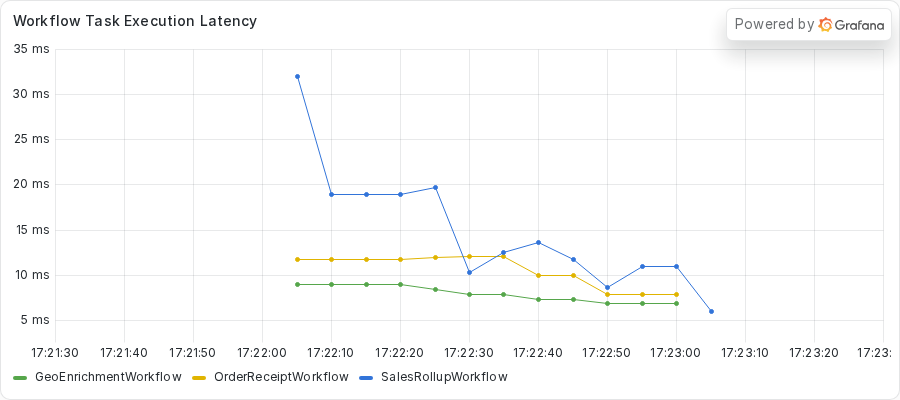
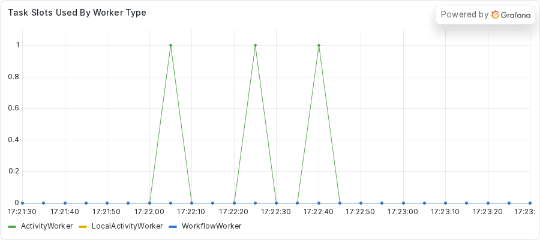
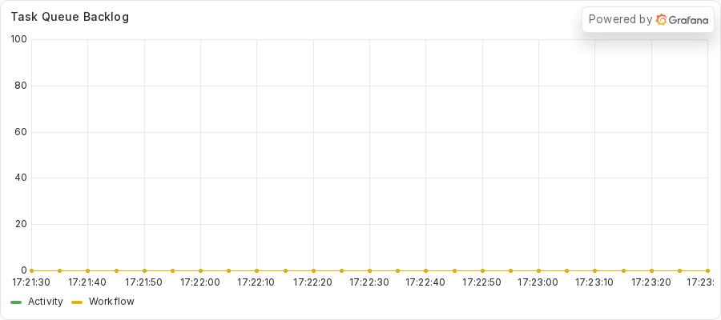

# Reading a healthy Temporal Worker
<!-- TODO: venue not yet chosen. -->

### Introduction

A Temporal Worker runs your Activities, and every `async def` Activity runs on one asyncio event loop.
One blocking call on that loop can stop everything else the Worker does, including Workflows that have nothing to do with the broken code.
This is part 1 of the series "Debugging blocking calls in Temporal async Activities".
The series teaches one mechanism: how a call that blocks the event loop hurts a Worker, and how you find it.
If you are new to the asyncio event loop, read the optional primer [Understanding the asyncio event loop in a Temporal Worker](event-loop-primer.md) first.

In this tutorial, you set up the demo, start a healthy Worker, and run a fleet of Workflows that all complete.
You read the Worker with Python's asyncio tools, `top`, `temporal task-queue describe`, and a Grafana dashboard.
Those readings are the baseline.
Every later part breaks the Worker on purpose and asks you to compare what you see with the numbers you record here.

This series runs one Worker with two Activity slots on purpose, as teaching code, so each problem in the later parts stands out.
To see the same bug on a fleet of Workers, read part 7: TODO (link to part 7, "Finding the frozen Worker in a fleet").

Previous: this is the first part.
Next: TODO (link to part 2, "Fixing a blocking HTTP client in an async Activity").

## Prerequisites

To complete this tutorial, you need:

- **Python 3.14 or newer**, from [python.org](https://www.python.org/downloads/).
  The asyncio tools in this series read another process, and both the tool and the Worker need Python 3.14 or newer.
- **uv**, the Python package manager, from the [uv documentation](https://docs.astral.sh/uv/).
  The `uv run` command gives you the right Python version.
- **just**, a command runner, from the [just repository](https://github.com/casey/just).
- **The Temporal command-line tool**, installed from the [Temporal documentation](https://docs.temporal.io/cli).
  It provides the `temporal` command.
- **Docker and docker-compose**, from the [Docker Compose documentation](https://docs.docker.com/compose/).
  They run Prometheus and Grafana.
- **A clone of the demo repository.**
  Run `git clone https://github.com/MasonEgger/temporal-async-debug.git`, then change into the new directory.

You also use `py-spy` in later parts.
The repository does not install it.
You run it on demand with `uvx py-spy`, and you first use it in part 2.

## Step 1: Allowing process inspection

Python 3.14 can print the tasks of a running program from another process.
`py-spy` can print its thread stacks.
Both tools attach to the Worker from the outside, so the operating system has to allow it.

On Linux, the Yama security module controls this with the `ptrace_scope` setting.
A value of 1 stops a process from attaching to a process it did not start.
Read the current value with this command:

```sh
cat /proc/sys/kernel/yama/ptrace_scope
```

If it reads 1, the tools refuse to attach.
You start the Worker in Step 3, so this first capture comes from an idle Worker started ahead of time.
It shows `py-spy` with the value at 1.
The capture records the setting, the command, its output, and the exit code.

<!-- vale off -->
<!-- vale MasonBase.CodeLineLength = NO -->
```text
$ cat /proc/sys/kernel/yama/ptrace_scope
1
$ uvx py-spy dump --pid 2542562
Permission Denied: Try running again with elevated permissions by going 'sudo env "PATH=$PATH" !!'
exit=1
```
<!-- vale MasonBase.CodeLineLength = YES -->
<!-- vale on -->

`python -m asyncio ps` fails the same way on the same Worker.
The block is the whole capture file.

<!-- vale off -->
<!-- vale MasonBase.CodeLineLength = NO -->
```text
$ python -m asyncio ps 2542562
Error: The specified process cannot be attached to due to insufficient permissions.
See the Python documentation for details on required privileges and troubleshooting:
https://docs.python.org/3.14/howto/remote_debugging.html#permission-requirements

exit=1
```
<!-- vale MasonBase.CodeLineLength = YES -->
<!-- vale on -->

Set the value to 0 for your session with this command:

```sh
sudo sysctl kernel.yama.ptrace_scope=0
```

The `sudo` prefix is necessary because the setting belongs to the kernel.
The change lasts until you restart the machine.
On macOS, run the inspection commands with `sudo` instead.

On Linux, read the setting back to check the change:

```sh
sysctl kernel.yama.ptrace_scope
```

A read needs no `sudo`.
This capture is a read with the setting at 0.

<!-- vale off -->
<!-- vale MasonBase.CodeLineLength = NO -->
```text
kernel.yama.ptrace_scope = 0
```
<!-- vale MasonBase.CodeLineLength = YES -->
<!-- vale on -->

With the value at 0, the same `py-spy` command attaches to the same Worker.
In the captures of this part, `<repo>`, `<home>`, `<ip>`, `<city>`, and `host` replace the paths, address, city, and hostname that appear in your own output.
The block is the whole capture file.

<!-- vale off -->
<!-- vale MasonBase.CodeLineLength = NO -->
```text
$ cat /proc/sys/kernel/yama/ptrace_scope
0
$ uvx py-spy dump --pid 2542562
Process 2542562: <repo>/.venv/bin/python -m temporal_async_debug.worker
Python v3.14.3 (<home>/.local/share/uv/python/cpython-3.14.3-linux-x86_64-gnu/bin/python3.14)

Thread 2542562 (idle): "MainThread"
    EpollSelector.select (selectors.py:452)
    BaseEventLoop._run_once (asyncio/base_events.py:2008)
    BaseEventLoop.run_forever (asyncio/base_events.py:677)
    BaseEventLoop.run_until_complete (asyncio/base_events.py:706)
    Runner.run (asyncio/runners.py:127)
    run (asyncio/runners.py:204)
    <module> (temporal_async_debug/worker.py:118)
    _run_code (<frozen runpy>:88)
    _run_module_as_main (<frozen runpy>:198)
exit=0
```
<!-- vale MasonBase.CodeLineLength = YES -->
<!-- vale on -->

The `asyncio ps` command attaches too, and it lists the seven tasks of an idle Worker.
The block is the whole capture file.

<!-- vale off -->
<!-- vale MasonBase.CodeLineLength = NO -->
```text
$ python -m asyncio ps 2542562
tid        task id              task name            coroutine stack                                    awaiter chain                                      awaiter name    awaiter id     
------------------------------------------------------------------------------------------------------------------------------------------------------------------------------------
2542562    0x7a24594f76b0       Task-1               Worker._run -> Worker.run -> main                                                                                     0x0            
2542562    0x7a24594f7e30       Task-2               Event.wait -> Worker._run.<locals>.raise_on_shutdown _wait -> wait                                      Task-5          0x7a24594abd90 
2542562    0x7a245938abd0       Task-3               _wait -> wait -> _ActivityWorker.run               _wait -> wait                                      Task-5          0x7a24594abd90 
2542562    0x7a245938a660       Task-4               Worker.poll_workflow_activation -> _WorkflowWorker.run _wait -> wait                                      Task-5          0x7a24594abd90 
2542562    0x7a24594abd90       Task-5               _wait -> wait                                      Worker._run -> Worker.run -> main                  Task-1          0x7a24594f76b0 
2542562    0x7a24594abbd0       Task-6               Queue.get -> _ActivityWorker.run.<locals>.raise_from_exception_queue _wait -> wait -> _ActivityWorker.run               Task-3          0x7a245938abd0 
2542562    0x7a2459260710       Task-7               Worker.poll_activity_task                          _wait -> wait -> _ActivityWorker.run               Task-3          0x7a245938abd0 
exit=0
```
<!-- vale MasonBase.CodeLineLength = YES -->
<!-- vale on -->

Now that your machine allows inspection, you can start the services the demo needs.

## Step 2: Starting the server and the dashboard

The demo needs a Temporal Service, and the `temporal` command includes a local development server.
Open a terminal in the repository and start it:

```sh
just server
```

The `just server` recipe runs `temporal server start-dev --metrics-port 9465`.
The `--metrics-port 9465` option makes the server export its own Prometheus metrics on port 9465.
Leave this terminal open.
The server also serves a Web UI at http://localhost:8233.

Next, start the metrics stack, which holds Prometheus and Grafana.
The two services run in containers, so the command returns once the containers exist.
Open a second terminal and run this command:

```sh
just metrics
```

The first run downloads two images.
The capture below drops the download lines and keeps the four lines that create the containers.

<!-- vale off -->
<!-- vale MasonBase.CodeLineLength = NO -->
```text
Creating observability_grafana_1 ... 
Creating observability_prometheus_1 ... 
Creating observability_prometheus_1 ... done
Creating observability_grafana_1    ... done
```
<!-- vale MasonBase.CodeLineLength = YES -->
<!-- vale on -->

Prometheus collects metrics from two places.
The Worker exports metrics on port 9464, and the server exports its own on port 9465.
Grafana reads from Prometheus and serves a provisioned dashboard named **Async Debug** at http://localhost:3000.
Anonymous viewers can open it without a login.

Prometheus can report which of its targets it has reached.
This capture comes from a query for the highest value of the `up` metric over three hours.
The value 1 means Prometheus reached the target at least once.

<!-- vale off -->
<!-- vale MasonBase.CodeLineLength = NO -->
```text
127.0.0.1:9464 1
127.0.0.1:9465 1
```
<!-- vale MasonBase.CodeLineLength = YES -->
<!-- vale on -->

Both ports read 1, so Prometheus saw the Worker and the server.
With both services up, you can start the Worker.

## Step 3: Starting the Worker

The Worker polls the Task Queue for Workflow Tasks and Activity Tasks, and it runs the code you register.
This Worker registers three Workflow types.
`GeoEnrichmentWorkflow` looks up an IP address and its location over HTTP.
`OrderReceiptWorkflow` builds a receipt in memory, and `SalesRollupWorkflow` pauses for five seconds and then sums some figures.
The three Workflow types share no code, and they share one Worker.

Open a third terminal in the repository and start the Worker:

```sh
just worker
```

The Worker prints a banner with its process ID (PID) and the commands that inspect it.
This capture drops the command echo and the log lines that follow the banner.
Your PID is different.

<!-- vale off -->
<!-- vale MasonBase.CodeLineLength = NO -->
```text
========================================================================
temporal-async-debug worker running with PID 2541958
Inspect the live event loop from another terminal with either of:
    python -m asyncio ps 2541958
    python -m asyncio pstree 2541958
Prometheus metrics: http://127.0.0.1:9464/metrics
========================================================================
```
<!-- vale MasonBase.CodeLineLength = YES -->
<!-- vale on -->

Note the PID.
You use it in every inspection command in this series.
The last banner line gives the address of the Worker's metrics endpoint.

Now that the Worker runs, you can give it some work.

## Step 4: Running the healthy fleet

A fleet is a set of Workflows that the starter submits together.
The `just healthy` recipe submits two geo runs, one rollup, and three receipts.
Open a fourth terminal and run it:

```sh
just healthy
```

The starter waits for every Workflow and prints each result.
This capture drops the first line, which is the command echo, and keeps the six result lines.

<!-- vale off -->
<!-- vale MasonBase.CodeLineLength = NO -->
```text
geo geo-74813b62-3f00-4d30-9377-d54f8236a39d: GeoEnrichmentOutput(ip='<ip>', location='<city>')
geo geo-4f15bc80-6e64-4f1b-a373-ab3c4f6ba7b8: GeoEnrichmentOutput(ip='<ip>', location='<city>')
receipt receipt-cca1bdc1-70f9-4314-b898-6cd5d0daf537: OrderReceiptOutput(receipt='order order-0: 59.97 USD')
receipt receipt-a44f7d50-276b-4a16-a83a-6a80661b9a68: OrderReceiptOutput(receipt='order order-1: 59.97 USD')
receipt receipt-7a2ad40d-52b4-4cda-81bc-13482b78af8a: OrderReceiptOutput(receipt='order order-2: 59.97 USD')
rollup rollup-1cc154ba-bd3d-4871-9b14-e6c81a0f1727: SalesRollupOutput(summary='Sales rollup for 2026-01: total 6030')
```
<!-- vale MasonBase.CodeLineLength = YES -->
<!-- vale on -->

Every Workflow completed, and nothing failed.
That outcome is the first part of the baseline.
In the parts that follow, the same fleet fails or stalls, and the code of the failing Workflows looks correct.

## Step 5: Reading the idle Worker

A baseline needs numbers, so you take three readings of the idle Worker.
The first reading lists the tasks on the event loop.
`python -m asyncio ps` reads the memory of the Worker from outside the process, so it needs no change to the Worker.
Run it from the repository root and replace `<PID>` with the PID from the banner:

```sh
uv run python -m asyncio ps <PID>
```

Each row is one asyncio task.
The capture below shows the idle Worker.

<!-- vale off -->
<!-- vale MasonBase.CodeLineLength = NO -->
```text
tid        task id              task name            coroutine stack                                    awaiter chain                                      awaiter name    awaiter id     
------------------------------------------------------------------------------------------------------------------------------------------------------------------------------------
2541958    0x7838e73036b0       Task-1               Worker._run -> Worker.run -> main                                                                                     0x0            
2541958    0x7838e7303e30       Task-2               Event.wait -> Worker._run.<locals>.raise_on_shutdown _wait -> wait                                      Task-5          0x7838e72b7d90 
2541958    0x7838e7196bd0       Task-3               _wait -> wait -> _ActivityWorker.run               _wait -> wait                                      Task-5          0x7838e72b7d90 
2541958    0x7838e7196660       Task-4               Worker.poll_workflow_activation -> _WorkflowWorker.run _wait -> wait                                      Task-5          0x7838e72b7d90 
2541958    0x7838e72b7d90       Task-5               _wait -> wait                                      Worker._run -> Worker.run -> main                  Task-1          0x7838e73036b0 
2541958    0x7838e72b7bd0       Task-6               Queue.get -> _ActivityWorker.run.<locals>.raise_from_exception_queue _wait -> wait -> _ActivityWorker.run               Task-3          0x7838e7196bd0 
2541958    0x7838e706c710       Task-7               Worker.poll_activity_task                          _wait -> wait -> _ActivityWorker.run               Task-3          0x7838e7196bd0 
```
<!-- vale MasonBase.CodeLineLength = YES -->
<!-- vale on -->

Read the `coroutine stack` column.
It lists the calls of each task from the innermost, where the task is now, to the outermost, where the task started.
The tasks belong to the Temporal SDK.
Task-1 runs the Worker, and Task-4 and Task-7 poll for Workflow and Activity work.
Each task waits at an await, because each task waits for something.
Its innermost call comes first, as in `Queue.get` or `Event.wait`.
Remember this shape.
A healthy loop parks every task at an await.

Next, run the same command while the fleet runs.
The rollup Activity sleeps for five seconds, which makes it the easiest Activity to catch.

<!-- vale off -->
<!-- vale MasonBase.CodeLineLength = NO -->
```text
tid        task id              task name            coroutine stack                                    awaiter chain                                      awaiter name    awaiter id     
------------------------------------------------------------------------------------------------------------------------------------------------------------------------------------
2541958    0x7838e73036b0       Task-1               Worker._run -> Worker.run -> main                                                                                     0x0            
2541958    0x7838e7303e30       Task-2               Event.wait -> Worker._run.<locals>.raise_on_shutdown _wait -> wait                                      Task-5          0x7838e72b7d90 
2541958    0x7838e7196bd0       Task-3               _wait -> wait -> _ActivityWorker.run               _wait -> wait                                      Task-5          0x7838e72b7d90 
2541958    0x7838e7196660       Task-4               Worker.poll_workflow_activation -> _WorkflowWorker.run _wait -> wait                                      Task-5          0x7838e72b7d90 
2541958    0x7838e72b7d90       Task-5               _wait -> wait                                      Worker._run -> Worker.run -> main                  Task-1          0x7838e73036b0 
2541958    0x7838e72b7bd0       Task-6               Queue.get -> _ActivityWorker.run.<locals>.raise_from_exception_queue _wait -> wait -> _ActivityWorker.run               Task-3          0x7838e7196bd0 
2541958    0x7838e56375c0       Task-56              sleep -> roll_up_sales -> _ActivityInboundImpl.execute_activity -> _ActivityWorker._execute_activity -> _ActivityWorker._handle_start_activity_task                                                                    0x0            
2541958    0x7838e6f57d40       Task-109             Worker.poll_activity_task                          _wait -> wait -> _ActivityWorker.run               Task-3          0x7838e7196bd0 
```
<!-- vale MasonBase.CodeLineLength = YES -->
<!-- vale on -->

Task-56 shows the rollup Activity.
Its stack starts at `sleep` and continues through `roll_up_sales` and `_ActivityInboundImpl.execute_activity`, out to the SDK handler `_ActivityWorker._handle_start_activity_task`.
The innermost call is `sleep`, so the task waits at an await and the loop is free.
In part 2, one task has only the SDK handler in its stack, with no call inside it.
That shape is the sign of a frozen loop.

The second reading is CPU use.
Run `top` for the Worker PID:

```sh
top -b -d 1 -n 2 -p <PID> | tail -8
```

The `-b` option prints plain text, and `-d 1` sets a one-second delay between frames.
The `-n 2` option prints two frames, so the second frame reports CPU use over a real one-second interval.
The `-p <PID>` option limits the output to the Worker.
This capture keeps only the column header and the process row.

<!-- vale off -->
<!-- vale MasonBase.CodeLineLength = NO -->
```text
    PID USER      PR  NI    VIRT    RES    SHR S  %CPU  %MEM     TIME+ COMMAND
2541958 ziggy     25   5  937844  78660  31612 S   0.0   0.5   0:00.94 python
```
<!-- vale MasonBase.CodeLineLength = YES -->
<!-- vale on -->

The `%CPU` column reads 0.0, and the state column reads `S`, which means sleeping.
An idle Worker uses no CPU.
Part 4 shows the same column when the loop does heavy work.

The third reading comes from the server.
Ask it about the Task Queue the Worker polls:

```sh
temporal task-queue describe --task-queue async-debug-task-queue
```

The capture below is the full output.

<!-- vale off -->
<!-- vale MasonBase.CodeLineLength = NO -->
```text
Task Queue Statistics:
    BuildID    TaskQueueType  ApproximateBacklogCount  ApproximateBacklogAge  BacklogIncreaseRate  TasksAddRate  TasksDispatchRate
  UNVERSIONED  activity                             0  0s                                       0             0                  0
  UNVERSIONED  workflow                             0  0s                                       0             0                  0
Pollers:
    BuildID    TaskQueueType   Identity    LastAccessTime  RatePerSecond
  UNVERSIONED  activity       2541958@host  52 seconds ago         100000
  UNVERSIONED  workflow       2541958@host  57 seconds ago         100000
```
<!-- vale MasonBase.CodeLineLength = YES -->
<!-- vale on -->

The `ApproximateBacklogCount` column reads 0 for both the Activity and Workflow queues.
No task waits for a Worker.
Keep that number in mind, because a frozen Worker stops taking tasks and the backlog can grow.

With three baseline readings recorded, you can read the dashboard.

## Step 6: Reading the dashboard

Open http://localhost:3000 and find the **Async Debug** dashboard.
It has seven panels:

- **Activity Execution Latency**
- **Workflow Task Schedule-To-Start Latency**
- **Workflow Task Execution Latency**
- **Activity And Workflow Task Failures**
- **Task Slots Used By Worker Type**
- **Task Queue Backlog**
- **Workflow Task Slots Used Per Worker**

The dashboard collects metrics every five seconds.
The three latency panels plot a 30-second rate average.
Later parts read the length of a stall from the Workflow history, not from these panels.

Start with **Workflow Task Execution Latency**.
It plots how long the Worker takes to answer a Workflow Task, with one line for each Workflow type.
The image below shows three healthy runs of `just healthy`.



The lines sit between about 6 and 32 milliseconds.
The unit is milliseconds, and the unit matters.
The Temporal SDK reports these latencies in milliseconds, and later images use the same scale.

Next, look at **Task Slots Used By Worker Type**.
The Worker has two Activity slots, so it runs two Activities at most at the same time.
This panel plots the count of slots that hold an Activity.



The panel shows three short spikes of one slot, one for each run, and zero between them.
A healthy Worker frees its slots as soon as the work ends.

The last panel to read is **Task Queue Backlog**.
The server exports this metric on port 9465, which is why `just server` sets that port.



Both lines stay at zero.
That agrees with the `temporal task-queue describe` reading from the previous step.

The backlog gauge stayed flat in the capture session, even during a freeze.
In one freeze, `temporal task-queue describe` reported a count of 1 and an age of 4.27 seconds while the gauge read 0.
That is one capture, not a general figure.
Treat `temporal task-queue describe` as the reliable backlog reading and the dashboard as corroboration.

## Conclusion

In this tutorial, you started a local Temporal server, a dashboard stack, and a Worker, and you ran a healthy fleet.
You recorded the baseline: every task parked at an await in `asyncio ps`, 0.0 percent CPU in `top`, a backlog of zero in `temporal task-queue describe`, and latencies of milliseconds on the dashboard.

In part 2, you run the same fleet with one Activity that blocks the event loop.
Unrelated Workflows fail, and you find the blocking line with `asyncio ps` and `py-spy`.
You can read more about Workers and Activities in the [Temporal documentation](https://docs.temporal.io/).

Next: TODO (link to part 2, "Fixing a blocking HTTP client in an async Activity").
