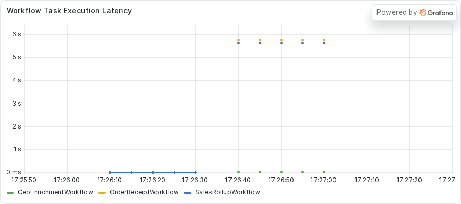
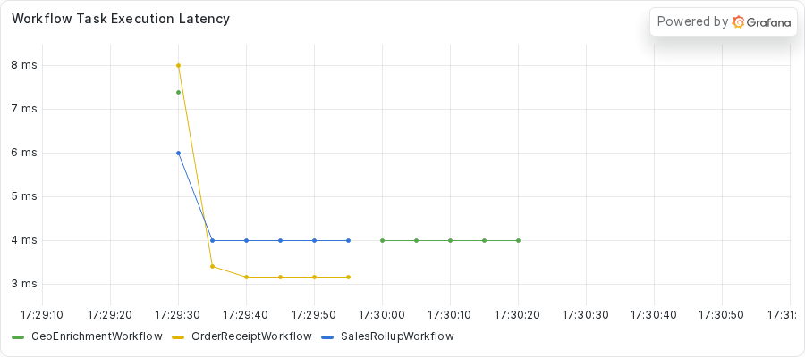

# Fixing a blocking HTTP client in an async Activity
<!-- TODO: venue not yet chosen. -->

### Introduction

An `async def` Activity runs on the Worker's event loop, and a synchronous HTTP call inside it holds that loop until the server answers.
Nothing else on the Worker runs in the meantime.
That includes Workflows whose code never touches the network.

In this tutorial, you run a fleet of Workflows against a Worker where one lookup waits on a slow upstream.
You watch unrelated Workflows fail, and you find the cause from outside the process with `python -m asyncio ps`, `pstree`, and `py-spy dump`.
Then you write a test that fails while the call holds the loop, move the call to a thread, and run the fleet again.

This tutorial runs one Worker with two Activity slots on purpose, as teaching code, so the failure is loud.
To see the same bug on a fleet of Workers, read part 7: TODO (link to part 7, "Finding the frozen Worker in a fleet").

This is part 2 of the series "Debugging blocking calls in Temporal async Activities".
Previous: TODO (link to part 1, "Reading a healthy Temporal Worker").
Next: TODO (link to part 3, "Fixing a sleep between heartbeats in an async Activity").

## Prerequisites

To complete this tutorial, you need:

- The setup from part 1: Python 3.14 or newer, `uv`, `just`, the `temporal` command, and Docker with docker-compose.
- The dashboard stack from `just metrics` and the server from `just server`, both running (part 1 explains them).
- Process inspection allowed on your machine, as described in part 1.
- The `exercises/01-sync-http-client` directory of the demo repository, which holds a `practice` copy with the bug and a `solution` copy with the fix.

You also use [py-spy](https://github.com/benfred/py-spy), which the repository does not install.
You run it on demand with `uvx py-spy dump --pid <PID>`.

## Step 1: Running the fleet

The demo has three Workflow types on one Worker.
`GeoEnrichmentWorkflow` calls two Activities, `get_ip` and `get_location`, and both fetch from HTTP providers.
`SalesRollupWorkflow` pauses for five seconds and sums some figures.
`OrderReceiptWorkflow` builds a receipt in memory.
The rollup and receipt code never touches the network.

This exercise starts the Worker from the `practice` copy.
Change to its directory and start the Worker:

```sh
cd exercises/01-sync-http-client/practice
uv run python worker.py
```

The Worker prints a banner with its PID.
Keep this terminal open and note the PID.
Do not read the Activity code yet.
You find the problem from the outside first.

In a second terminal, change to the same directory.
Submit a small fleet against the real providers:

```sh
uv run python starter.py --geo 2 --receipts 3
```

The Workflows finish and nothing looks wrong.
That is part of the problem.
Now submit the full fleet:

```sh
uv run python starter.py --block-seconds 30 --bad 1 --geo 1 \
    --rollups 1 --receipts 2
```

The `--bad 1` option sends one geo run to a slow local endpoint, and `--block-seconds 30` sets how long that endpoint waits before it answers.
The starter submits the rollup first and the healthy geo run second.
It submits the bad run third, and it adds the receipts after the bad run reaches `get_location`.
The command takes about half a minute.
This is the output from the capture of this exercise.
In the capture, `ziggy`, `256.256.256.256`, and `Milky Way Galaxy` are stand-ins for the user name, address, and location of the capture machine.
Your own output shows your own values.

<!-- vale off -->
<!-- vale MasonBase.CodeLineLength = NO -->
```text
rollup rollup-a5de1f87-2d83-461f-919e-83652ffadc45 FAILED: Activity task timed out
geo geo-6215226e-70d8-4d93-8ace-6410d45a2685: GeoEnrichmentOutput(ip='256.256.256.256', location='Milky Way Galaxy')
receipt receipt-54a77ca5-a787-4de7-8d49-43609be3960d: OrderReceiptOutput(receipt='order order-0: 59.97 USD')
receipt receipt-0ad58652-e4de-4a20-b741-d894fbbaa521: OrderReceiptOutput(receipt='order order-1: 59.97 USD')
geo geo-fe66e250-5ff3-44e8-80a0-ce7db5cfc1f8: GeoEnrichmentOutput(ip='256.256.256.256', location='Milky Way Galaxy')
```
<!-- vale MasonBase.CodeLineLength = YES -->
<!-- vale on -->

The rollup failed with `Activity task timed out`.
The receipts finished, but you can ask the server how long they took.
Now that the fleet has run, you read the Event History of one receipt.

## Step 2: Reading the Event History

Run `temporal workflow show -w <receipt workflow ID>` with a receipt ID from your own output.
This capture keeps the first ten lines, which cover the first Workflow Task and the first Activity.

<!-- vale off -->
<!-- vale MasonBase.CodeLineLength = NO -->
```text
Progress:
  ID           Time                     Type           
    1  2026-11-03T23:26:03Z  WorkflowExecutionStarted  
    2  2026-11-03T23:26:03Z  WorkflowTaskScheduled     
    3  2026-11-03T23:26:03Z  WorkflowTaskStarted       
    4  2026-11-03T23:26:13Z  WorkflowTaskTimedOut      
    5  2026-11-03T23:26:23Z  WorkflowTaskScheduled     
    6  2026-11-03T23:26:23Z  WorkflowTaskStarted       
    7  2026-11-03T23:26:32Z  WorkflowTaskCompleted     
    8  2026-11-03T23:26:32Z  ActivityTaskScheduled     
```
<!-- vale MasonBase.CodeLineLength = YES -->
<!-- vale on -->

The first Workflow Task started at 23:26:03.
At 23:26:13 the history shows `WorkflowTaskTimedOut`, because the Worker never replied to that task.
The server scheduled a second Workflow Task at 23:26:23, and the Worker completed it at 23:26:32.
The receipt waited about 29 seconds for its first decision, across two Workflow Tasks.
A healthy Worker answers a Workflow Task in milliseconds, and a receipt does no I/O.
A 29-second stall is the mystery to solve.

The rollup tells the same story.
Run `temporal workflow show -w <rollup workflow ID>`.
This capture starts at the `Results:` line and runs to the end.

<!-- vale off -->
<!-- vale MasonBase.CodeLineLength = NO -->
```text
Results:
  Status   FAILED
  Failure  
    Message: Activity task timed out
    Cause:
        Message: activity ScheduleToClose timeout
        Cause:
            Message: activity StartToClose timeout
```
<!-- vale MasonBase.CodeLineLength = YES -->
<!-- vale on -->

The rollup Activity only had to sleep for five seconds, and the server gave up on it first.
Its Event History also holds a `WorkflowTaskTimedOut` event.
The code of both Workflows is correct, so something shared is wrong.
The shared piece is the Worker's single event loop.
It runs your `async def` Activities, the bookkeeping tasks of the Temporal SDK, and the tasks that hand Workflow Tasks to your code.
If one call holds the loop, every other task waits.

Run the next three steps about 8 seconds after you submit the full fleet.
Replace `<PID>` with the PID from the Worker banner.

## Step 3: Finding the stuck task with asyncio ps

`python -m asyncio ps` reads the memory of the Worker from outside the process, so it answers even during a freeze.
Run it from the repository root:

```sh
uv run python -m asyncio ps <PID>
```

First, here is the same command on an idle Worker.
Every task waits at an await.

<!-- vale off -->
<!-- vale MasonBase.CodeLineLength = NO -->
```text
tid        task id              task name            coroutine stack                                    awaiter chain                                      awaiter name    awaiter id     
------------------------------------------------------------------------------------------------------------------------------------------------------------------------------------
2580799    0x7e12644f72f0       Task-1               Worker._run -> Worker.run -> main                                                                                     0x0            
2580799    0x7e12644f7e30       Task-2               Event.wait -> Worker._run.<locals>.raise_on_shutdown _wait -> wait                                      Task-5          0x7e1264439550 
2580799    0x7e126433ef70       Task-3               _wait -> wait -> _ActivityWorker.run               _wait -> wait                                      Task-5          0x7e1264439550 
2580799    0x7e126433ea00       Task-4               Worker.poll_workflow_activation -> _WorkflowWorker.run _wait -> wait                                      Task-5          0x7e1264439550 
2580799    0x7e1264439550       Task-5               _wait -> wait                                      Worker._run -> Worker.run -> main                  Task-1          0x7e12644f72f0 
2580799    0x7e126443ba10       Task-6               Queue.get -> _ActivityWorker.run.<locals>.raise_from_exception_queue _wait -> wait -> _ActivityWorker.run               Task-3          0x7e126433ef70 
2580799    0x7e12645df140       Task-7               Worker.poll_activity_task                          _wait -> wait -> _ActivityWorker.run               Task-3          0x7e126433ef70 
```
<!-- vale MasonBase.CodeLineLength = YES -->
<!-- vale on -->

This is the output about 8 seconds into the fleet run.

<!-- vale off -->
<!-- vale MasonBase.CodeLineLength = NO -->
```text
tid        task id              task name            coroutine stack                                    awaiter chain                                      awaiter name    awaiter id     
------------------------------------------------------------------------------------------------------------------------------------------------------------------------------------
2580799    0x7e12644f72f0       Task-1               Worker._run -> Worker.run -> main                                                                                     0x0            
2580799    0x7e12644f7e30       Task-2               Event.wait -> Worker._run.<locals>.raise_on_shutdown _wait -> wait                                      Task-5          0x7e1264439550 
2580799    0x7e126433ef70       Task-3               _wait -> wait -> _ActivityWorker.run               _wait -> wait                                      Task-5          0x7e1264439550 
2580799    0x7e126433ea00       Task-4               Worker.poll_workflow_activation -> _WorkflowWorker.run _wait -> wait                                      Task-5          0x7e1264439550 
2580799    0x7e1264439550       Task-5               _wait -> wait                                      Worker._run -> Worker.run -> main                  Task-1          0x7e12644f72f0 
2580799    0x7e126443ba10       Task-6               Queue.get -> _ActivityWorker.run.<locals>.raise_from_exception_queue _wait -> wait -> _ActivityWorker.run               Task-3          0x7e126433ef70 
2580799    0x7e12641476b0       Task-127             sleep -> roll_up_sales -> _ActivityInboundImpl.execute_activity -> _ActivityWorker._execute_activity -> _ActivityWorker._handle_start_activity_task                                                                    0x0            
2580799    0x7e1264146b70       Task-152             _ActivityWorker._handle_start_activity_task                                                                           0x0            
2580799    0x7e12629394f0       Task-153             Worker.poll_activity_task                          _wait -> wait -> _ActivityWorker.run               Task-3          0x7e126433ef70 
```
<!-- vale MasonBase.CodeLineLength = YES -->
<!-- vale on -->

Look at Task-152.
Its stack holds only `_ActivityWorker._handle_start_activity_task`, the outermost call, with no call inside it.
Compare it with Task-127, the rollup, whose innermost call is `sleep` inside `roll_up_sales`.
A waiting task lists its await first, as its innermost call.
A task with no await inside the handler runs synchronous code.

`python -m asyncio pstree` draws the same tasks as a tree.
This capture keeps the last lines, where the two Activity tasks appear.

```sh
uv run python -m asyncio pstree <PID>
```

The output ends like this:

<!-- vale off -->
<!-- vale MasonBase.CodeLineLength = NO -->
```text
└── (T) Task-127
    └──  _ActivityWorker._handle_start_activity_task /home/ziggy/temporal-async-debug/.venv/lib/python3.14/site-packages/temporalio/worker/_activity.py:351
        └──  _ActivityWorker._execute_activity /home/ziggy/temporal-async-debug/.venv/lib/python3.14/site-packages/temporalio/worker/_activity.py:681
            └──  _ActivityInboundImpl.execute_activity /home/ziggy/temporal-async-debug/.venv/lib/python3.14/site-packages/temporalio/worker/_activity.py:889
                └──  roll_up_sales /home/ziggy/temporal-async-debug/exercises/01-sync-http-client/practice/rollup.py:48
                    └──  sleep /home/ziggy/.local/share/uv/python/cpython-3.14.3-linux-x86_64-gnu/lib/python3.14/asyncio/tasks.py:702
└── (T) Task-152
    └──  _ActivityWorker._handle_start_activity_task /home/ziggy/temporal-async-debug/.venv/lib/python3.14/site-packages/temporalio/worker/_activity.py:351
```
<!-- vale MasonBase.CodeLineLength = YES -->
<!-- vale on -->

The tree agrees.
Task-127 reaches `sleep` in `rollup.py`, and Task-152 holds only the SDK handler.
The tool shows the shape, but it cannot name the line that blocks.
A task stuck in synchronous code does not wait at an await, so there is no await to report.

## Step 4: Naming the line with py-spy

`py-spy dump` reads the thread stacks from the operating system instead of the asyncio task list.
It shows what the main thread does at that moment:

```sh
uvx py-spy dump --pid <PID>
```

This capture keeps only the `MainThread` stack.

<!-- vale off -->
<!-- vale MasonBase.CodeLineLength = NO -->
```text
Process 2580799: /home/ziggy/temporal-async-debug/.venv/bin/python worker.py
Python v3.14.3 (/home/ziggy/.local/share/uv/python/cpython-3.14.3-linux-x86_64-gnu/bin/python3.14)

Thread 2580799 (idle): "MainThread"
    SyncStream.read (httpcore/_backends/sync.py:128)
    HTTP11Connection._receive_event (httpcore/_sync/http11.py:217)
    HTTP11Connection._receive_response_headers (httpcore/_sync/http11.py:177)
    HTTP11Connection.handle_request (httpcore/_sync/http11.py:106)
    HTTPConnection.handle_request (httpcore/_sync/connection.py:103)
    ConnectionPool.handle_request (httpcore/_sync/connection_pool.py:236)
    HTTPTransport.handle_request (httpx/_transports/default.py:250)
    Client._send_single_request (httpx/_client.py:1014)
    Client._send_handling_redirects (httpx/_client.py:979)
    Client._send_handling_auth (httpx/_client.py:942)
    Client.send (httpx/_client.py:914)
    Client.request (httpx/_client.py:825)
    Client.get (httpx/_client.py:1053)
    get_location (activities.py:155)
    _ActivityInboundImpl.execute_activity (temporalio/worker/_activity.py:889)
    _ActivityWorker._execute_activity (temporalio/worker/_activity.py:681)
    _ActivityWorker._handle_start_activity_task (temporalio/worker/_activity.py:351)
    Handle._run (asyncio/events.py:94)
    BaseEventLoop._run_once (asyncio/base_events.py:2046)
    BaseEventLoop.run_forever (asyncio/base_events.py:677)
    BaseEventLoop.run_until_complete (asyncio/base_events.py:706)
    Runner.run (asyncio/runners.py:127)
    run (asyncio/runners.py:204)
    <module> (worker.py:115)
```
<!-- vale MasonBase.CodeLineLength = YES -->
<!-- vale on -->

Read the stack from the top, where the innermost call sits.
The top frame is `SyncStream.read` in `httpcore`.
Below it, `Client.get` in `httpx/_client.py` was called by `get_location` at `activities.py:155`.
Below that, the SDK handler `_ActivityWorker._handle_start_activity_task` ran it directly on the main thread.
The main thread runs the event loop, so `get_location` holds the loop while it waits for a socket.

The first line of the thread says `idle`.
The thread waits on the network and does not compute.
Check that with `top`:

```sh
top -b -d 1 -n 2 -p <PID> | tail -8
```

The `-n 2` option prints two frames, so the second frame reports CPU use over a real one-second interval.
This capture keeps only the column header and the process row.

<!-- vale off -->
<!-- vale MasonBase.CodeLineLength = NO -->
```text
    PID USER      PR  NI    VIRT    RES    SHR S  %CPU  %MEM     TIME+ COMMAND
2580799 ziggy     25   5  932948  80316  31864 S   0.0   0.5   0:00.91 python
```
<!-- vale MasonBase.CodeLineLength = YES -->
<!-- vale on -->

The Worker uses 0.0 percent of a CPU, which matches the baseline from part 1.
A frozen loop with near-zero CPU points to a call that waits on something outside the process.
Part 4 shows a frozen loop that keeps one CPU core busy.

## Step 5: Checking the dashboard

Open http://localhost:3000 and find the **Workflow Task Execution Latency** panel.
It shows the fleet-wide view of what the tools showed you.
The panel plots a 30-second rate average of Workflow Task time, with one line for each Workflow type.



The receipt and rollup lines climb to between 5 and 6 seconds, and the geo line stays flat.
The panel averages over 30 seconds, so a 29-second stall reads as about 5 to 6 seconds.
Read the true length from `temporal workflow show`, as you did in Step 2.
The panel tells you that more than one Workflow type suffers.
The tools told you why.

Now that you know the line, you can open the code.

## Step 6: Finding the cause in the code

Open the file `exercises/01-sync-http-client/practice/activities.py` in your editor.
Find `get_location`, which is an `async def` function, and look at the call that `py-spy` named.
The comment before that line starts with `ANTIPATTERN (deliberate, for teaching)`.
The marker flags every deliberate bug in this repository.

<!-- vale off -->
<!-- vale MasonBase.CodeLineLength = NO -->
<!-- fmt:off -->
```python
    with httpx.Client(timeout=HTTP_TIMEOUT_SECONDS) as client:
        for url_template, parse in providers:
            url = url_template.format(ip=ip)
            try:
                # ANTIPATTERN (deliberate, for teaching): a synchronous client blocks the one event loop while it
                # waits on the socket, so every other task on the worker waits too. Correct: a def Activity on
                # the worker's activity_executor, or an async client. Do not copy.
                response = client.get(url, timeout=timeout)
```
<!-- fmt:on -->
<!-- vale MasonBase.CodeLineLength = YES -->
<!-- vale on -->

The `with httpx.Client(...)` block creates a synchronous client, and `client.get(url, timeout=timeout)` waits on the socket.
The call never gives control back to the event loop.
Every other task on the Worker stays stuck until the response arrives.
`get_ip` has the same pattern.

The fix runs the blocking work somewhere else.
A plain `def` Activity runs on the Worker's `activity_executor`, which is a pool of threads.
A blocked thread leaves the event loop free.
The `activity_executor` runs only `def` Activities.
An `async def` Activity always runs on the event loop.
The fix keeps the same synchronous client and changes where it runs.

### Same bug, other library

Your own blocker may not be an HTTP client.
The bug is the same in every library: a blocking call inside an `async def` Activity.
You find it and fix it the way this tutorial teaches.
The table lists the call shapes to look for in each category.

| Category | Synchronous call shape to look for |
| --- | --- |
| Database drivers and ORMs | A plain `psycopg` connection or a `sqlalchemy` session that runs a query with `execute()` or `commit()` |
| SDKs for cloud services | A `boto3` client that calls an API method such as `get_object()` and waits for the reply |
| LLM SDKs | A synchronous client that sends a request and waits for the whole completion |
| Message producers that flush synchronously | A call such as `producer.flush()` that waits until the broker confirms the messages |

## Step 7: Writing a test that probes the event loop

You write a test that fails for the right reason before you change the code.
Then you know the fix turned it green.
From the `practice` directory, run the tests:

```sh
uv run python -m pytest -o pythonpath="$PWD" tests
```

One test fails on purpose.
Open `tests/test_probe.py` and read the `TODO PART D` comment in `test_get_location_does_not_starve_the_event_loop`.
It describes the test you write.
The test serves the slow endpoint from `slow_upstream.py` and runs `get_location` the way the Worker does.
Beside it runs a small coroutine that records a timestamp every 50 milliseconds.
The test asserts that no gap between ticks reaches 0.2 seconds.

If you need a hint, the finished version is in `solution/tests/test_probe.py`:

<!-- vale off -->
<!-- vale MasonBase.CodeLineLength = NO -->
<!-- fmt:off -->
```python
async def test_get_location_does_not_starve_the_event_loop() -> None:
    """With the worker's activity_executor in play, the probe ticks through the upstream's wait."""
    async with await WorkflowEnvironment.start_time_skipping() as environment:
        executor = build_worker(environment.client).config()["activity_executor"]
        assert isinstance(executor, ThreadPoolExecutor)
        try:
            with serve_slow_upstream(UPSTREAM_DELAY_SECONDS) as upstream_url:
                gaps = await _record_probe_gaps(executor, upstream_url)
        finally:
            executor.shutdown(wait=False)

    assert gaps, "the probe recorded too few ticks to measure a gap"
    assert max(gaps) < COOPERATIVE_GAP_CEILING_SECONDS
```
<!-- fmt:on -->
<!-- vale MasonBase.CodeLineLength = YES -->
<!-- vale on -->

The test builds the Worker with `build_worker` and takes the executor from its configuration.
It collects the gaps between ticks while `get_location` runs, and it asserts that the largest gap stays under the ceiling.
Run against the practice copy, a test written like this hint fails first because the Worker has no `activity_executor`.
A probe that runs the `async def` directly fails because a gap between ticks reaches the length of the wait.
Run the tests again after you write yours.
The failure is the reason for the next step.

## Step 8: Moving the call off the event loop

Open `activities.py` in the `practice` directory.
Remove the `async` keyword from `get_ip` and from `get_location`.
Delete the `ANTIPATTERN` comments and the `TODO PART C` comments.
The solution shows the new signature of `get_location`:

<!-- vale off -->
<!-- vale MasonBase.CodeLineLength = NO -->
<!-- fmt:off -->
```python
@activity.defn
def get_location(ip: str, upstream_url: str | None) -> str:
```
<!-- fmt:on -->
<!-- vale MasonBase.CodeLineLength = YES -->
<!-- vale on -->

Next, open `worker.py` and find the `TODO PART D` comment in `build_worker`.
A `def` Activity needs a place to run, so pass the Worker an `activity_executor`.
A thread pool passed to a Worker whose Activities are all `async def` runs nothing, whatever its size.
Use a `ThreadPoolExecutor` with `max_workers` equal to `MAX_CONCURRENT_ACTIVITIES`.
Add the import at the top of the file.
The solution has these two lines in `build_worker`:

<!-- vale off -->
<!-- vale MasonBase.CodeLineLength = NO -->
<!-- fmt:off -->
```python
        activity_executor=ThreadPoolExecutor(max_workers=MAX_CONCURRENT_ACTIVITIES),
        max_concurrent_activities=MAX_CONCURRENT_ACTIVITIES,
```
<!-- fmt:on -->
<!-- vale MasonBase.CodeLineLength = YES -->
<!-- vale on -->

The import comes from `concurrent.futures`:

<!-- vale off -->
<!-- vale MasonBase.CodeLineLength = NO -->
<!-- fmt:off -->
```python
from concurrent.futures import ThreadPoolExecutor
```
<!-- fmt:on -->
<!-- vale MasonBase.CodeLineLength = YES -->
<!-- vale on -->

The pool has one thread for each Activity slot.
Every blocking call now sits on a pool thread, and the loop thread stays free.
Run the tests a third time.
They all pass.

## Step 9: Verifying the fix

Stop the old Worker with `CTRL+C`, and start it again from the `practice` directory:

```sh
uv run python worker.py
```

Submit the same fleet from your second terminal:

```sh
uv run python starter.py --block-seconds 30 --bad 1 --geo 1 \
    --rollups 1 --receipts 2
```

This is what the starter printed in the capture of the solution copy.
The rollup completes this time.

<!-- vale off -->
<!-- vale MasonBase.CodeLineLength = NO -->
```text
rollup rollup-67b0e059-a3c5-4e51-a358-3f72a8ee8132: SalesRollupOutput(summary='Sales rollup for 2026-01: total 6030')
geo geo-2fd7600d-44c1-494a-87ef-65b34edd933a: GeoEnrichmentOutput(ip='256.256.256.256', location='Milky Way Galaxy')
receipt receipt-f7ea0059-9fdc-4784-80bc-de836516cdc4: OrderReceiptOutput(receipt='order order-0: 59.97 USD')
receipt receipt-c07f982e-957d-472a-9112-1496bddf74a1: OrderReceiptOutput(receipt='order order-1: 59.97 USD')
geo geo-499c1040-c7e3-4538-b124-047db6f5aa2c: GeoEnrichmentOutput(ip='256.256.256.256', location='Milky Way Galaxy')
```
<!-- vale MasonBase.CodeLineLength = YES -->
<!-- vale on -->

Run `uv run python -m asyncio ps <PID>` again about 8 seconds in.

<!-- vale off -->
<!-- vale MasonBase.CodeLineLength = NO -->
```text
tid        task id              task name            coroutine stack                                    awaiter chain                                      awaiter name    awaiter id     
------------------------------------------------------------------------------------------------------------------------------------------------------------------------------------
2597040    0x73a0229074d0       Task-1               Worker._run -> Worker.run -> main                                                                                     0x0            
2597040    0x73a022907e30       Task-2               Event.wait -> Worker._run.<locals>.raise_on_shutdown _wait -> wait                                      Task-5          0x73a022873d90 
2597040    0x73a02273f310       Task-3               _wait -> wait -> _ActivityWorker.run               _wait -> wait                                      Task-5          0x73a022873d90 
2597040    0x73a02273ef70       Task-4               Worker.poll_workflow_activation -> _WorkflowWorker.run _wait -> wait                                      Task-5          0x73a022873d90 
2597040    0x73a022873d90       Task-5               _wait -> wait                                      Worker._run -> Worker.run -> main                  Task-1          0x73a0229074d0 
2597040    0x73a022873a10       Task-6               Queue.get -> _ActivityWorker.run.<locals>.raise_from_exception_queue _wait -> wait -> _ActivityWorker.run               Task-3          0x73a02273f310 
2597040    0x73a022562f30       Task-43              _ActivityInboundImpl.execute_activity -> _ActivityWorker._execute_activity -> _ActivityWorker._handle_start_activity_task                                                                    0x0            
2597040    0x73a0208f23f0       Task-89              Worker.poll_activity_task                          _wait -> wait -> _ActivityWorker.run               Task-3          0x73a02273f310 
```
<!-- vale MasonBase.CodeLineLength = YES -->
<!-- vale on -->

Task-43 still ends at `_handle_start_activity_task`, because that is how the SDK starts a `def` Activity.
Its stack now shows `_ActivityInboundImpl.execute_activity`, and the other tasks wait as before.
Run `py-spy` again.
This capture keeps only the `MainThread` stack.

<!-- vale off -->
<!-- vale MasonBase.CodeLineLength = NO -->
```text
Process 2597040: /home/ziggy/temporal-async-debug/.venv/bin/python worker.py
Python v3.14.3 (/home/ziggy/.local/share/uv/python/cpython-3.14.3-linux-x86_64-gnu/bin/python3.14)

Thread 2597040 (idle): "MainThread"
    EpollSelector.select (selectors.py:452)
    BaseEventLoop._run_once (asyncio/base_events.py:2008)
    BaseEventLoop.run_forever (asyncio/base_events.py:677)
    BaseEventLoop.run_until_complete (asyncio/base_events.py:706)
    Runner.run (asyncio/runners.py:127)
    run (asyncio/runners.py:204)
    <module> (worker.py:116)
```
<!-- vale MasonBase.CodeLineLength = YES -->
<!-- vale on -->

The main thread sits in `EpollSelector.select`.
That is the event loop waiting for work, which is what a healthy loop does.
The HTTP read moved to a thread.
This capture keeps only the stack of the `ThreadPoolExecutor-0_0` thread.

<!-- vale off -->
<!-- vale MasonBase.CodeLineLength = NO -->
```text
Thread 2597483 (idle): "ThreadPoolExecutor-0_0"
    SyncStream.read (httpcore/_backends/sync.py:128)
    HTTP11Connection._receive_event (httpcore/_sync/http11.py:217)
    HTTP11Connection._receive_response_headers (httpcore/_sync/http11.py:177)
    HTTP11Connection.handle_request (httpcore/_sync/http11.py:106)
    HTTPConnection.handle_request (httpcore/_sync/connection.py:103)
    ConnectionPool.handle_request (httpcore/_sync/connection_pool.py:236)
    HTTPTransport.handle_request (httpx/_transports/default.py:250)
    Client._send_single_request (httpx/_client.py:1014)
    Client._send_handling_redirects (httpx/_client.py:979)
    Client._send_handling_auth (httpx/_client.py:942)
    Client.send (httpx/_client.py:914)
    Client.request (httpx/_client.py:825)
    Client.get (httpx/_client.py:1053)
    get_location (activities.py:148)
    _execute_sync_activity (temporalio/worker/_activity.py:951)
    WorkerContext.run (concurrent/futures/thread.py:73)
    _WorkItem.run (concurrent/futures/thread.py:86)
    _worker (concurrent/futures/thread.py:119)
```
<!-- vale MasonBase.CodeLineLength = YES -->
<!-- vale on -->

The same `Client.get` call now sits on `ThreadPoolExecutor-0_0`, at `activities.py:148`.
The Worker still waits on the slow endpoint, but the event loop does not wait with it.

The receipts no longer wait for their first Workflow Task.
The repository ships a helper that reads each receipt's Event History and prints the Workflow Task time and the Activity waits.
Run it from the repository root with the receipt Workflow IDs from your run.

```sh
just receipt-gaps <receipt workflow ID> <receipt workflow ID>
```

This block comes from an earlier script with the same output format, run on the two receipts in the solution capture.
The capture predates the commit of `scripts/receipt_gaps.py`, so `just receipt-gaps` did not print it.
The helper you run prints the same columns.

<!-- vale off -->
<!-- vale MasonBase.CodeLineLength = NO -->
```text
receipt-c07f982e total 3304ms | WT1 started->completed 15ms | validate_order: sched->started 3202ms started->completed 5ms | compute_total: sched->started 5ms started->completed 6ms | format_receipt: sched->started 7ms started->completed 7ms
receipt-f7ea0059 total 3292ms | WT1 started->completed 16ms | validate_order: sched->started 3203ms started->completed 5ms | compute_total: sched->started 7ms started->completed 6ms | format_receipt: sched->started 6ms started->completed 9ms
```
<!-- vale MasonBase.CodeLineLength = YES -->
<!-- vale on -->

The first Workflow Task takes 15 and 16 milliseconds, where the practice run stalled for about 29 seconds.
The receipts take about 3.3 seconds in total, because `validate_order` waits 3.2 seconds for an Activity slot.
The rollup holds one of the two slots for its five-second pause, and a slot frees up before the receipts get theirs.
That is a short wait for a slot and not a frozen loop.

Last, look at the **Workflow Task Execution Latency** panel again.



Every line stays below 8 milliseconds, and the receipt line sits at about 3 milliseconds.
The scale on the left changed from seconds to milliseconds.

## Conclusion

In this tutorial, you moved a blocking call off the event loop with two small changes.
You turned two `async def` Activities into plain `def` Activities, and you gave the Worker a thread pool to run them on.
The receipt and rollup Workflows needed no change, because their code was never the problem.

You diagnosed the freeze with three tools that each answer one question.
`asyncio ps` showed the shape, `py-spy dump` named the line, and `top` showed the CPU.
The dashboard confirmed that more than one Workflow type suffered.

In part 3, a blocking call hides inside a polling loop that heartbeats.
Read more about Activities and Workers in the [Temporal documentation](https://docs.temporal.io/).

Next: TODO (link to part 3, "Fixing a sleep between heartbeats in an async Activity").
