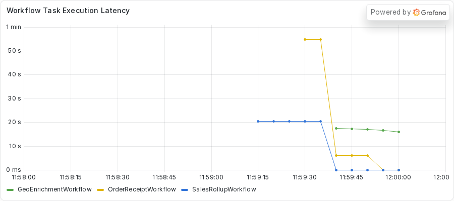
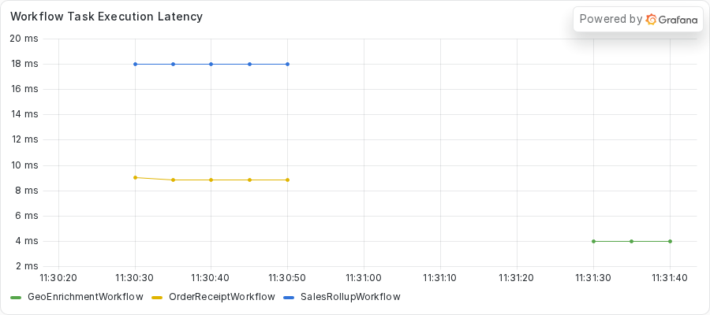

# Fixing a sleep between heartbeats in an async Activity
<!-- TODO: venue not yet chosen. -->

### Introduction

An Activity can send a Heartbeat to tell the Temporal Service that it still runs.
In an `async def` Activity, the SDK handles that Heartbeat on the same event loop that runs your code.
If your code then blocks the loop with `time.sleep`, the Heartbeat waits in a queue and never reaches the server.

In this tutorial, you run a polling Activity that heartbeats before every wait, and you watch the server fail it on a Heartbeat timeout anyway.
You use the Worker log, `python -m asyncio ps`, and `py-spy dump` to find the sleep that holds the event loop.
Then you write a test that counts Heartbeats during one poll wait, replace the single sleep with awaited ticks, and run the fleet again.

This is part 3 of the series "Debugging blocking calls in Temporal async Activities".
Previous: TODO (link to part 2, "Fixing a blocking HTTP client in an async Activity").
Next: TODO (link to part 4, "Moving CPU-bound work off the event loop").

## Prerequisites

To complete this tutorial, you need:

- The setup from part 1 and the process inspection setting it describes.
- The server from `just server` and the dashboard stack from `just metrics`, both running.
- The `exercises/02-sleep-between-heartbeats` directory of the demo repository, which holds a `practice` copy with the bug and a `solution` copy with the fix.
- `py-spy`, which you run on demand with `uvx py-spy dump --pid <PID>`.

The practice copy calls the public providers with the async `httpx.AsyncClient`, so nothing in this exercise blocks on the network.

## Step 1: Running the fleet

Most lookups in this service ask a public provider and return in well under a second.
One lookup path polls a slow job instead.
The `get_location` Activity checks the job, records a Heartbeat, waits eight seconds, and checks again.
The job needs about 20 seconds to finish.

The Workflow gives that Activity a Heartbeat timeout of five seconds.
The Activity heartbeats before every wait, so you expect it to pass.
The same Worker also runs a `SalesRollupWorkflow` and an `OrderReceiptWorkflow`, which share nothing with the slow job.
Do not read the Activity code yet.

Change to the practice directory and start the Worker:

```sh
cd exercises/02-sleep-between-heartbeats/practice
uv run python worker.py
```

Note the PID in the banner.
In a second terminal, change to the same directory and submit the fleet:

```sh
uv run python starter.py --bad 1 --geo 1 --rollups 1 --receipts 2
```

The `--bad 1` option sends one geo run to the slow job.
The command takes about 25 seconds.
This is the output from the capture of this exercise:

<!-- vale off -->
<!-- vale MasonBase.CodeLineLength = NO -->
```text
rollup rollup-e071744b-46fe-4f56-893c-36ffa679afd5 FAILED: Activity task timed out
geo geo-7d352b25-12cd-4078-ad00-32685d57a45d: GeoEnrichmentOutput(ip='256.256.256.256', location='Milky Way Galaxy')
receipt receipt-139a9639-7c45-47a7-b1b4-e9d6893e8200: OrderReceiptOutput(receipt='order order-0: 59.97 USD')
receipt receipt-bb24abb6-fcba-418c-8356-698d4fcacebb: OrderReceiptOutput(receipt='order order-1: 59.97 USD')
geo geo-49539f7f-fa16-459f-957e-2d5d755a5f80: GeoEnrichmentOutput(ip='256.256.256.256', location='Austin, Texas, United States')
```
<!-- vale MasonBase.CodeLineLength = YES -->
<!-- vale on -->

The rollup failed with `Activity task timed out`.
The geo run for the slow job finished, but only after a long wait.
The receipts finished too, and they do no I/O.
Now that you have a failure and a delay, you read the Event History of one receipt.

## Step 2: Reading the Event History

Run `temporal workflow show -w <receipt workflow ID>` for one receipt.
This capture keeps the first ten lines, which cover the first Workflow Task and the first Activity.

<!-- vale off -->
<!-- vale MasonBase.CodeLineLength = NO -->
```text
Progress:
  ID           Time                     Type           
    1  2026-11-03T23:31:26Z  WorkflowExecutionStarted  
    2  2026-11-03T23:31:26Z  WorkflowTaskScheduled     
    3  2026-11-03T23:31:26Z  WorkflowTaskStarted       
    4  2026-11-03T23:31:36Z  WorkflowTaskTimedOut      
    5  2026-11-03T23:31:46Z  WorkflowTaskScheduled     
    6  2026-11-03T23:31:46Z  WorkflowTaskStarted       
    7  2026-11-03T23:31:49Z  WorkflowTaskCompleted     
    8  2026-11-03T23:31:49Z  ActivityTaskScheduled     
```
<!-- vale MasonBase.CodeLineLength = YES -->
<!-- vale on -->

The first Workflow Task started at 23:31:26.
At 23:31:36 the history shows `WorkflowTaskTimedOut`, because the Worker never replied to that task.
The second Workflow Task started at 23:31:46 and completed at 23:31:49.
The receipt waited about 23 seconds for its first decision, across two Workflow Tasks.
A receipt should not wait that long for anything, so something shared holds the Worker.

You now have two clues.
The server reports a Heartbeat timeout for an Activity that heartbeats, and unrelated Workflows stall.
Replace `<PID>` with the PID from the Worker banner in the next steps.

## Step 3: Asking the server what happened

Run `temporal workflow describe -w <geo workflow ID>` while the slow job runs, about 9 seconds after you submit the fleet.
Use the ID of the geo run that takes the longest.
This capture keeps the pending Activity section.
It comes from a second run of the same fleet, so its IDs differ from the starter output.

<!-- vale off -->
<!-- vale MasonBase.CodeLineLength = NO -->
```text
Pending Activities: 1

  ActivityId          2
  Type                get_location
  State               Scheduled
  Attempt             2
  MaximumAttempts     0
  ScheduledTime       1 second ago
  ExpirationTime      2 minutes from now
  LastFailure         {"message":"activity Heartbeat timeout","source":"Server","timeoutFailureInfo":{"timeoutType":"TIMEOUT_TYPE_HEARTBEAT"}}
  LastWorkerIdentity  2604231@host
```
<!-- vale MasonBase.CodeLineLength = YES -->
<!-- vale on -->

The `LastFailure` field shows that the server already failed the first attempt of `get_location` on a Heartbeat timeout.
Attempt 2 sits in the `Scheduled` state.
The Worker has not picked it up, even though attempt 1 ended seconds ago.
A Worker with a healthy loop picks up a scheduled Activity right away.

## Step 4: Finding the stuck task and the blocking line

`python -m asyncio ps` reads the memory of the Worker from outside the process, so it answers during a freeze.
Run it from the repository root, about 10 seconds into the run:

```sh
uv run python -m asyncio ps <PID>
```

The output lists the tasks on the loop:

<!-- vale off -->
<!-- vale MasonBase.CodeLineLength = NO -->
```text
tid        task id              task name            coroutine stack                                    awaiter chain                                      awaiter name    awaiter id     
------------------------------------------------------------------------------------------------------------------------------------------------------------------------------------
2604231    0x73dbf7af74d0       Task-1               Worker._run -> Worker.run -> main                                                                                     0x0            
2604231    0x73dbf7af7a70       Task-2               Event.wait -> Worker._run.<locals>.raise_on_shutdown _wait -> wait                                      Task-5          0x73dbf7a56350 
2604231    0x73dbf795af70       Task-3               _wait -> wait -> _ActivityWorker.run               _wait -> wait                                      Task-5          0x73dbf7a56350 
2604231    0x73dbf795aa00       Task-4               Worker.poll_workflow_activation -> _WorkflowWorker.run _wait -> wait                                      Task-5          0x73dbf7a56350 
2604231    0x73dbf7a56350       Task-5               _wait -> wait                                      Worker._run -> Worker.run -> main                  Task-1          0x73dbf7af74d0 
2604231    0x73dbf7a57a10       Task-6               Queue.get -> _ActivityWorker.run.<locals>.raise_from_exception_queue _wait -> wait -> _ActivityWorker.run               Task-3          0x73dbf795af70 
2604231    0x73dbf7993cd0       Task-18              sleep -> roll_up_sales -> _ActivityInboundImpl.execute_activity -> _ActivityWorker._execute_activity -> _ActivityWorker._handle_start_activity_task                                                                    0x0            
2604231    0x73dbf61805f0       Task-43              _ActivityWorker._handle_start_activity_task                                                                           0x0            
2604231    0x73dbf62dc500       Task-44              Worker.poll_activity_task                          _wait -> wait -> _ActivityWorker.run               Task-3          0x73dbf795af70 
2604231    0x73dbf7762210       Task-45              _ActivityWorker._heartbeat_async                                                                                      0x0            
```
<!-- vale MasonBase.CodeLineLength = YES -->
<!-- vale on -->

Look at Task-43.
Its stack holds only `_ActivityWorker._handle_start_activity_task`, the outermost call, with no call inside it.
Task-18, the rollup, has `sleep` as its innermost call, as a healthy task does.
Task-45 is `_ActivityWorker._heartbeat_async`, and its stack also holds no call inside it.
The SDK uses that task to send a Heartbeat to the server.
The tool shows the shape, but it cannot name the line that blocks.

Now run `py-spy dump`, which reads the thread stacks from the operating system:

```sh
uvx py-spy dump --pid <PID>
```

This capture keeps only the `MainThread` stack.

<!-- vale off -->
<!-- vale MasonBase.CodeLineLength = NO -->
```text
Process 2604231: /home/ziggy/temporal-async-debug/.venv/bin/python worker.py
Python v3.14.3 (/home/ziggy/.local/share/uv/python/cpython-3.14.3-linux-x86_64-gnu/bin/python3.14)

Thread 2604231 (idle): "MainThread"
    get_location (activities.py:187)
    _ActivityInboundImpl.execute_activity (temporalio/worker/_activity.py:889)
    _ActivityWorker._execute_activity (temporalio/worker/_activity.py:681)
    _ActivityWorker._handle_start_activity_task (temporalio/worker/_activity.py:351)
    Handle._run (asyncio/events.py:94)
    BaseEventLoop._run_once (asyncio/base_events.py:2046)
    BaseEventLoop.run_forever (asyncio/base_events.py:677)
    BaseEventLoop.run_until_complete (asyncio/base_events.py:706)
    Runner.run (asyncio/runners.py:127)
    run (asyncio/runners.py:204)
    <module> (worker.py:113)
```
<!-- vale MasonBase.CodeLineLength = YES -->
<!-- vale on -->

The top frame, the innermost call, is `get_location` at `activities.py:187`.
No `httpx` frame sits on top of it, and no socket read.
You meet the line at that number in Step 7.
The main thread runs the event loop, so that line holds the loop.

Check the CPU with `top`:

```sh
top -b -d 1 -n 2 -p <PID> | tail -8
```

The `-n 2` option prints two frames, so the second frame reports CPU use over a real one-second interval.
This capture keeps only the column header and the process row.

<!-- vale off -->
<!-- vale MasonBase.CodeLineLength = NO -->
```text
    PID USER      PR  NI    VIRT    RES    SHR S  %CPU  %MEM     TIME+ COMMAND
2604231 ziggy     20   0  726204  77404  31660 S   0.0   0.5   0:00.77 python
```
<!-- vale MasonBase.CodeLineLength = YES -->
<!-- vale on -->

The Worker uses 0.0 percent of a CPU.
A frozen loop at near-zero CPU points to a call that waits, and `time.sleep` waits.

## Step 5: Reading the Worker log

The server failed attempt 1 about five seconds in.
The Activity prints a line on every poll, with the attempt number, so the Worker log shows what happened next.
This capture keeps only the poll lines from the first run in the log.

<!-- vale off -->
<!-- vale MasonBase.CodeLineLength = NO -->
```text
[attempt 1] poll 1: job 0s of 20s
[attempt 1] poll 2: job 8s of 20s
[attempt 1] poll 3: job 16s of 20s
[attempt 1] poll 4: job 20s of 20s
[attempt 2] poll 1: job 20s of 20s
```
<!-- vale MasonBase.CodeLineLength = YES -->
<!-- vale on -->

The first four lines come from attempt 1.
Poll 2 prints at job time 8 seconds, and poll 3 at 16 seconds.
Both come after the server failed the attempt at about 5 seconds.
The attempt never stopped, so it ran to the end of the job as a zombie.
The last line comes from attempt 2, which starts after the loop thaws and finishes at once.

The SDK tried to cancel attempt 1 and could not find it.
This capture keeps only the two warning lines from the same log.

<!-- vale off -->
<!-- vale MasonBase.CodeLineLength = NO -->
```text
/home/ziggy/temporal-async-debug/.venv/lib/python3.14/site-packages/temporalio/worker/_activity.py:210: UserWarning: Cannot find activity to cancel for token b'\n$01a1a3af-4c64-79c6-a67e-a00f864b9a6b\x12(geo-49539f7f-fa16-459f-957e-2d5d755a5f80\x1a$01a1a3c0-d377-7a90-b56c-69c835aefbf7 \x0b(\x012\x012B\x0cget_locationJ\x08\x08\x01\x10\xbd\x99@\x18\x01'
  warnings.warn(f"Cannot find activity to cancel for token {task_token!r}")
```
<!-- vale MasonBase.CodeLineLength = YES -->
<!-- vale on -->

The SDK cancels an `async def` Activity with an asyncio cancel.
That cancel lands only at an await, and `time.sleep` is not an await.
The attempt ended only when the job did.

The text output of `temporal workflow show` lists no failure for the geo run, because a retried Activity writes no event for each failed attempt.
The JSON output keeps the trace.
Run `temporal workflow show -w <geo workflow ID> --output json` and look at the `ActivityTaskStarted` event for attempt 2.
This capture starts at event 12 and stops at the `timeoutType` field.

<!-- vale off -->
<!-- vale MasonBase.CodeLineLength = NO -->
```text
      "eventId": "12",
      "eventTime": "2026-11-03T23:31:49.790169419Z",
      "eventType": "EVENT_TYPE_ACTIVITY_TASK_STARTED",
      "taskId": "1051895",
      "activityTaskStartedEventAttributes": {
        "scheduledEventId": "11",
        "identity": "2604231@host",
        "requestId": "85b070c8-ed2c-4009-8595-5e7f4e47a627",
        "attempt": 2,
        "lastFailure": {
          "message": "activity Heartbeat timeout",
          "source": "Server",
          "timeoutFailureInfo": {
            "timeoutType": "TIMEOUT_TYPE_HEARTBEAT"
```
<!-- vale MasonBase.CodeLineLength = YES -->
<!-- vale on -->

The `lastFailure` field holds the Heartbeat timeout from attempt 1.

## Step 6: Checking the dashboard

Open http://localhost:3000 and find the **Workflow Task Execution Latency** panel.
It plots a 30-second rate average of Workflow Task time for each Workflow type.



The receipt and rollup lines jump to between 4 and 5 seconds in each of the two runs.
The panel averages over 30 seconds, so the real stall is longer.
Read the true length from `temporal workflow show`, as you did in Step 2.

Now that the tools agree, you can open the code.

## Step 7: Finding the cause in the code

Open the file `exercises/02-sleep-between-heartbeats/practice/activities.py` in your editor.
Find the `TODO PART C` comment in `get_location`, and read the loop under `if slow_job:`.
The loop polls the job, calls `activity.heartbeat()`, and then calls `time.sleep(POLL_INTERVAL_SECONDS)`.

<!-- vale off -->
<!-- vale MasonBase.CodeLineLength = NO -->
<!-- fmt:off -->
```python
        while True:
            poll_number += 1
            if _job_is_done(f"{info.workflow_id}/{info.workflow_run_id}", info.attempt, poll_number):
                return JOB_RESULT
            if activity.in_activity():
                activity.heartbeat()
            # ANTIPATTERN (deliberate, for teaching): the heartbeat above is only queued on the event loop, and
            # time.sleep blocks that loop, so it cannot reach the server until the sleep ends and the heartbeat
            # timeout fires first; the SDK's cancel is an asyncio cancel, which cannot interrupt time.sleep, so
            # the failed attempt keeps polling as a zombie. Correct: wait in awaited ticks with a heartbeat per
            # tick. Do not copy.
            # TODO PART C: replace this single blocking sleep with a wait that heartbeats and can be cancelled.
            time.sleep(POLL_INTERVAL_SECONDS)
```
<!-- fmt:on -->
<!-- vale MasonBase.CodeLineLength = YES -->
<!-- vale on -->

The call `activity.heartbeat()` does not block.
In an `async def` Activity, the SDK processes the Heartbeat on the event loop, which is the same loop that runs your Activity.
The call queues the Heartbeat and returns.
The next line calls `time.sleep` for eight seconds, which is longer than the five-second Heartbeat timeout.
The loop cannot run the queued Heartbeat until the sleep ends, so the timeout fires first.

Two symptoms come from the same cause.
The server fails the attempt and schedules attempt 2, which waits because the loop is busy.
The cancel for attempt 1 cannot interrupt the sleep, so attempt 1 keeps polling.
The receipts and the rollup stall because they share the loop.

The fix keeps the Activity `async def` and gives the loop a chance to run between Heartbeats.
You replace the one long sleep with short awaited waits.
Because the loop is free between ticks, the SDK can send the recorded Heartbeat, and a cancel lands at the await.

## Step 8: Writing a test that counts Heartbeats

You write the test before you change the code.
From the `practice` directory, run the tests:

```sh
uv run python -m pytest -o pythonpath="$PWD" tests
```

One test fails on purpose, and its stub carries a `TODO PART D` comment.
Open `tests/test_heartbeat.py` and read the comment in `test_a_poll_wait_heartbeats_and_does_not_starve_the_loop`.
It describes the test you write.
You shrink the timings in `activities.py` with `monkeypatch`, so one poll wait spans several ticks.
You run `get_location` under `ActivityEnvironment` and count the calls to `on_heartbeat`.
A probe coroutine beside it records a timestamp every 50 milliseconds.
The test asserts at least two Heartbeats and no probe gap that reaches 0.2 seconds.

If you need a hint, the finished version is in `solution/tests/test_heartbeat.py`.
Run the tests again after you write yours.
The test fails while the Activity calls `time.sleep`, because the wait records one Heartbeat and holds the loop.

## Step 9: Replacing the sleep with awaited ticks

Open `activities.py` in the `practice` directory.
Replace the `time.sleep(POLL_INTERVAL_SECONDS)` line with a loop that works until the next poll is due.
On each pass, the loop calls `activity.heartbeat()` and then awaits `asyncio.sleep(...)` for at most `TICK_SECONDS`.
The `TICK_SECONDS` constant already exists in the file, and you need `import asyncio` at the top.
Delete the `ANTIPATTERN` comment and the `TODO PART C` comment.
The solution shows one way to write the loop:

<!-- vale off -->
<!-- vale MasonBase.CodeLineLength = NO -->
<!-- fmt:off -->
```python
        while True:
            poll_number += 1
            if _job_is_done(f"{info.workflow_id}/{info.workflow_run_id}", info.attempt, poll_number):
                return JOB_RESULT
            loop = asyncio.get_running_loop()
            next_poll_at = loop.time() + POLL_INTERVAL_SECONDS
            while (remaining := next_poll_at - loop.time()) > 0:
                if activity.in_activity():
                    activity.heartbeat()
                await asyncio.sleep(min(TICK_SECONDS, remaining))
```
<!-- fmt:on -->
<!-- vale MasonBase.CodeLineLength = YES -->
<!-- vale on -->

The inner `while` loop runs until the next poll time.
Each pass records a Heartbeat and then awaits a short sleep, so the event loop gets a turn on every tick.
With the loop free, the SDK can send the Heartbeat.
The Activity still polls the job on the same schedule.
Run the tests a third time.
They all pass.

## Step 10: Verifying the fix

Stop the old Worker with `CTRL+C`, and start it again from the `practice` directory:

```sh
uv run python worker.py
```

Submit the same fleet from your second terminal:

```sh
uv run python starter.py --bad 1 --geo 1 --rollups 1 --receipts 2
```

This is what the starter printed in the capture of the solution copy.
Every Workflow completes, and the rollup completes this time.

<!-- vale off -->
<!-- vale MasonBase.CodeLineLength = NO -->
```text
rollup rollup-d71cca00-3785-45d5-834c-15a5096c9b87: SalesRollupOutput(summary='Sales rollup for 2026-01: total 6030')
geo geo-d2a7b334-15f7-4e16-8efc-a64becbc1099: GeoEnrichmentOutput(ip='256.256.256.256', location='Milky Way Galaxy')
receipt receipt-bb3b1ee5-b78c-442d-a6c8-d1d087182dfe: OrderReceiptOutput(receipt='order order-0: 59.97 USD')
receipt receipt-2d67cebc-1f82-4738-9403-13d0eb868f26: OrderReceiptOutput(receipt='order order-1: 59.97 USD')
geo geo-edaf5b78-5cac-477f-b27c-1402e7531464: GeoEnrichmentOutput(ip='256.256.256.256', location='Austin, Texas, United States')
```
<!-- vale MasonBase.CodeLineLength = YES -->
<!-- vale on -->

Run `temporal workflow describe -w <geo workflow ID>` while the slow job runs.
This capture keeps the pending Activity section.

<!-- vale off -->
<!-- vale MasonBase.CodeLineLength = NO -->
```text
Pending Activities: 1

  ActivityId          2
  Type                get_location
  State               Started
  Attempt             1
  MaximumAttempts     0
  ScheduledTime       7 seconds ago
  LastStartedTime     7 seconds ago
  LastHeartbeatTime   3 seconds ago
  ExpirationTime      2 minutes from now
  LastWorkerIdentity  2615445@host
```
<!-- vale MasonBase.CodeLineLength = YES -->
<!-- vale on -->

The Activity sits in the `Started` state on attempt 1, and the `LastHeartbeatTime` field shows that the server received a Heartbeat.
Now run `py-spy dump` while the job runs.
This capture keeps only the `MainThread` stack.

<!-- vale off -->
<!-- vale MasonBase.CodeLineLength = NO -->
```text
Process 2615445: /home/ziggy/temporal-async-debug/.venv/bin/python worker.py
Python v3.14.3 (/home/ziggy/.local/share/uv/python/cpython-3.14.3-linux-x86_64-gnu/bin/python3.14)

Thread 2615445 (idle): "MainThread"
    EpollSelector.select (selectors.py:452)
    BaseEventLoop._run_once (asyncio/base_events.py:2008)
    BaseEventLoop.run_forever (asyncio/base_events.py:677)
    BaseEventLoop.run_until_complete (asyncio/base_events.py:706)
    Runner.run (asyncio/runners.py:127)
    run (asyncio/runners.py:204)
    <module> (worker.py:113)
```
<!-- vale MasonBase.CodeLineLength = YES -->
<!-- vale on -->

The main thread sits in `EpollSelector.select`, which is a healthy loop waiting for work.
The Worker log shows each poll once.
This capture keeps only the first four poll lines.

<!-- vale off -->
<!-- vale MasonBase.CodeLineLength = NO -->
```text
[attempt 1] poll 1: job 0s of 20s
[attempt 1] poll 2: job 8s of 20s
[attempt 1] poll 3: job 16s of 20s
[attempt 1] poll 4: job 20s of 20s
```
<!-- vale MasonBase.CodeLineLength = YES -->
<!-- vale on -->

All four poll lines come from attempt 1, and the job finishes at poll 4.

The receipts need one more check.
The next block holds the Workflow Task time and the Activity waits of each receipt in the solution capture.
These receipts come from a second run of the same fleet, so their IDs differ from the starter output.
An author helper script produced these lines from each receipt's Event History, and the script is not in the repository.

<CLAUDE_HELP>
The helper script that produced `receipt-gaps.txt` is not committed.
A reader cannot reproduce these lines without it.
Commit a small script, or replace the block with `workflow show` excerpts.
</CLAUDE_HELP>

<!-- vale off -->
<!-- vale MasonBase.CodeLineLength = NO -->
```text
receipt-d5e316ce total 3301ms | WT1 started->completed 17ms | validate_order: sched->started 3215ms started->completed 6ms | compute_total: sched->started 4ms started->completed 6ms | format_receipt: sched->started 3ms started->completed 5ms
receipt-37e3a158 total 3278ms | WT1 started->completed 11ms | validate_order: sched->started 3199ms started->completed 7ms | compute_total: sched->started 8ms started->completed 7ms | format_receipt: sched->started 3ms started->completed 5ms
```
<!-- vale MasonBase.CodeLineLength = YES -->
<!-- vale on -->

The first Workflow Task takes 17 and 11 milliseconds.
The `validate_order` Activity waits about 3.2 seconds for a slot, because the rollup holds one of the two slots for its five-second pause.
That is a wait for a free slot and not a frozen loop.

Last, look at the **Workflow Task Execution Latency** panel again.



Every line stays between 3 and 6 milliseconds.
The scale on the left changed from seconds to milliseconds.

## Conclusion

In this tutorial, you replaced one blocking sleep with a loop of awaited ticks.
Each tick gives the event loop a turn.
The Heartbeat reaches the server, a cancel can land, and the receipts and the rollup keep running.
The Activity still polls the job on the same schedule.

You found the cause with the server and the Worker log first, then with `asyncio ps` and `py-spy dump`.
The first showed a timeout and a zombie attempt, and the second pair named the sleep that held the loop.

In part 4, the call that blocks the loop is a calculation instead of a sleep.
Read more about Activity Heartbeats in the [Temporal documentation](https://docs.temporal.io/).

Next: TODO (link to part 4, "Moving CPU-bound work off the event loop").
