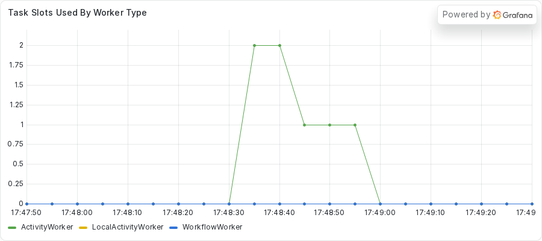
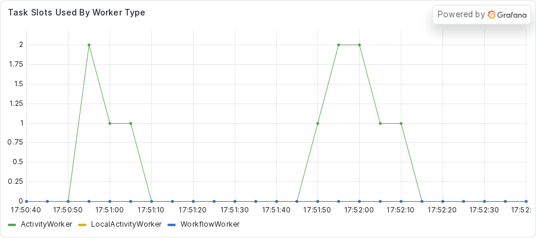

# Stopping a thread that outlives its Activity attempt
<!-- TODO: venue not yet chosen. -->

### Introduction

Moving blocking work into `asyncio.to_thread` frees the event loop, and it looks like a complete fix.
It leaves a gap.
Cancelling the awaiting coroutine does not stop a thread that already started.
The work can keep running after the server has failed the Activity attempt.
The retry then starts the same work again beside it.

In this tutorial, you run a fleet where the Activity already moves its blocking work to a thread.
You see why one Workflow still fails.
You use the Worker log to watch one attempt keep working after the server failed it, and `py-spy dump` to find the orphaned threads.
Then you write tests, run the work on the thread pool of the Worker, and heartbeat from that thread.

This tutorial runs one Worker with two Activity slots on purpose, as teaching code, so the failure is loud.
To see the same bug on a fleet of Workers, read part 7: TODO (link to part 7, "Finding the frozen Worker in a fleet").

This is part 5 of the series "Debugging blocking calls in Temporal async Activities".
Previous: TODO (link to part 4, "Moving CPU-bound work off the event loop").
Next: TODO (link to part 6, "Catching a short blocking call before it ships").

## Prerequisites

To complete this tutorial, you need:

- The setup from part 1 and the process inspection setting it describes.
- The server from `just server` and the dashboard stack from `just metrics`, both running.
- The `exercises/04-zombie-thread` directory of the demo repository, which holds a `practice` copy with the bug and a `solution` copy with the fix.
- `py-spy`, which you run on demand with `uvx py-spy dump --pid <PID>`.

The practice copy calls the public providers with the async `httpx.AsyncClient`, so the HTTP calls do not block.
The work that blocks is a loop of short sleeps, and the practice copy already hands that loop to a thread.

## Step 1: Running the fleet

A teammate fixed a freeze like the one in part 2 by moving the blocking work into `asyncio.to_thread`.
The work now runs on a thread, so the event loop stays free, and the rollup and the receipts run fine.
The geo run does not.
Its `get_location` Activity does about ten seconds of blocking work, and the Workflow gives it a Heartbeat timeout of five seconds.
Someone reports that the geo run fails and that its job seems to run more than once.
Do not read the Activity code yet.

Change to the practice directory and start the Worker:

```sh
cd exercises/04-zombie-thread/practice
uv run python worker.py
```

Note the PID in the banner.
In a second terminal, change to the same directory and submit the fleet:

```sh
uv run python starter.py --bad 1 --geo 1 --rollups 1 --receipts 2
```

The `--bad 1` option gives one geo run the ten-second job.
The command takes about 25 seconds.
This is the output from the capture of this exercise.
In the capture, `ziggy`, `256.256.256.256`, `Milky Way Galaxy`, and `host` are stand-ins for the user name, address, location, and hostname of the capture machine.
Your own output shows your own values.

<!-- vale off -->
<!-- vale MasonBase.CodeLineLength = NO -->
```text
rollup rollup-ebc46e29-4a46-46b9-ba54-121ad855df5f: SalesRollupOutput(summary='Sales rollup for 2026-01: total 6030')
geo geo-556fec5c-6c96-4943-9f44-577944a98a01: GeoEnrichmentOutput(ip='256.256.256.256', location='Milky Way Galaxy (1 steps)')
receipt receipt-fd452f34-7cf3-4fa6-b7a9-13fe4ed3c7aa: OrderReceiptOutput(receipt='order order-0: 59.97 USD')
receipt receipt-30c04b87-533e-498d-bcd9-2e09bc05dc10: OrderReceiptOutput(receipt='order order-1: 59.97 USD')
geo geo-7535f8ac-2825-456e-8df8-96583b62c3ad FAILED: Activity task timed out
```
<!-- vale MasonBase.CodeLineLength = YES -->
<!-- vale on -->

The rollup, the healthy geo run, and both receipts completed.
The bad geo run failed with `Activity task timed out`.
The Worker is healthy, and one Workflow still fails.

## Step 2: Confirming the loop is live

You do not expect a frozen loop here, so check that first.
Replace `<PID>` with the PID from the Worker banner.
Run `python -m asyncio ps` from the repository root, about 8 seconds after you submit the fleet:

```sh
uv run python -m asyncio ps <PID>
```

The output lists the tasks on the loop:

<!-- vale off -->
<!-- vale MasonBase.CodeLineLength = NO -->
```text
tid        task id              task name            coroutine stack                                    awaiter chain                                      awaiter name    awaiter id     
------------------------------------------------------------------------------------------------------------------------------------------------------------------------------------
2656163    0x799d28def2f0       Task-1               Worker._run -> Worker.run -> main                                                                                     0x0            
2656163    0x799d28defe30       Task-2               Event.wait -> Worker._run.<locals>.raise_on_shutdown _wait -> wait                                      Task-5          0x799d28d43d90 
2656163    0x799d28c32f70       Task-3               _wait -> wait -> _ActivityWorker.run               _wait -> wait                                      Task-5          0x799d28d43d90 
2656163    0x799d28c32a00       Task-4               Worker.poll_workflow_activation -> _WorkflowWorker.run _wait -> wait                                      Task-5          0x799d28d43d90 
2656163    0x799d28d43d90       Task-5               _wait -> wait                                      Worker._run -> Worker.run -> main                  Task-1          0x799d28def2f0 
2656163    0x799d28d43bd0       Task-6               Queue.get -> _ActivityWorker.run.<locals>.raise_from_exception_queue _wait -> wait -> _ActivityWorker.run               Task-3          0x799d28c32f70 
2656163    0x799d1af50320       Task-43              to_thread -> get_location -> _ActivityInboundImpl.execute_activity -> _ActivityWorker._execute_activity -> _ActivityWorker._handle_start_activity_task                                                                    0x0            
2656163    0x799d281ac410       Task-90              Worker.poll_activity_task                          _wait -> wait -> _ActivityWorker.run               Task-3          0x799d28c32f70 
```
<!-- vale MasonBase.CodeLineLength = YES -->
<!-- vale on -->

Look at Task-43.
Its stack is `to_thread -> get_location -> ...`, so it waits at an await.
Compare it with part 2, where the stuck task held only the SDK handler.
Here the loop runs, and the Activity waits for a thread.
Now that the loop is clear, you ask the server why the geo run fails.

## Step 3: Asking the server what happened

Run `temporal workflow describe -w <geo workflow ID>` for the failing geo run while it runs, about 18 seconds in.
This capture keeps the pending Activity section.

<!-- vale off -->
<!-- vale MasonBase.CodeLineLength = NO -->
```text
Pending Activities: 1

  ActivityId          2
  Type                get_location
  State               Scheduled
  Attempt             3
  MaximumAttempts     0
  ScheduledTime       1 second from now
  ExpirationTime      8 seconds from now
  LastFailure         {"message":"activity Heartbeat timeout","source":"Server","timeoutFailureInfo":{"timeoutType":"TIMEOUT_TYPE_HEARTBEAT"}}
  LastWorkerIdentity  2656163@host
```
<!-- vale MasonBase.CodeLineLength = YES -->
<!-- vale on -->

The Activity is on attempt 3, and the last failure is a Heartbeat timeout.
Nothing in the Activity code heartbeats, so the server fails each attempt when the five seconds run out.
The server then starts the next attempt.

## Step 4: Reading the Worker log

The Activity prints one line per step, with the attempt number, which makes the log the best evidence you have.
The next capture comes from a second run, with the Worker output prefixed by the time of day.
A small filter added the time prefix, and the Worker does not print it.
This capture keeps only the step lines between 17:48:35 and 17:48:39, which start with `attempt` after the time prefix.
The filter drops the other log lines from the same seconds, including the traceback you read next.

<!-- vale off -->
<!-- vale MasonBase.CodeLineLength = NO -->
```text
17:48:35 attempt 1: step 12/20 for Milky Way Galaxy
17:48:35 attempt 2: step 1/20 for Milky Way Galaxy
17:48:35 attempt 1: step 13/20 for Milky Way Galaxy
17:48:36 attempt 2: step 2/20 for Milky Way Galaxy
17:48:36 attempt 1: step 14/20 for Milky Way Galaxy
17:48:36 attempt 2: step 3/20 for Milky Way Galaxy
17:48:36 attempt 1: step 15/20 for Milky Way Galaxy
17:48:37 attempt 2: step 4/20 for Milky Way Galaxy
17:48:37 attempt 1: step 16/20 for Milky Way Galaxy
17:48:37 attempt 2: step 5/20 for Milky Way Galaxy
17:48:37 attempt 1: step 17/20 for Milky Way Galaxy
17:48:38 attempt 2: step 6/20 for Milky Way Galaxy
17:48:38 attempt 1: step 18/20 for Milky Way Galaxy
17:48:38 attempt 2: step 7/20 for Milky Way Galaxy
17:48:38 attempt 1: step 19/20 for Milky Way Galaxy
17:48:39 attempt 2: step 8/20 for Milky Way Galaxy
17:48:39 attempt 1: step 20/20 for Milky Way Galaxy
17:48:39 attempt 2: step 9/20 for Milky Way Galaxy
```
<!-- vale MasonBase.CodeLineLength = YES -->
<!-- vale on -->

Attempt 1 printed its first step at 17:48:29.
At 17:48:35, attempt 1 was on step 12 of 20 and attempt 2 started.
The two attempts then ran side by side, and each printed a step about every half second.
Attempt 1 printed its last step, 20 of 20, at 17:48:39, after attempt 2 had started.

The same log holds a traceback at the moment attempt 1 ended.
This capture keeps the lines from the `asyncio/threads.py` frame to the exception line.

<!-- vale off -->
<!-- vale MasonBase.CodeLineLength = NO -->
```text
17:48:39   File "/home/ziggy/.local/share/uv/python/cpython-3.14.3-linux-x86_64-gnu/lib/python3.14/asyncio/threads.py", line 25, in to_thread
17:48:39     return await loop.run_in_executor(None, func_call)
17:48:39            ^^^^^^^^^^^^^^^^^^^^^^^^^^^^^^^^^^^^^^^^^^^
17:48:39 asyncio.exceptions.CancelledError: Activity cancelled
```
<!-- vale MasonBase.CodeLineLength = YES -->
<!-- vale on -->

The coroutine did get cancelled.
The traceback runs out of `asyncio.to_thread` in `get_location`, about ten seconds into the attempt.
The thread did not stop, and it printed its last step in the same second.
The log cannot tell you which came first.
The cancel ended the coroutine, and the thread ran on.

The same pattern repeats for attempt 2 and attempt 3, and each attempt runs the full ten seconds.
During the third attempt, the Activity reaches its Schedule-To-Close Timeout, and the failure reads `ScheduleToClose`, caused by `Heartbeat`.
This capture starts at the `Results:` line of the Event History of the failing geo run, in the second run of the fleet.

<!-- vale off -->
<!-- vale MasonBase.CodeLineLength = NO -->
```text
Results:
  Status   FAILED
  Failure  
    Message: Activity task timed out
    Cause:
        Message: activity ScheduleToClose timeout
        Cause:
            Message: activity Heartbeat timeout
```
<!-- vale MasonBase.CodeLineLength = YES -->
<!-- vale on -->

The outer message names the `ScheduleToClose` timeout, and the cause beneath it names `Heartbeat`.
The Event History lists only the last attempt, so attempts 1 and 2 show up only in the Worker log and in `describe`.

## Step 5: Finding the orphaned threads with py-spy

The log shows the work still running after the failure.
`py-spy dump` shows where it runs:

```sh
uvx py-spy dump --pid <PID>
```

This capture comes from the first run, taken while the attempts overlapped.
It skips the `MainThread` and starts at the first pool thread.

<!-- vale off -->
<!-- vale MasonBase.CodeLineLength = NO -->
```text
Thread 2656572 (idle): "asyncio_0"
    _blocking_work (activities.py:123)
    WorkerContext.run (concurrent/futures/thread.py:73)
    _WorkItem.run (concurrent/futures/thread.py:86)
    _worker (concurrent/futures/thread.py:119)
    Thread.run (threading.py:1024)
    Thread._bootstrap_inner (threading.py:1082)
    Thread._bootstrap (threading.py:1044)
Thread 2657028 (idle): "asyncio_1"
    _blocking_work (activities.py:123)
    WorkerContext.run (concurrent/futures/thread.py:73)
    _WorkItem.run (concurrent/futures/thread.py:86)
    _worker (concurrent/futures/thread.py:119)
    Thread.run (threading.py:1024)
    Thread._bootstrap_inner (threading.py:1082)
    Thread._bootstrap (threading.py:1044)
```
<!-- vale MasonBase.CodeLineLength = YES -->
<!-- vale on -->

Two threads named `asyncio_0` and `asyncio_1` both sit in `_blocking_work` at `activities.py:123`.
Each overlapping attempt has its own thread.
Those threads come from the default executor that `asyncio.to_thread` uses.
The `MainThread` in the same dump sits in `EpollSelector.select`, so the event loop is healthy.

## Step 6: Checking the dashboard

Open http://localhost:3000 and find the **Task Slots Used By Worker Type** panel.
It shows the fleet-wide view of what the tools found.



The Activity slots read 2 and then 1 from about 17:48:35 to about 17:48:55, in the second run of the fleet.
The orphaned attempts keep their slots after the server failed them.
This panel is a weak signal on its own, because slot use also rises for healthy work.
The Worker log and the thread dump carry the real evidence.

## Step 7: Finding the cause in the code

Open the file `exercises/04-zombie-thread/practice/activities.py` in your editor.
Find `_blocking_work`.
It sleeps for one step, prints a line, and loops.
The `TODO PART C` comment inside it says that the work never tells the server that it lives.

<!-- vale off -->
<!-- vale MasonBase.CodeLineLength = NO -->
<!-- fmt:off -->
```python
    for step in range(1, steps + 1):
        # TODO PART C: the work never tells the server it is alive, so a timeout or cancel has no way in.
        # Heartbeat once per step here, from this same thread.
        # Also log a line when the cancel arrives, then let it propagate so the work stops.
        time.sleep(STEP_SECONDS)
        print(f"attempt {attempt}: step {step}/{steps} for {location}", flush=True)
    return f"{location} ({steps} steps)"
```
<!-- fmt:on -->
<!-- vale MasonBase.CodeLineLength = YES -->
<!-- vale on -->

Now find the end of `get_location`, which is an `async def` Activity.
The comment before the last line starts with `ANTIPATTERN (deliberate, for teaching)`.

<!-- vale off -->
<!-- vale MasonBase.CodeLineLength = NO -->
<!-- fmt:off -->
```python
            # ANTIPATTERN (deliberate, for teaching): cancelling the awaiting coroutine cannot stop a thread that
            # asyncio.to_thread already started, and nothing heartbeats, so when the server times the attempt out the
            # work keeps running and finishes after the attempt failed while the retry runs it again beside it.
            # Correct: a def Activity on the worker's activity_executor that heartbeats from its own thread, so the
            # cancel arrives as CancelledError inside the work. Do not copy.
            # TODO PART C: replace this to_thread call with a direct call once the function is a plain def.
            return await asyncio.to_thread(_blocking_work, location, work_steps, activity.info().attempt)
```
<!-- fmt:on -->
<!-- vale MasonBase.CodeLineLength = YES -->
<!-- vale on -->

The call `asyncio.to_thread` moves the work off the event loop, which is why the receipts and the rollup stay healthy.
It does not give the work a way to stop.
When the server fails the attempt, asyncio cancels the awaiting coroutine.
In the capture, the cancel arrives about five seconds after the failure.
Nothing stops a thread that already started.
The thread runs to the end, and the next attempt starts the same work beside it.

The work also never heartbeats.
The server cannot learn that the thread is alive, so it times the attempt out.
It also cannot deliver a cancel to a thread that never checks in.

The fix has two parts.
A plain `def` Activity runs on the `activity_executor` of the Worker, and the SDK raises `CancelledError` inside that thread when the attempt gets a cancel or a timeout.
The thread records its Heartbeat from inside the work, so a cancel has a way in.

## Step 8: Writing tests that check the cancel

You write the tests before you change the code.
From the `practice` directory, run the tests:

```sh
uv run python -m pytest -o pythonpath="$PWD" tests
```

Two tests fail on purpose, and both stubs carry a `TODO PART D` comment.
Open `tests/test_cancel_stops_work.py` and read the two stubs.
The first test runs `get_location` under `ActivityEnvironment` with the timings patched down, cancels it, and checks that the work stops at the next Heartbeat.
The second test builds the Worker with `build_worker`, reads its `activity_executor`, and checks that the pool has at least as many threads as `max_concurrent_activities`.

If you need a hint, the finished versions are in `solution/tests/test_cancel_stops_work.py`.
Run the tests again after you write yours.
Both fail until the fix is in.

## Step 9: Running the work on the thread pool of the Worker

Open `activities.py` in the `practice` directory.
In `_blocking_work`, record a Heartbeat after every step from the same thread.
Log a line when the cancel arrives, and then let the error propagate so the work stops.
The solution shows one way to write it:

<!-- vale off -->
<!-- vale MasonBase.CodeLineLength = NO -->
<!-- fmt:off -->
```python
    step = 0
    try:
        for step in range(1, steps + 1):
            time.sleep(STEP_SECONDS)
            print(f"attempt {attempt}: step {step}/{steps} for {location}", flush=True)
            if activity.in_activity():
                activity.heartbeat(step)
    except CancelledError:
        print(f"attempt {attempt}: cancelled during step {step}/{steps}, work stopped", flush=True)
        raise
    return f"{location} ({steps} steps)"
```
<!-- fmt:on -->
<!-- vale MasonBase.CodeLineLength = YES -->
<!-- vale on -->

The `activity.heartbeat(step)` call runs on the work thread after each step.
Add `from temporalio.exceptions import CancelledError` at the top of the file, because the `except` block catches it.
The SDK raises `CancelledError` in that thread when the attempt gets a cancel or a timeout.
The `except` block logs one line and re-raises the error, so the loop ends.

Next, change `get_location`.
Remove the `async` keyword and the `ANTIPATTERN` comment.
Change the `async with httpx.AsyncClient(...)` line to `with httpx.Client(...)`, and remove the `await` before `client.get`.
Replace the `asyncio.to_thread` call with a direct call to `_blocking_work`.
The solution has this signature:

<!-- vale off -->
<!-- vale MasonBase.CodeLineLength = NO -->
<!-- fmt:off -->
```python
@activity.defn
def get_location(ip: str, work_steps: int) -> str:
```
<!-- fmt:on -->
<!-- vale MasonBase.CodeLineLength = YES -->
<!-- vale on -->

The `def` keyword replaces `async def`, so the Worker runs `get_location` on its thread pool.
The return line calls the work directly, with no `to_thread`:

<!-- vale off -->
<!-- vale MasonBase.CodeLineLength = NO -->
<!-- fmt:off -->
```python
            return _blocking_work(location, work_steps, activity.info().attempt)
```
<!-- fmt:on -->
<!-- vale MasonBase.CodeLineLength = YES -->
<!-- vale on -->

The file no longer calls `asyncio`, so remove `import asyncio` at the top, or `ruff` flags it as unused.

Then open `worker.py` and find the `TODO PART D` comment in `build_worker`.
Pass the Worker an `activity_executor` that is a `ThreadPoolExecutor` with `max_workers` equal to `MAX_CONCURRENT_ACTIVITIES`.
Add the import at the top of the file.
The solution has these lines:

<!-- vale off -->
<!-- vale MasonBase.CodeLineLength = NO -->
<!-- fmt:off -->
```python
        activity_executor=ThreadPoolExecutor(max_workers=MAX_CONCURRENT_ACTIVITIES),
        max_concurrent_activities=MAX_CONCURRENT_ACTIVITIES,
```
<!-- fmt:on -->
<!-- vale MasonBase.CodeLineLength = YES -->
<!-- vale on -->

Run the tests a third time.
They all pass.

Two mistakes in this step are common, and the Worker tells you about both at startup.
If you make `get_location` a `def` and forget the executor, the Worker does not start.
This capture keeps the last line of the error:

<!-- vale off -->
<!-- vale MasonBase.CodeLineLength = NO -->
```text
ValueError: Activity get_location is not async so an activity_executor must be present
```
<!-- vale MasonBase.CodeLineLength = YES -->
<!-- vale on -->

If you add an executor with too small a pool, the Worker starts and prints a warning.
This capture keeps only the two warning lines, for an executor with `max_workers` set to 1.

<!-- vale off -->
<!-- vale MasonBase.CodeLineLength = NO -->
```text
/home/ziggy/temporal-async-debug/.venv/lib/python3.14/site-packages/temporalio/worker/_worker.py:413: UserWarning: Worker max_concurrent_activities is 2 but activity_executor's max_workers is only 1
  self._init_from_config(client, config)
```
<!-- vale MasonBase.CodeLineLength = YES -->
<!-- vale on -->

The Worker hands the executor one task per Activity slot, even when no thread is free.
A pool smaller than `max_concurrent_activities` makes tasks wait for a thread.
The second test you wrote checks for this.

## Step 10: Verifying the fix

Stop the old Worker with `CTRL+C`, and start it again from the `practice` directory:

```sh
uv run python worker.py
```

Submit the same fleet from your second terminal:

```sh
uv run python starter.py --bad 1 --geo 1 --rollups 1 --receipts 2
```

This is what the starter printed in the capture of the solution copy.
The geo run with the ten-second job completes, and it reports 20 steps.

<!-- vale off -->
<!-- vale MasonBase.CodeLineLength = NO -->
```text
rollup rollup-98e74ab7-1e12-4cdb-8523-0212b527bab7: SalesRollupOutput(summary='Sales rollup for 2026-01: total 6030')
geo geo-c57f9c47-250d-46ee-8445-d208dda098b3: GeoEnrichmentOutput(ip='256.256.256.256', location='Milky Way Galaxy (1 steps)')
receipt receipt-dd32d462-8581-459e-88b2-052b3d723583: OrderReceiptOutput(receipt='order order-0: 59.97 USD')
receipt receipt-4c09020b-1e11-40ee-a01d-15b20e7c9089: OrderReceiptOutput(receipt='order order-1: 59.97 USD')
geo geo-cb63d923-3425-4642-bafb-5d36bbd1da29: GeoEnrichmentOutput(ip='256.256.256.256', location='Milky Way Galaxy (20 steps)')
```
<!-- vale MasonBase.CodeLineLength = YES -->
<!-- vale on -->

Now read the Worker log.
This capture keeps only the first and last step lines of the bad run, from the solution capture with the time prefix.

<!-- vale off -->
<!-- vale MasonBase.CodeLineLength = NO -->
```text
17:50:52 attempt 1: step 1/20 for Milky Way Galaxy
17:51:01 attempt 1: step 20/20 for Milky Way Galaxy
```
<!-- vale MasonBase.CodeLineLength = YES -->
<!-- vale on -->

One attempt printed all 20 steps, and no second attempt appears.
Run `temporal workflow describe -w <geo workflow ID>` while the work runs.
This capture keeps the pending Activity section, from the start to the `LastHeartbeatDetails` field.

<!-- vale off -->
<!-- vale MasonBase.CodeLineLength = NO -->
```text
Pending Activities: 1

  ActivityId            2
  Type                  get_location
  State                 Started
  Attempt               1
  MaximumAttempts       0
  ScheduledTime         3 seconds ago
  LastStartedTime       3 seconds ago
  LastHeartbeatTime     2 seconds ago
  ExpirationTime        16 seconds from now
  LastWorkerIdentity    2669340@host
  LastHeartbeatDetails  [1]
```
<!-- vale MasonBase.CodeLineLength = YES -->
<!-- vale on -->

The Activity is on attempt 1 and has a `LastHeartbeatTime`.
The `LastHeartbeatDetails` field shows the step number that the thread passed to `activity.heartbeat`.
Now run `py-spy dump` again.
This capture keeps only the stack of the `ThreadPoolExecutor-0_0` thread.

<!-- vale off -->
<!-- vale MasonBase.CodeLineLength = NO -->
```text
Thread 2669867 (idle): "ThreadPoolExecutor-0_0"
    _blocking_work (activities.py:127)
    get_location (activities.py:187)
    _execute_sync_activity (temporalio/worker/_activity.py:951)
    WorkerContext.run (concurrent/futures/thread.py:73)
    _WorkItem.run (concurrent/futures/thread.py:86)
    _worker (concurrent/futures/thread.py:119)
```
<!-- vale MasonBase.CodeLineLength = YES -->
<!-- vale on -->

The work runs on `ThreadPoolExecutor-0_0`, the pool you passed to the Worker.
One thread sits in `_blocking_work`, because the work has one attempt.

Last, look at the **Task Slots Used By Worker Type** panel.



The panel shows one burst for the fleet run, from about 17:50:55 to about 17:51:10.
The second burst later in the image comes from the forced-timeout run in the next step.
Slot use drops back to zero soon after the ten-second job ends.
In the practice run, the slots stayed busy for about 20 seconds because the orphaned attempts kept them.

## Step 11: Forcing a timeout to watch the work stop

In the fix, the Heartbeat is also how a cancel reaches the thread.
You can see that by making each step longer than the Heartbeat timeout.
The capture in this step came from a scratch copy of the solution, with `STEP_SECONDS` set to 6.0 in `activities.py`.
Do this only in a scratch copy, because the Workflow still ends in a failure for the run.

This capture keeps the first 94 lines of the log.
Within them, it keeps only the step lines, the `time.sleep` frame of each traceback, and the exception line.
It ends at the third attempt, before the Worker shutdown that the full log shows later.

<!-- vale off -->
<!-- vale MasonBase.CodeLineLength = NO -->
```text
17:51:47 attempt 1: step 1/20 for Milky Way Galaxy
17:51:53 attempt 2: step 1/20 for Milky Way Galaxy
17:51:53 attempt 1: cancelled during step 2/20, work stopped
17:51:53     time.sleep(STEP_SECONDS)
17:51:53 temporalio.exceptions.CancelledError: Cancelled
17:51:59 attempt 2: cancelled during step 2/20, work stopped
17:51:59     time.sleep(STEP_SECONDS)
17:51:59 temporalio.exceptions.CancelledError: Cancelled
17:52:00 attempt 3: step 1/20 for Milky Way Galaxy
17:52:06 attempt 3: cancelled during step 2/20, work stopped
17:52:06     time.sleep(STEP_SECONDS)
17:52:06 temporalio.exceptions.CancelledError: Cancelled
```
<!-- vale MasonBase.CodeLineLength = YES -->
<!-- vale on -->

Attempt 1 logs `cancelled during step 2/20, work stopped`, and no later line comes from attempt 1.
The traceback ends in `time.sleep` inside `_blocking_work`, with `temporalio.exceptions.CancelledError: Cancelled`.
Attempt 2 stops the same way at 17:51:59.
When the cancel arrives, each attempt stops at the end of its current step, and none runs on to step 20.
The retry can overlap the old attempt by up to one step.
Each step sleeps before it prints.
So attempt 2 started about six seconds before its first line at 17:51:53, while attempt 1 was in step 2.
With the shipped half-second steps, the overlap is half a second at most.
The run still fails, because a six-second step is longer than the five-second Heartbeat timeout.
That failure comes from the scratch copy and has nothing to do with the fix.

## Conclusion

In this tutorial, you replaced a fix that looked right with one that works.
The `asyncio.to_thread` call kept the event loop free but left the work with no way to stop.
Running the work on the thread pool of the Worker, and heartbeating from that thread, lets a timeout or cancel reach it as `CancelledError`.
Each attempt now stops at the end of its current step when a cancel arrives.
No attempt runs on to the end of the job.

The Worker log and `py-spy dump` were the tools that exposed the orphaned threads, because the loop itself was healthy.

In part 6, you catch a blocking call that never fails and never times out.
Read more about Activities in the [Temporal documentation](https://docs.temporal.io/).

Next: TODO (link to part 6, "Catching a short blocking call before it ships").
