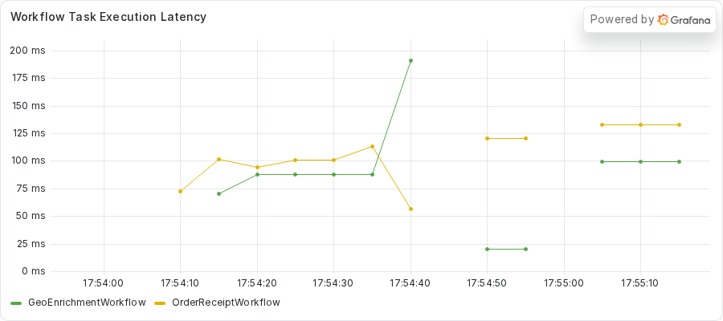
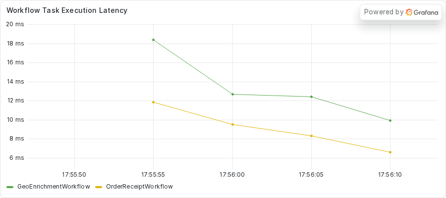

# Catching a short blocking call before it ships
<!-- TODO: venue not yet chosen. -->

### Introduction

The earlier parts froze a Worker for half a minute, and the failures were loud.
A blocking call that lasts a third of a second behaves differently.
Nothing times out, nothing fails, and every Workflow completes.
The Worker runs slower than a healthy Worker, and no alert tells you why.

In this tutorial, you run a fleet where every Workflow completes.
You compare the first Workflow Task of a receipt with and without a short blocking call.
You turn on asyncio debug mode and read its slow-callback warning, and you use `py-spy dump` to name the line behind the warning.
Then you write a test that probes every `async def` Activity, and you move the blocking call to a thread.
The test fails the build when an `async def` Activity blocks the loop for 0.2 seconds or more with the network mocked.

This is part 6 of the series "Debugging blocking calls in Temporal async Activities".
Previous: TODO (link to part 5, "Stopping a thread that outlives its Activity attempt").
This is the last part of the series.

## Prerequisites

To complete this tutorial, you need:

- The setup from part 1 and the process inspection setting it describes.
- The server from `just server` and the dashboard stack from `just metrics`, both running.
- The `exercises/05-catching-blockers-early` directory of the demo repository, which holds a `practice` copy with the bug and a `solution` copy with the fix.
- `py-spy`, which you run on demand with `uvx py-spy dump --pid <PID>`.

The practice copy calls the public providers with the async `httpx.AsyncClient`, so the HTTP calls do not block.
The call that blocks takes about a third of a second.

## Step 1: Running the fleet

The `get_location` Activity archives an audit trail for each lookup before it asks a provider for the location.
The archiving compresses a block of bytes.
The same Worker also runs an `OrderReceiptWorkflow`, which does nothing slow.
Do not read the Activity code yet.
You find the cause with tools.

Change to the practice directory and start the Worker:

```sh
cd exercises/05-catching-blockers-early/practice
uv run python worker.py
```

Note the PID in the banner.
In a second terminal, change to the same directory.
Submit a fleet of receipts alone, for a reference reading:

```sh
uv run python starter.py --geo 0 --receipts 3 --rollups 0
```

Then submit the practice fleet, with geo runs beside the receipts:

```sh
uv run python starter.py --geo 3 --receipts 3 --rollups 0
```

This is what the starter printed for the practice fleet in the capture of this exercise:

<!-- vale off -->
<!-- vale MasonBase.CodeLineLength = NO -->
```text
receipt receipt-43ea837a-8d74-4f32-9594-6be2ddf15528: OrderReceiptOutput(receipt='order order-0: 59.97 USD')
receipt receipt-5f6cbd4a-ccd0-4eca-aab8-0946c6faa313: OrderReceiptOutput(receipt='order order-1: 59.97 USD')
receipt receipt-13b2c3b7-eaf3-4b35-8541-6c1b2f840a85: OrderReceiptOutput(receipt='order order-2: 59.97 USD')
geo geo-cc81da64-304b-4899-8ab1-7b957cf80844: GeoEnrichmentOutput(ip='256.256.256.256', location='Milky Way Galaxy (22000 audit records)')
geo geo-e4273f38-8968-4445-8634-0731ab8a420a: GeoEnrichmentOutput(ip='256.256.256.256', location='Milky Way Galaxy (22000 audit records)')
geo geo-3bb56178-1e2f-4234-ad34-8098b6e75b04: GeoEnrichmentOutput(ip='256.256.256.256', location='Milky Way Galaxy (22000 audit records)')
```
<!-- vale MasonBase.CodeLineLength = YES -->
<!-- vale on -->

Every Workflow completed.
To see what changed, you read the first Workflow Task of a receipt in each fleet.

## Step 2: Comparing the first Workflow Task

Run `temporal workflow show -w <receipt workflow ID> --output json` for a receipt.
Find the first `WORKFLOW_TASK_STARTED` event and the first `WORKFLOW_TASK_COMPLETED` event, and subtract their `eventTime` values.

The next two captures hold those numbers for the receipts-only fleet and for the practice fleet.
An author helper script computed them from each Event History, and the script is not in the repository.
The `WT1 started->completed` field is the first Workflow Task.

<CLAUDE_HELP>
The captures have no `workflow show` output for this exercise, only the helper script output.
A reader has to do the subtraction by hand from the JSON.
Commit a small script, or add a captured JSON excerpt.
</CLAUDE_HELP>

This is the receipts-only fleet:

<!-- vale off -->
<!-- vale MasonBase.CodeLineLength = NO -->
```text
receipt-ee390ee6 total 124ms | WT1 started->completed 19ms | validate_order: sched->started 4ms started->completed 17ms | compute_total: sched->started 4ms started->completed 4ms | format_receipt: sched->started 4ms started->completed 10ms
receipt-53011e69 total 109ms | WT1 started->completed 20ms | validate_order: sched->started 7ms started->completed 10ms | compute_total: sched->started 3ms started->completed 7ms | format_receipt: sched->started 5ms started->completed 4ms
receipt-5ae07bf1 total 117ms | WT1 started->completed 23ms | validate_order: sched->started 3ms started->completed 10ms | compute_total: sched->started 9ms started->completed 6ms | format_receipt: sched->started 3ms started->completed 9ms
```
<!-- vale MasonBase.CodeLineLength = YES -->
<!-- vale on -->

This capture keeps only the first nine lines for the practice fleet, which hold nine receipts from three runs.

<!-- vale off -->
<!-- vale MasonBase.CodeLineLength = NO -->
```text
receipt-9f186320 total 1268ms | WT1 started->completed 326ms | validate_order: sched->started 469ms started->completed 375ms | compute_total: sched->started 21ms started->completed 7ms | format_receipt: sched->started 4ms started->completed 6ms
receipt-a5ad6d0d total 1228ms | WT1 started->completed 298ms | validate_order: sched->started 427ms started->completed 9ms | compute_total: sched->started 385ms started->completed 17ms | format_receipt: sched->started 20ms started->completed 9ms
receipt-b5ea8600 total 1207ms | WT1 started->completed 313ms | validate_order: sched->started 20ms started->completed 6ms | compute_total: sched->started 19ms started->completed 9ms | format_receipt: sched->started 22ms started->completed 8ms
receipt-e01d8ae5 total 490ms | WT1 started->completed 319ms | validate_order: sched->started 32ms started->completed 9ms | compute_total: sched->started 4ms started->completed 5ms | format_receipt: sched->started 4ms started->completed 7ms
receipt-8c04abc3 total 524ms | WT1 started->completed 394ms | validate_order: sched->started 31ms started->completed 4ms | compute_total: sched->started 9ms started->completed 7ms | format_receipt: sched->started 4ms started->completed 8ms
receipt-87dcf1cd total 487ms | WT1 started->completed 333ms | validate_order: sched->started 7ms started->completed 15ms | compute_total: sched->started 5ms started->completed 6ms | format_receipt: sched->started 4ms started->completed 5ms
receipt-43ea837a total 481ms | WT1 started->completed 330ms | validate_order: sched->started 58ms started->completed 7ms | compute_total: sched->started 15ms started->completed 7ms | format_receipt: sched->started 6ms started->completed 8ms
receipt-5f6cbd4a total 459ms | WT1 started->completed 320ms | validate_order: sched->started 44ms started->completed 8ms | compute_total: sched->started 13ms started->completed 7ms | format_receipt: sched->started 10ms started->completed 6ms
receipt-13b2c3b7 total 442ms | WT1 started->completed 313ms | validate_order: sched->started 31ms started->completed 7ms | compute_total: sched->started 4ms started->completed 7ms | format_receipt: sched->started 13ms started->completed 6ms
```
<!-- vale MasonBase.CodeLineLength = YES -->
<!-- vale on -->

Without geo runs, the first Workflow Task of a receipt takes 19 to 23 milliseconds.
With them, it takes 298 to 394 milliseconds across the three runs in the capture.
The Activities in the receipt still finish in milliseconds, with one 375-millisecond `validate_order` as the exception.
The slow part is the Workflow Task, before the Activities start.
The receipt code is the same in both fleets, so something on the Worker holds up the Workflow Task.

The delay is short, so you cannot catch it with `asyncio ps` by luck, and nothing fails to point you at it.
Two tools help here.
Asyncio debug mode reports slow callbacks, and `py-spy` names the line once you know when to look.

## Step 3: Turning on asyncio debug mode

Python has a debug mode for asyncio.
In that mode, the event loop logs a warning for every callback that runs longer than 0.1 seconds.
The [asyncio development guide](https://docs.python.org/3/library/asyncio-dev.html#debug-mode) describes it.

Stop the Worker with `CTRL+C` and start it again with the debug mode on:

```sh
PYTHONASYNCIODEBUG=1 uv run python worker.py
```

The `PYTHONASYNCIODEBUG=1` prefix sets an environment variable for this one command.
Submit the practice fleet again:

```sh
uv run python starter.py --geo 3 --receipts 3 --rollups 0
```

Debug mode prints a warning for each slow step.
The capture holds six warnings for two practice fleets.
This capture keeps only the first warning.

<!-- vale off -->
<!-- vale MasonBase.CodeLineLength = NO -->
```text
Executing <Task pending name='Task-37' coro=<_ActivityWorker._handle_start_activity_task() running at /home/ziggy/temporal-async-debug/.venv/lib/python3.14/site-packages/temporalio/worker/_activity.py:351> created at /home/ziggy/.local/share/uv/python/cpython-3.14.3-linux-x86_64-gnu/lib/python3.14/asyncio/tasks.py:395> took 0.367 seconds
```
<!-- vale MasonBase.CodeLineLength = YES -->
<!-- vale on -->

Read the warning from the left.
It names a task, `_ActivityWorker._handle_start_activity_task`, running at `_activity.py:351` in the SDK.
It ends with `took 0.367 seconds`.
The six warnings in the capture ran from 0.355 to 0.384 seconds.

The warning tells you that an Activity ran on the loop for more than a third of a second.
That matches the 298 to 394 millisecond gap you measured.
The warning does not name your code.
The SDK handler is the frame that calls your Activity, so the line that blocks sits further down.
Replace `<PID>` with the PID from the Worker banner in the next step.

## Step 4: Naming the line with py-spy

`py-spy dump` reads the thread stacks from the operating system, so it can name the line.
The blocking call lasts about 350 milliseconds, so a single dump often misses it.
Run the dump several times while the fleet runs:

```sh
uvx py-spy dump --pid <PID>
```

The capture needed 12 tries before the main thread was inside the blocking call.
This capture keeps only the `MainThread` stack.

<!-- vale off -->
<!-- vale MasonBase.CodeLineLength = NO -->
```text
Process 2682858: /home/ziggy/temporal-async-debug/.venv/bin/python worker.py
Python v3.14.3 (/home/ziggy/.local/share/uv/python/cpython-3.14.3-linux-x86_64-gnu/bin/python3.14)

Thread 2682858 (active): "MainThread"
    _archive_audit_trail (activities.py:142)
    get_location (activities.py:188)
    _ActivityInboundImpl.execute_activity (temporalio/worker/_activity.py:889)
    _ActivityWorker._execute_activity (temporalio/worker/_activity.py:681)
    _ActivityWorker._handle_start_activity_task (temporalio/worker/_activity.py:351)
    Handle._run (asyncio/events.py:94)
    BaseEventLoop._run_once (asyncio/base_events.py:2038)
    BaseEventLoop.run_forever (asyncio/base_events.py:677)
    BaseEventLoop.run_until_complete (asyncio/base_events.py:706)
    Runner.run (asyncio/runners.py:127)
    run (asyncio/runners.py:204)
    <module> (worker.py:122)
```
<!-- vale MasonBase.CodeLineLength = YES -->
<!-- vale on -->

The top frame is `_archive_audit_trail` at `activities.py:142`, called by `get_location` at `activities.py:188`.
The state is `active`, and the thread is the `MainThread`, which runs the event loop.
Line 142 is the `zlib.compress` call.
The loop holds one call for about 350 milliseconds each time a geo run starts.

## Step 5: Checking the dashboard

Open http://localhost:3000 and find the **Workflow Task Execution Latency** panel.
It shows the fleet-wide view of what the tools found, and here the view is weak.



The lines sit between 20 and 190 milliseconds, with most readings near 100.
That is a small number on a chart, and nothing on the panel alarms anyone.
The debug-mode warning and the thread dump found what the panel could not.

## Step 6: Finding the cause in the code

Open the file `exercises/05-catching-blockers-early/practice/activities.py` in your editor.
Find `_archive_audit_trail`.
It takes a block of bytes and calls `zlib.compress` on it, and most of its time goes to that one call.

<!-- vale off -->
<!-- vale MasonBase.CodeLineLength = NO -->
<!-- fmt:off -->
```python
    trail = _audit_trail_bytes(records * RECORD_BYTES)
    zlib.compress(trail, COMPRESSION_LEVEL)
    return records
```
<!-- fmt:on -->
<!-- vale MasonBase.CodeLineLength = YES -->
<!-- vale on -->

Now find the call in `get_location`, which is an `async def` Activity.
It calls `_archive_audit_trail` directly, with no `await`.
The comment before it starts with `ANTIPATTERN (deliberate, for teaching)`.

<!-- vale off -->
<!-- vale MasonBase.CodeLineLength = NO -->
<!-- fmt:off -->
```python
    # TODO PART C: this call holds the event loop. Move the work off it.
    # ANTIPATTERN (deliberate, for teaching): a plain call archives the payload on the one event loop, so every
    # other task on the worker waits out a few hundred milliseconds. Correct: run it off the loop with
    # asyncio.to_thread (or a def activity on an executor), and let a probe test over every async activity keep it
    # out. Do not copy.
    archived = _archive_audit_trail(ip, payload_records)
```
<!-- fmt:on -->
<!-- vale MasonBase.CodeLineLength = YES -->
<!-- vale on -->

A plain call inside an `async def` Activity runs on the event loop and holds it until the call returns.
This one returns in a third of a second, so nothing times out.
Every other task on the Worker waits it out anyway.

The fix runs the call off the loop.
The work is short and has a clear end, and `zlib.compress` releases the GIL while it works.
A thread runs it, and the event loop keeps running beside it.

Part 5 showed what goes wrong when you do this with long work that a timeout must stop.
Nothing stops a thread that `asyncio.to_thread` already started.
Here the work lasts a third of a second and has no Heartbeat timeout, so waiting on a thread is safe.

## Step 7: Writing a test that probes every Activity

The delay is invisible in production, and a test can catch it before it ships.
You write one test that probes every `async def` Activity the Worker registers, so the next blocking call fails the build.
From the `practice` directory, run the tests:

```sh
uv run python -m pytest -o pythonpath="$PWD" tests
```

One test fails on purpose, and its stub carries a `TODO PART D` comment.
Open `tests/test_probe_all_activities.py` and read the comment in `test_async_activities_do_not_starve_the_event_loop`.
You take `worker.ACTIVITIES`, so the test can parametrize at collection time, and keep the `async def` entries.
You run each one beside a coroutine that records a timestamp every 50 milliseconds, with the network mocked.
You size the payload of `get_location` so that archiving it on the loop takes well over 0.2 seconds.
The test asserts that no gap between ticks reaches 0.2 seconds, for every Activity.

If you need a hint, the finished version is in `solution/tests/test_probe_all_activities.py`.
These two excerpts show how the solution picks its Activities and checks each one.
The first picks them:

<!-- vale off -->
<!-- vale MasonBase.CodeLineLength = NO -->
<!-- fmt:off -->
```python
ASYNC_ACTIVITIES: list[Callable[..., Any]] = [fn for fn in ACTIVITIES if inspect.iscoroutinefunction(fn)]
"""Every ``async def`` activity the worker registers, taken from the list build_worker uses."""
```
<!-- fmt:on -->
<!-- vale MasonBase.CodeLineLength = YES -->
<!-- vale on -->

The list comprehension keeps every registered Activity that is a coroutine function.
The second excerpt is the check that runs for each of them:

<!-- vale off -->
<!-- vale MasonBase.CodeLineLength = NO -->
<!-- fmt:off -->
```python
@pytest.mark.parametrize("activity_fn", ASYNC_ACTIVITIES, ids=lambda fn: fn.__name__)
async def test_async_activity_does_not_starve_the_event_loop(
    activity_fn: Callable[..., Any], mocked_network: respx.MockRouter
) -> None:
    """With the network mocked, the probe ticks through every async activity without a long gap."""
    args = ACTIVITY_INPUTS[activity_fn.__name__]()

    gaps = await _record_probe_gaps(activity_fn, args)

    assert gaps, "the probe recorded too few ticks to measure a gap"
    assert max(gaps) < COOPERATIVE_GAP_CEILING_SECONDS
```
<!-- fmt:on -->
<!-- vale MasonBase.CodeLineLength = YES -->
<!-- vale on -->

The `parametrize` decorator runs the check once for each Activity in that list.
Run the tests again after you write yours.
Your test fails for `get_location`, because the archiving holds the loop.

## Step 8: Moving the blocking call to a thread

Open `activities.py` in the `practice` directory.
Add the import that moving the work off the loop needs, at the `TODO PART C` comment near the top.
Replace the direct call in `get_location` with `await asyncio.to_thread(...)`, passing `_archive_audit_trail` and its two arguments.
Delete the `ANTIPATTERN` comment and the `TODO PART C` comments.
The solution shows the changed line:

<!-- vale off -->
<!-- vale MasonBase.CodeLineLength = NO -->
<!-- fmt:off -->
```python
    archived = await asyncio.to_thread(_archive_audit_trail, ip, payload_records)
```
<!-- fmt:on -->
<!-- vale MasonBase.CodeLineLength = YES -->
<!-- vale on -->

Run the tests a third time.
They all pass.
The test is the lasting part of this exercise.
It probes every Activity that the Worker registers, so a new `async def` Activity gets the same check without any edit.

## Step 9: Verifying the fix

Stop the old Worker with `CTRL+C`, and start it again from the `practice` directory:

```sh
uv run python worker.py
```

Submit the same fleet from your second terminal:

```sh
uv run python starter.py --geo 3 --receipts 3 --rollups 0
```

This is what the starter printed in the capture of the solution copy, run with debug mode off.
Every Workflow completes, as before.

<!-- vale off -->
<!-- vale MasonBase.CodeLineLength = NO -->
```text
receipt receipt-228b2574-1728-4e81-97e4-861517889fb3: OrderReceiptOutput(receipt='order order-0: 59.97 USD')
receipt receipt-cb117a78-d48a-4c8e-bcdd-8a6be6faab19: OrderReceiptOutput(receipt='order order-1: 59.97 USD')
receipt receipt-b6e5a47d-6413-491f-9858-5279c494c933: OrderReceiptOutput(receipt='order order-2: 59.97 USD')
geo geo-074ea430-de27-491a-9e10-83060754a99d: GeoEnrichmentOutput(ip='256.256.256.256', location='Milky Way Galaxy (22000 audit records)')
geo geo-177c77b1-8c32-4f3b-a3d0-35ad3a5c2fc2: GeoEnrichmentOutput(ip='256.256.256.256', location='Milky Way Galaxy (22000 audit records)')
geo geo-994e0437-1911-420b-b20d-53c5491976dc: GeoEnrichmentOutput(ip='256.256.256.256', location='Milky Way Galaxy (22000 audit records)')
```
<!-- vale MasonBase.CodeLineLength = YES -->
<!-- vale on -->

Now read the first Workflow Task of the receipts.
This capture also comes from the solution run with debug mode off.
It keeps only the first nine lines, which hold nine receipts from three solution runs, from the same helper script as in Step 2.

<!-- vale off -->
<!-- vale MasonBase.CodeLineLength = NO -->
```text
receipt-b29f5d20 total 2092ms | WT1 started->completed 12ms | validate_order: sched->started 2014ms started->completed 4ms | compute_total: sched->started 5ms started->completed 5ms | format_receipt: sched->started 4ms started->completed 6ms
receipt-0d31cc28 total 577ms | WT1 started->completed 18ms | validate_order: sched->started 465ms started->completed 5ms | compute_total: sched->started 7ms started->completed 7ms | format_receipt: sched->started 5ms started->completed 6ms
receipt-90752794 total 562ms | WT1 started->completed 14ms | validate_order: sched->started 407ms started->completed 7ms | compute_total: sched->started 48ms started->completed 8ms | format_receipt: sched->started 4ms started->completed 7ms
receipt-2c961566 total 695ms | WT1 started->completed 13ms | validate_order: sched->started 523ms started->completed 14ms | compute_total: sched->started 11ms started->completed 23ms | format_receipt: sched->started 18ms started->completed 11ms
receipt-d43e2957 total 704ms | WT1 started->completed 24ms | validate_order: sched->started 518ms started->completed 9ms | compute_total: sched->started 23ms started->completed 8ms | format_receipt: sched->started 21ms started->completed 8ms
receipt-f326a4e1 total 685ms | WT1 started->completed 22ms | validate_order: sched->started 362ms started->completed 10ms | compute_total: sched->started 191ms started->completed 8ms | format_receipt: sched->started 27ms started->completed 9ms
receipt-cb117a78 total 419ms | WT1 started->completed 37ms | validate_order: sched->started 10ms started->completed 27ms | compute_total: sched->started 32ms started->completed 14ms | format_receipt: sched->started 50ms started->completed 50ms
receipt-b6e5a47d total 322ms | WT1 started->completed 31ms | validate_order: sched->started 67ms started->completed 18ms | compute_total: sched->started 15ms started->completed 7ms | format_receipt: sched->started 12ms started->completed 7ms
receipt-228b2574 total 301ms | WT1 started->completed 61ms | validate_order: sched->started 7ms started->completed 12ms | compute_total: sched->started 68ms started->completed 15ms | format_receipt: sched->started 13ms started->completed 19ms
```
<!-- vale MasonBase.CodeLineLength = YES -->
<!-- vale on -->

All nine receipts read between 12 and 61 milliseconds.
In the practice fleets, they read between 298 and 394.
The loop stays free while the Worker archives the audit trail.

Now check debug mode.
Stop the Worker and start it again with the debug mode on:

```sh
PYTHONASYNCIODEBUG=1 uv run python worker.py
```

Submit the fleet twice more from your second terminal, the same way as before.
In the debug-mode capture, the receipts read between 21 and 55 milliseconds, a little slower than with debug mode off.
The debug-mode log is the other check.
This capture keeps only the first nine lines of the Worker log from the solution copy, with debug mode on, during two fleets.
The banner comes first, and the shutdown traceback follows it.

<!-- vale off -->
<!-- vale MasonBase.CodeLineLength = NO -->
```text
========================================================================
temporal-async-debug worker running with PID 2690262
Inspect the live event loop from another terminal with either of:
    python -m asyncio ps 2690262
    python -m asyncio pstree 2690262
Prometheus metrics: http://127.0.0.1:9464/metrics
========================================================================
Traceback (most recent call last):
  File "/home/ziggy/.local/share/uv/python/cpython-3.14.3-linux-x86_64-gnu/lib/python3.14/asyncio/runners.py", line 127, in run
```
<!-- vale MasonBase.CodeLineLength = YES -->
<!-- vale on -->

No slow-callback warning appears between the banner and the shutdown.
The same fleet produced six warnings on the practice copy.

Last, look at the **Workflow Task Execution Latency** panel again.



The lines now sit between 6 and 18 milliseconds, and the practice panel showed about 100.
The panel is a weak signal in both states, and it moves in the right direction.

## Conclusion

In this tutorial, you found a blocking call that no timeout would ever report.
Debug mode flagged a slow callback, `py-spy` named the line, and `asyncio.to_thread` moved the work off the loop.
The test you wrote probes every `async def` Activity on the Worker, so a later `async def` Activity that blocks the loop for 0.2 seconds or more, with the network mocked, fails the build.

Across the series, you used one mechanism and a small set of tools.
`asyncio ps` shows the shape of a frozen loop, `py-spy dump` names the line, the CPU reading separates a wait from a calculation, and debug mode catches what is too short to fail.
Read more about Activities and Workers in the [Temporal documentation](https://docs.temporal.io/).
