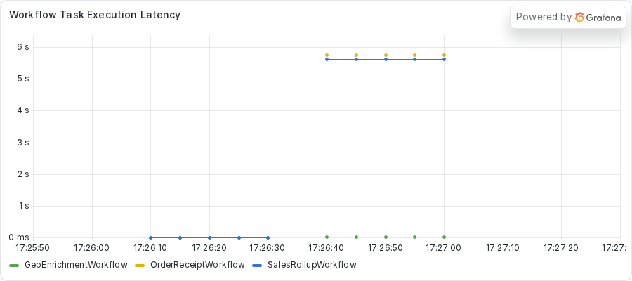
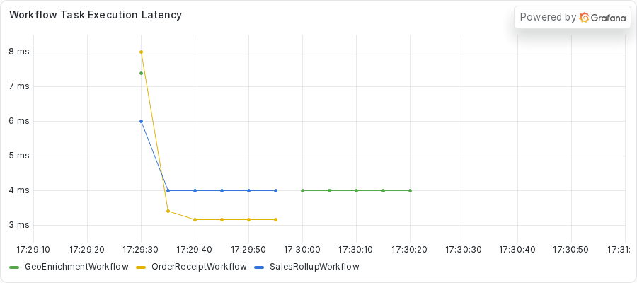

# Exercise 1: Fixing a synchronous HTTP client in an async Activity

During this exercise, you will

- Run a fleet of Workflows against a Worker and watch one Workflow type break another
- Use `python -m asyncio ps` and `pstree` to find the task that never gives control back
- Use `py-spy dump` to name the exact line that holds the event loop
- Write a test that fails while a blocking call holds the event loop
- Move the blocking call off the event loop, then verify the fix

Make your changes to the code in the `practice` subdirectory.
Look for the `TODO PART C` and `TODO PART D` comments, which mark where you make changes.
If you need a hint or want to verify your changes, look at the complete version in the `solution` subdirectory.

## Prerequisites

Finish the setup in the root [README](../../README.md#quickstart) first.
You need the `temporal` command, `uv`, and Python 3.14 or newer.
The commands below use `uv run`, so the Worker and the inspecting Python both run on 3.14.

This exercise also uses `py-spy`, which the repository does not install.
You run it on demand with `uvx py-spy dump --pid <PID>`.

Part E compares a Grafana panel before and after the fix.
Start the dashboard stack once, from the repository root.

```sh
just metrics
```

Grafana serves the provisioned **Async Debug** dashboard at http://localhost:3000.
The Worker in this exercise exports Prometheus metrics on port 9464, and the dev server exports its own on port 9465.
Start the dev server with `just server` so that the second port is open.

## Part A: Run the Workflow

Your team runs a service that looks up where a request came from.
A `GeoEnrichmentWorkflow` calls two Activities, `get_ip` and `get_location`, and both fetch from public HTTP providers.
The same Worker also runs two other, unrelated Workflows.
`SalesRollupWorkflow` pauses for five seconds and then sums some sales figures.
`OrderReceiptWorkflow` validates an order, totals it, and formats a receipt, all in memory.

Nothing in the receipt or rollup code touches the network.
In this part, you start the Worker and submit a fleet.
One geo run in the fleet asks a slow upstream, the way a real provider sometimes takes several seconds to answer.
Do not read the code yet.
Part B asks you to find out what is wrong from the outside.

1. Change to the `exercises/01-sync-http-client/practice` directory.
2. Start the Worker.

   ```sh
   uv run python worker.py
   ```

   The Worker prints a banner with its PID and the exact introspection commands.
   Keep this terminal open and note the PID.

3. In another terminal, change to the same directory and submit a small fleet against the real providers.

   ```sh
   uv run python starter.py --geo 2 --receipts 3
   ```

   The Workflows finish and nothing looks wrong.
   That is part of the problem.

4. Submit the full fleet.
   The `--bad 1` option sends one geo run to the slow local endpoint.
   The `--block-seconds 30` option sets how long that endpoint waits before it answers.

   ```sh
   uv run python starter.py --block-seconds 30 --bad 1 --geo 1 \
       --rollups 1 --receipts 2
   ```

   The starter submits the rollup first, then the healthy geo run, and then the bad run.
   It adds the receipts after the bad run reaches its `get_location` Activity.
   The command takes about half a minute to finish.

Here is what the starter printed in the capture for this exercise.

<!-- vale off -->
<!-- vale MasonBase.CodeLineLength = NO -->
```text
rollup rollup-a5de1f87-2d83-461f-919e-83652ffadc45 FAILED: Activity task timed out
geo geo-6215226e-70d8-4d93-8ace-6410d45a2685: GeoEnrichmentOutput(ip='256.256.256.256', location='Milky Way Galaxy')
receipt receipt-54a77ca5-a787-4de7-8d49-43609be3960d: OrderReceiptOutput(receipt='order order-0: 59.97 USD')
receipt receipt-0ad58652-e4de-4a20-b741-d894fbbaa521: OrderReceiptOutput(receipt='order order-1: 59.97 USD')
geo geo-fe66e250-5ff3-44e8-80a0-ce7db5cfc1f8: GeoEnrichmentOutput(ip='256.256.256.256', location='Austin, Texas, United States')
```
<!-- vale MasonBase.CodeLineLength = YES -->
<!-- vale on -->

The rollup failed with `Activity task timed out`.
The receipts completed, but you can ask the server how long they took.
Run `temporal workflow show -w <receipt workflow ID>` with one of the receipt IDs from your own output.
This block keeps the first Workflow Task and the first Activity from the Event History of the first receipt.

<!-- vale off -->
<!-- vale MasonBase.CodeLineLength = NO -->
```text
Progress:
  ID           Time                     Type           
    1  2026-11-03T23:26:03Z  WorkflowExecutionStarted  
    2  2026-11-03T23:26:03Z  WorkflowTaskScheduled     
    3  2026-11-03T23:26:03Z  WorkflowTaskStarted       
    4  2026-11-03T23:26:13Z  WorkflowTaskTimedOut      
    5  2026-11-03T23:26:23Z  WorkflowTaskScheduled     
    6  2026-11-03T23:26:23Z  WorkflowTaskStarted       
    7  2026-11-03T23:26:32Z  WorkflowTaskCompleted     
    8  2026-11-03T23:26:32Z  ActivityTaskScheduled     
```
<!-- vale MasonBase.CodeLineLength = YES -->
<!-- vale on -->

The first Workflow Task started at 23:26:03.
At 23:26:13 the history shows `WorkflowTaskTimedOut`.
The Worker never replied to that first task.
The next Workflow Task started at 23:26:23 and completed at 23:26:32.
So the receipt's first decision took about 29 seconds.
Treat the `WorkflowTaskTimedOut` event as a clue, because a Worker that is healthy answers a Workflow Task in milliseconds.
A receipt does no I/O, so a 29-second stall is the mystery to solve.

The rollup tells the same story.
Run `temporal workflow show -w <rollup workflow ID>` and read the end of the output.

<!-- vale off -->
<!-- vale MasonBase.CodeLineLength = NO -->
```text
Results:
  Status   FAILED
  Failure  
    Message: Activity task timed out
    Cause:
        Message: activity ScheduleToClose timeout
        Cause:
            Message: activity StartToClose timeout
```
<!-- vale MasonBase.CodeLineLength = YES -->
<!-- vale on -->

The Activity in the rollup only had to sleep for five seconds.
The server gave up on it first, and its Event History also holds a `WorkflowTaskTimedOut` event.
The code in those two Workflows is correct, so something shared is wrong.

## Part B: Diagnose the stall

All three Workflow types run on one Worker process.
That Worker has one asyncio event loop.
The loop runs your `async def` Activities, the bookkeeping tasks of the SDK, and the tasks that hand Workflow Tasks to your code.
If one call holds the loop, every other task waits.

You confirm that with the Python tooling first, and then you look at the dashboard.
Run the commands below while the starter waits, about 8 seconds after you submit the full fleet.
Replace `<PID>` with the PID from the Worker banner.

### Step 1: Read the task list

`python -m asyncio ps` reads the Worker's memory from outside the process, so it answers even during a freeze.
Run it from the repository root.

```sh
uv run python -m asyncio ps <PID>
```

First, here is the same command on an idle Worker.
Every task waits at an await.

<!-- vale off -->
<!-- vale MasonBase.CodeLineLength = NO -->
```text
tid        task id              task name            coroutine stack                                    awaiter chain                                      awaiter name    awaiter id     
------------------------------------------------------------------------------------------------------------------------------------------------------------------------------------
2580799    0x7e12644f72f0       Task-1               Worker._run -> Worker.run -> main                                                                                     0x0            
2580799    0x7e12644f7e30       Task-2               Event.wait -> Worker._run.<locals>.raise_on_shutdown _wait -> wait                                      Task-5          0x7e1264439550 
2580799    0x7e126433ef70       Task-3               _wait -> wait -> _ActivityWorker.run               _wait -> wait                                      Task-5          0x7e1264439550 
2580799    0x7e126433ea00       Task-4               Worker.poll_workflow_activation -> _WorkflowWorker.run _wait -> wait                                      Task-5          0x7e1264439550 
2580799    0x7e1264439550       Task-5               _wait -> wait                                      Worker._run -> Worker.run -> main                  Task-1          0x7e12644f72f0 
2580799    0x7e126443ba10       Task-6               Queue.get -> _ActivityWorker.run.<locals>.raise_from_exception_queue _wait -> wait -> _ActivityWorker.run               Task-3          0x7e126433ef70 
2580799    0x7e12645df140       Task-7               Worker.poll_activity_task                          _wait -> wait -> _ActivityWorker.run               Task-3          0x7e126433ef70 
```
<!-- vale MasonBase.CodeLineLength = YES -->
<!-- vale on -->

This is the output about 8 seconds into the fleet run.

<!-- vale off -->
<!-- vale MasonBase.CodeLineLength = NO -->
```text
tid        task id              task name            coroutine stack                                    awaiter chain                                      awaiter name    awaiter id     
------------------------------------------------------------------------------------------------------------------------------------------------------------------------------------
2580799    0x7e12644f72f0       Task-1               Worker._run -> Worker.run -> main                                                                                     0x0            
2580799    0x7e12644f7e30       Task-2               Event.wait -> Worker._run.<locals>.raise_on_shutdown _wait -> wait                                      Task-5          0x7e1264439550 
2580799    0x7e126433ef70       Task-3               _wait -> wait -> _ActivityWorker.run               _wait -> wait                                      Task-5          0x7e1264439550 
2580799    0x7e126433ea00       Task-4               Worker.poll_workflow_activation -> _WorkflowWorker.run _wait -> wait                                      Task-5          0x7e1264439550 
2580799    0x7e1264439550       Task-5               _wait -> wait                                      Worker._run -> Worker.run -> main                  Task-1          0x7e12644f72f0 
2580799    0x7e126443ba10       Task-6               Queue.get -> _ActivityWorker.run.<locals>.raise_from_exception_queue _wait -> wait -> _ActivityWorker.run               Task-3          0x7e126433ef70 
2580799    0x7e12641476b0       Task-127             sleep -> roll_up_sales -> _ActivityInboundImpl.execute_activity -> _ActivityWorker._execute_activity -> _ActivityWorker._handle_start_activity_task                                                                    0x0            
2580799    0x7e1264146b70       Task-152             _ActivityWorker._handle_start_activity_task                                                                           0x0            
2580799    0x7e12629394f0       Task-153             Worker.poll_activity_task                          _wait -> wait -> _ActivityWorker.run               Task-3          0x7e126433ef70 
```
<!-- vale MasonBase.CodeLineLength = YES -->
<!-- vale on -->

Look at Task-152.
Its stack ends at `_ActivityWorker._handle_start_activity_task`, and nothing sits beneath it.
Compare it with Task-127, the rollup, which waits at `sleep` inside `roll_up_sales`.
A waiting task has its await at the bottom of the stack.
A task with no await below it runs synchronous code.

`python -m asyncio pstree` draws the same tasks as a tree.
The next block holds the last lines of the capture, where the two Activity tasks appear.

```sh
uv run python -m asyncio pstree <PID>
```

<!-- vale off -->
<!-- vale MasonBase.CodeLineLength = NO -->
```text
└── (T) Task-127
    └──  _ActivityWorker._handle_start_activity_task /home/ziggy/temporal-async-debug/.venv/lib/python3.14/site-packages/temporalio/worker/_activity.py:351
        └──  _ActivityWorker._execute_activity /home/ziggy/temporal-async-debug/.venv/lib/python3.14/site-packages/temporalio/worker/_activity.py:681
            └──  _ActivityInboundImpl.execute_activity /home/ziggy/temporal-async-debug/.venv/lib/python3.14/site-packages/temporalio/worker/_activity.py:889
                └──  roll_up_sales /home/ziggy/temporal-async-debug/exercises/01-sync-http-client/practice/rollup.py:48
                    └──  sleep /home/ziggy/.local/share/uv/python/cpython-3.14.3-linux-x86_64-gnu/lib/python3.14/asyncio/tasks.py:702
└── (T) Task-152
    └──  _ActivityWorker._handle_start_activity_task /home/ziggy/temporal-async-debug/.venv/lib/python3.14/site-packages/temporalio/worker/_activity.py:351
```
<!-- vale MasonBase.CodeLineLength = YES -->
<!-- vale on -->

The tree agrees.
Task-127 reaches `sleep` in `rollup.py`.
Task-152 ends at the SDK handler.

The tool gives you the shape, but it cannot name the line that blocks.
A task stuck in synchronous code does not wait at an await, so there is no await to report.

### Step 2: Name the line with py-spy

`py-spy dump` reads the operating system thread stack instead of the asyncio task list.
It shows what the main thread does at that moment.

```sh
uvx py-spy dump --pid <PID>
```

This block keeps only the `MainThread` stack from the capture.

<!-- vale off -->
<!-- vale MasonBase.CodeLineLength = NO -->
```text
Process 2580799: /home/ziggy/temporal-async-debug/.venv/bin/python worker.py
Python v3.14.3 (/home/ziggy/.local/share/uv/python/cpython-3.14.3-linux-x86_64-gnu/bin/python3.14)

Thread 2580799 (idle): "MainThread"
    SyncStream.read (httpcore/_backends/sync.py:128)
    HTTP11Connection._receive_event (httpcore/_sync/http11.py:217)
    HTTP11Connection._receive_response_headers (httpcore/_sync/http11.py:177)
    HTTP11Connection.handle_request (httpcore/_sync/http11.py:106)
    HTTPConnection.handle_request (httpcore/_sync/connection.py:103)
    ConnectionPool.handle_request (httpcore/_sync/connection_pool.py:236)
    HTTPTransport.handle_request (httpx/_transports/default.py:250)
    Client._send_single_request (httpx/_client.py:1014)
    Client._send_handling_redirects (httpx/_client.py:979)
    Client._send_handling_auth (httpx/_client.py:942)
    Client.send (httpx/_client.py:914)
    Client.request (httpx/_client.py:825)
    Client.get (httpx/_client.py:1053)
    get_location (activities.py:155)
    _ActivityInboundImpl.execute_activity (temporalio/worker/_activity.py:889)
    _ActivityWorker._execute_activity (temporalio/worker/_activity.py:681)
    _ActivityWorker._handle_start_activity_task (temporalio/worker/_activity.py:351)
    Handle._run (asyncio/events.py:94)
    BaseEventLoop._run_once (asyncio/base_events.py:2046)
    BaseEventLoop.run_forever (asyncio/base_events.py:677)
    BaseEventLoop.run_until_complete (asyncio/base_events.py:706)
    Runner.run (asyncio/runners.py:127)
    run (asyncio/runners.py:204)
    <module> (worker.py:115)
```
<!-- vale MasonBase.CodeLineLength = YES -->
<!-- vale on -->

Read the stack from the top.
The top frame is `SyncStream.read` in `httpcore`.
Below it, `Client.get` in `httpx/_client.py` was called by `get_location` at `activities.py:155`.
Below that, the SDK's `_ActivityWorker._handle_start_activity_task` ran it directly on the `MainThread`.
The main thread runs the event loop, so `get_location` holds the loop while it waits for a socket.

The first line also says `idle`.
The thread waits on the network and does not compute.

### Step 3: Read the CPU

Check how hard the process works.
Run `top` for the Worker's PID.

```sh
top -b -d 1 -n 2 -p <PID> | tail -8
```

The `-n 2` option makes `top` print two frames, so the second frame reports CPU over a real one-second interval.
This block keeps only the column header and the process row from the same moment.
<!-- vale off -->
<!-- vale MasonBase.CodeLineLength = NO -->
```text
    PID USER      PR  NI    VIRT    RES    SHR S  %CPU  %MEM     TIME+ COMMAND
2580799 ziggy     25   5  932948  80316  31864 S   0.0   0.5   0:00.91 python
```
<!-- vale MasonBase.CodeLineLength = YES -->
<!-- vale on -->

The Worker uses 0.0 percent of a CPU.
A frozen loop with near-zero CPU points to a call that waits on something outside the process.
Keep this number in mind.
Exercise 3 shows a frozen loop with CPU near 100 percent.

### Step 4: Check the dashboard

Open the dashboard at http://localhost:3000 and find the panel named **Workflow Task Execution Latency**.
This panel is the fleet-wide view of what the tooling just showed you.
It plots a 30-second rate average of how long Workflow Tasks take, one line for each Workflow type.



The receipt and rollup lines climb to between 5 and 6 seconds, and the geo line stays flat.
The panel averages over 30 seconds, so a 29-second stall reads as about 5 to 6 seconds.
Read the true length from `temporal workflow show`, as you did in Part A.
The panel tells you that more than one Workflow type suffers.
The tools told you why.

## Part C: Find the bug

You now know what the Worker was doing and on which line.
Open `activities.py` in the `practice` directory and find the two `TODO PART C` comments.

1. Find `get_ip` and `get_location`.
   Both are `async def` functions.
2. Inside each one, find the `with httpx.Client(...)` block and the `client.get(...)` call.
   This is a synchronous HTTP client.
   It waits on the socket and does not give control back to the event loop.
3. Find the comment that starts with `ANTIPATTERN (deliberate, for teaching)`.
   It sits on the line that `py-spy` named.

An `async def` Activity runs on the event loop.
A blocking call inside it stops every other task on that loop until the call returns.
The fix is to run the blocking work somewhere else.
A plain `def` Activity runs on the Worker's `activity_executor`, a pool of threads, so a blocked thread leaves the event loop free.

The practice copy uses the synchronous `httpx.Client` for the bug.
The fix keeps the same client and moves where it runs.

## Part D: Write a test, then fix the bug

Write a test that fails for the right reason before you change the code.
Then you know the fix turned it green.

1. From the `practice` directory, run the tests.

   ```sh
   uv run python -m pytest -o pythonpath="$PWD" tests
   ```

   One test fails on purpose.
   The stub carries a `TODO PART D` comment.
2. Open `tests/test_probe.py` and read the comment in `test_get_location_does_not_starve_the_event_loop`.
   It describes the test you write.
   The test serves the slow endpoint from `slow_upstream.py`.
   It runs `get_location` the way the Worker does, beside a small coroutine that records a timestamp every 50 milliseconds.
   It then asserts that no gap between ticks reaches 0.2 seconds.
3. Write the test.
   If you need a hint, the finished version is in `solution/tests/test_probe.py`.
4. Run the tests again.
   Your test fails while `get_location` is an `async def`, because the probe cannot tick while the call holds the loop.
   The gap between two ticks is about as long as the upstream's wait.
   If you copy the hinted test from `solution/tests/test_probe.py`, it stops earlier, at `assert isinstance(executor, ThreadPoolExecutor)`.
   The practice `build_worker` passes no `activity_executor` yet, so the hinted test fails on that line before the probe runs.
   Both failures point at the same fix.
5. Open `activities.py`.
   Remove the `async` keyword from `get_ip` and from `get_location`.
   Delete the `ANTIPATTERN` comments and the `TODO PART C` comments.
6. Open `worker.py` and find the `TODO PART D` comment in `build_worker`.
   A `def` Activity needs somewhere to run.
   Pass the Worker an `activity_executor` that is a `ThreadPoolExecutor` with `max_workers` equal to `MAX_CONCURRENT_ACTIVITIES`.
   Add the import that line needs at the top of the file.
7. Run the tests a third time.
   They all pass.

## Part E: Redeploy and verify

Stop the old Worker with `CTRL+C`, then start it again from the `practice` directory.

```sh
uv run python worker.py
```

Submit the same fleet from your second terminal.

```sh
uv run python starter.py --block-seconds 30 --bad 1 --geo 1 \
    --rollups 1 --receipts 2
```

This is what the starter printed in the capture of the solution copy.
The rollup completes this time.

<!-- vale off -->
<!-- vale MasonBase.CodeLineLength = NO -->
```text
rollup rollup-67b0e059-a3c5-4e51-a358-3f72a8ee8132: SalesRollupOutput(summary='Sales rollup for 2026-01: total 6030')
geo geo-2fd7600d-44c1-494a-87ef-65b34edd933a: GeoEnrichmentOutput(ip='256.256.256.256', location='Milky Way Galaxy')
receipt receipt-f7ea0059-9fdc-4784-80bc-de836516cdc4: OrderReceiptOutput(receipt='order order-0: 59.97 USD')
receipt receipt-c07f982e-957d-472a-9112-1496bddf74a1: OrderReceiptOutput(receipt='order order-1: 59.97 USD')
geo geo-499c1040-c7e3-4538-b124-047db6f5aa2c: GeoEnrichmentOutput(ip='256.256.256.256', location='Austin, Texas, United States')
```
<!-- vale MasonBase.CodeLineLength = YES -->
<!-- vale on -->

Run `uv run python -m asyncio ps <PID>` again about 8 seconds in.

<!-- vale off -->
<!-- vale MasonBase.CodeLineLength = NO -->
```text
tid        task id              task name            coroutine stack                                    awaiter chain                                      awaiter name    awaiter id     
------------------------------------------------------------------------------------------------------------------------------------------------------------------------------------
2597040    0x73a0229074d0       Task-1               Worker._run -> Worker.run -> main                                                                                     0x0            
2597040    0x73a022907e30       Task-2               Event.wait -> Worker._run.<locals>.raise_on_shutdown _wait -> wait                                      Task-5          0x73a022873d90 
2597040    0x73a02273f310       Task-3               _wait -> wait -> _ActivityWorker.run               _wait -> wait                                      Task-5          0x73a022873d90 
2597040    0x73a02273ef70       Task-4               Worker.poll_workflow_activation -> _WorkflowWorker.run _wait -> wait                                      Task-5          0x73a022873d90 
2597040    0x73a022873d90       Task-5               _wait -> wait                                      Worker._run -> Worker.run -> main                  Task-1          0x73a0229074d0 
2597040    0x73a022873a10       Task-6               Queue.get -> _ActivityWorker.run.<locals>.raise_from_exception_queue _wait -> wait -> _ActivityWorker.run               Task-3          0x73a02273f310 
2597040    0x73a022562f30       Task-43              _ActivityInboundImpl.execute_activity -> _ActivityWorker._execute_activity -> _ActivityWorker._handle_start_activity_task                                                                    0x0            
2597040    0x73a0208f23f0       Task-89              Worker.poll_activity_task                          _wait -> wait -> _ActivityWorker.run               Task-3          0x73a02273f310 
```
<!-- vale MasonBase.CodeLineLength = YES -->
<!-- vale on -->

Task-43 still ends at `_handle_start_activity_task`, because that is how the SDK starts a `def` Activity.
Its stack now shows `_ActivityInboundImpl.execute_activity`, and the rest of the tasks wait as before.
Now run `py-spy` again.
This block keeps only the `MainThread` stack from the capture.

<!-- vale off -->
<!-- vale MasonBase.CodeLineLength = NO -->
```text
Process 2597040: /home/ziggy/temporal-async-debug/.venv/bin/python worker.py
Python v3.14.3 (/home/ziggy/.local/share/uv/python/cpython-3.14.3-linux-x86_64-gnu/bin/python3.14)

Thread 2597040 (idle): "MainThread"
    EpollSelector.select (selectors.py:452)
    BaseEventLoop._run_once (asyncio/base_events.py:2008)
    BaseEventLoop.run_forever (asyncio/base_events.py:677)
    BaseEventLoop.run_until_complete (asyncio/base_events.py:706)
    Runner.run (asyncio/runners.py:127)
    run (asyncio/runners.py:204)
    <module> (worker.py:116)
```
<!-- vale MasonBase.CodeLineLength = YES -->
<!-- vale on -->

The `MainThread` sits in `EpollSelector.select`.
That is the event loop waiting for work, which is what a healthy loop does.
The HTTP read moved to a thread.
This block keeps only the stack of the `ThreadPoolExecutor-0_0` thread from the same capture.

<!-- vale off -->
<!-- vale MasonBase.CodeLineLength = NO -->
```text
Thread 2597483 (idle): "ThreadPoolExecutor-0_0"
    SyncStream.read (httpcore/_backends/sync.py:128)
    HTTP11Connection._receive_event (httpcore/_sync/http11.py:217)
    HTTP11Connection._receive_response_headers (httpcore/_sync/http11.py:177)
    HTTP11Connection.handle_request (httpcore/_sync/http11.py:106)
    HTTPConnection.handle_request (httpcore/_sync/connection.py:103)
    ConnectionPool.handle_request (httpcore/_sync/connection_pool.py:236)
    HTTPTransport.handle_request (httpx/_transports/default.py:250)
    Client._send_single_request (httpx/_client.py:1014)
    Client._send_handling_redirects (httpx/_client.py:979)
    Client._send_handling_auth (httpx/_client.py:942)
    Client.send (httpx/_client.py:914)
    Client.request (httpx/_client.py:825)
    Client.get (httpx/_client.py:1053)
    get_location (activities.py:148)
    _execute_sync_activity (temporalio/worker/_activity.py:951)
    WorkerContext.run (concurrent/futures/thread.py:73)
    _WorkItem.run (concurrent/futures/thread.py:86)
    _worker (concurrent/futures/thread.py:119)
```
<!-- vale MasonBase.CodeLineLength = YES -->
<!-- vale on -->

The same `Client.get` call at `activities.py:148` now sits on `ThreadPoolExecutor-0_0`.
The Worker still waits on the slow endpoint, but the event loop does not wait with it.

Receipts no longer wait for their first Workflow Task.
Run the repository's helper from the repository root with the receipt Workflow IDs from your run.
It reads each receipt's Event History and prints the Workflow Task time and the Activity waits.

```sh
just receipt-gaps <receipt workflow ID> <receipt workflow ID>
```

This block comes from an earlier script with the same output format, run on the two receipts in the solution capture.
The capture predates the commit of `scripts/receipt_gaps.py`, so `just receipt-gaps` did not print it.
The helper you run prints the same columns.

<!-- vale off -->
<!-- vale MasonBase.CodeLineLength = NO -->
```text
receipt-c07f982e total 3304ms | WT1 started->completed 15ms | validate_order: sched->started 3202ms started->completed 5ms | compute_total: sched->started 5ms started->completed 6ms | format_receipt: sched->started 7ms started->completed 7ms
receipt-f7ea0059 total 3292ms | WT1 started->completed 16ms | validate_order: sched->started 3203ms started->completed 5ms | compute_total: sched->started 7ms started->completed 6ms | format_receipt: sched->started 6ms started->completed 9ms
```
<!-- vale MasonBase.CodeLineLength = YES -->
<!-- vale on -->

The first Workflow Task takes 15 and 16 milliseconds instead of a stall of about 29 seconds.
The receipts' total of about 3.3 seconds comes from `validate_order` waiting 3.2 seconds for an Activity slot.
The rollup holds one of the two slots for its five-second pause, and a slot frees up before the receipts get theirs.
That is a short wait for a slot, not a frozen loop.

Last, look at the **Workflow Task Execution Latency** panel again.



Every line stays below 8 milliseconds, and the receipt line sits at about 3 milliseconds.
The scale on the left changed from seconds to milliseconds.

## Conclusion

You moved a blocking call off the event loop with two small changes.
You turned two `async def` Activities into plain `def` Activities, and you gave the Worker a thread pool to run them on.
The receipt and rollup Workflows needed no change, because their code was never the problem.

Exercise 2 shows a blocking call that hides inside a polling loop.

### This is the end of the exercise.
