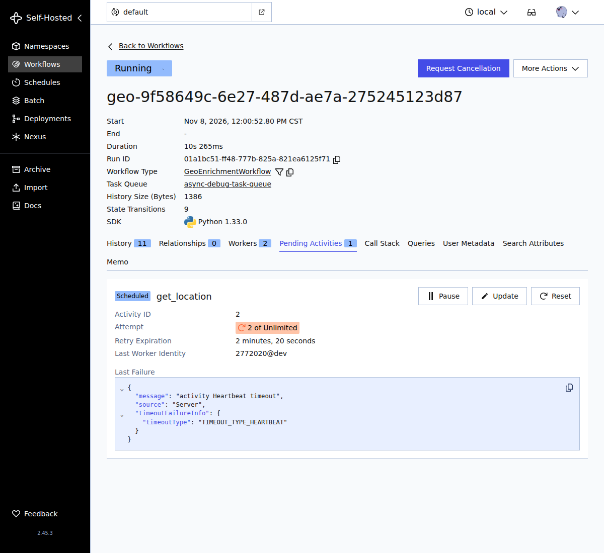
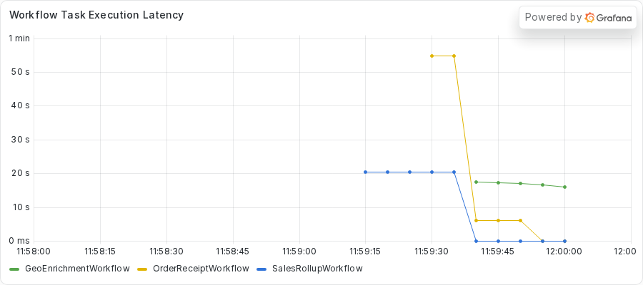
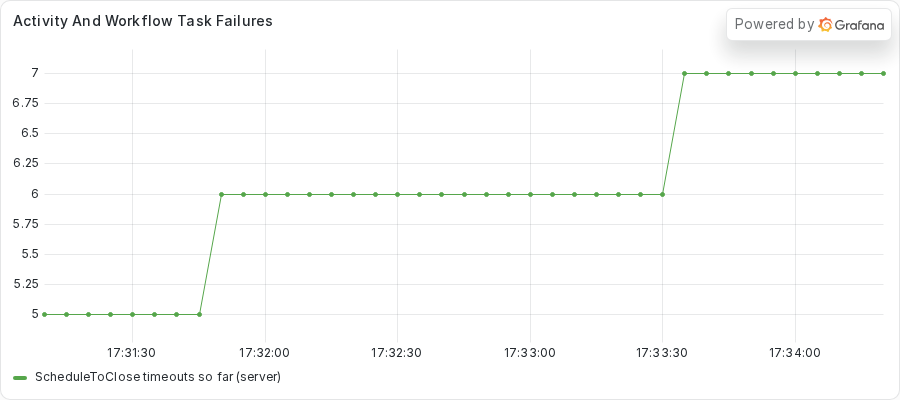

# Exercise 2: Sleeping between heartbeats in an async Activity

During this exercise, you will

- Run a polling Activity that heartbeats, and watch the server fail and retry it over and over
- Read the climbing attempt count in the Web UI and in `temporal workflow describe`
- Use `python -m asyncio ps`, `py-spy dump`, and the Worker log to find the sleep that holds the event loop
- Write a test that counts heartbeats during one poll wait
- Replace the single sleep with awaited ticks, then verify the fix

This exercise runs one Worker with two Activity slots on purpose, as teaching code, so the failure is loud.
To see the same bug on a fleet of Workers, read [Exercise 6](../06-finding-the-frozen-worker/README.md).

Make your changes to the code in the `practice` subdirectory.
Look for the `TODO PART C` and `TODO PART D` comments, which mark where you make changes.
If you need a hint or want to verify your changes, look at the complete version in the `solution` subdirectory.

## Prerequisites

Finish the setup in the root [README](../../README.md#quickstart) first.
You need the `temporal` command, `uv`, and Python 3.14 or newer.
You also use `py-spy`, which the repository does not install.
You run it on demand with `uvx py-spy dump --pid <PID>`.

Part E compares a Grafana panel before and after the fix.
Start the dashboard stack once, from the repository root.

```sh
just metrics
```

Grafana serves the provisioned **Async Debug** dashboard at http://localhost:3000.
Start the dev server with `just server` so that Prometheus can read it on port 9465.
The Worker exports its own metrics on port 9464.

The practice copy here calls the public providers with the async `httpx.AsyncClient`, unlike Exercise 1.
Nothing in this exercise blocks on the network.

## Part A: Run the Workflow

Your team runs a service that looks up where a request came from.
Most lookups ask a public provider and return in well under a second.
One lookup path polls a slow job instead.
The `get_location` Activity checks the job, records a heartbeat, waits eight seconds, and checks again.
The job needs about 60 seconds to finish.

The Workflow gives that Activity a Heartbeat timeout of five seconds and no retry limit.
The Activity heartbeats before every wait, so you expect it to pass.
The same Worker also runs a `SalesRollupWorkflow` and an `OrderReceiptWorkflow`, which share nothing with the slow job.

Do not read the Activity code yet.
Part B asks you to find the cause from the outside.

1. Change to the `exercises/02-sleep-between-heartbeats/practice` directory.
2. Start the Worker.

   ```sh
   uv run python worker.py
   ```

   The Worker prints a banner with its PID.
   Keep this terminal open and note the PID.

3. Open another terminal in the same directory and submit the fleet.
   The `--bad 1` option sends one geo run to the slow job.

   ```sh
   uv run python starter.py --bad 1 --geo 1 --rollups 1 --receipts 2
   ```

   The command takes about 70 seconds to finish.

### Watch the retries

While the fleet runs, find the geo run that is still running.
The healthy geo run finishes in about a second, so the one left is the slow job.
Open the Web UI at http://localhost:8233, or list it with the `temporal` command.

```sh
temporal workflow list \
  --query 'WorkflowType="GeoEnrichmentWorkflow" AND ExecutionStatus="Running"'
```

Open that Workflow and select the **Pending Activities** tab.
The capture below shows the tab about 10 seconds in.
The **Attempt** field reads `2 of Unlimited`, and **Last Failure** holds a Heartbeat timeout.



Reload the page about 50 seconds in.


The attempt count climbs.
The Activity never stops failing, and the server keeps starting it again.
The command line shows the same thing.
Run `temporal workflow describe -w <geo workflow ID>` at about 3, 9, 31, and 48 seconds.
This block keeps only the `State` and `Attempt` lines from each of the four captures, in that order.

<!-- vale off -->
<!-- vale MasonBase.CodeLineLength = NO -->
```text
  State               Started
  Attempt             1
  State               Scheduled
  Attempt             2
  State               Scheduled
  Attempt             3
  State               Scheduled
  Attempt             4
```
<!-- vale MasonBase.CodeLineLength = YES -->
<!-- vale on -->

Attempt 1 runs at 3 seconds.
Attempt 2 waits in `Scheduled` at 9 seconds, attempt 3 at 31 seconds, and attempt 4 at 48 seconds.
At 9 and 31 seconds the `ScheduledTime` has already passed.
The tasks for attempts 2 and 3 were due, and the Worker had not taken either.
A Worker with a healthy loop picks up a due Activity task right away.
At 48 seconds `ScheduledTime` still reads 1 second from now, so attempt 4 is still in its retry backoff.

This is the pending Activity section from the 9-second capture.
In the capture, `ziggy`, `256.256.256.256`, `Milky Way Galaxy`, and `host` are stand-ins for the user name, address, location, and hostname of the capture machine.
Your own output shows your own values.

<!-- vale off -->
<!-- vale MasonBase.CodeLineLength = NO -->
```text
Pending Activities: 1

  ActivityId          2
  Type                get_location
  State               Scheduled
  Attempt             2
  MaximumAttempts     0
  ScheduledTime       1 second ago
  ExpirationTime      2 minutes from now
  LastFailure         {"message":"activity Heartbeat timeout","source":"Server","timeoutFailureInfo":{"timeoutType":"TIMEOUT_TYPE_HEARTBEAT"}}
  LastWorkerIdentity  2772020@host
```
<!-- vale MasonBase.CodeLineLength = YES -->
<!-- vale on -->

The next block is what the starter printed in the capture.

<!-- vale off -->
<!-- vale MasonBase.CodeLineLength = NO -->
```text
rollup rollup-04fbf28c-faca-4cd2-b192-98e92244e979 FAILED: Activity task timed out
geo geo-4f8ec4a1-1fef-4b27-a937-37871f345be6: GeoEnrichmentOutput(ip='256.256.256.256', location='Milky Way Galaxy')
receipt receipt-b52b2fe6-52e4-4f98-9321-67105c069833: OrderReceiptOutput(receipt='order order-0: 59.97 USD')
receipt receipt-73ebe4bd-bb4d-431a-9273-9598fd2893a1: OrderReceiptOutput(receipt='order order-1: 59.97 USD')
geo geo-9f58649c-6e27-487d-ae7a-275245123d87: GeoEnrichmentOutput(ip='256.256.256.256', location='Milky Way Galaxy')
```
<!-- vale MasonBase.CodeLineLength = YES -->
<!-- vale on -->

The rollup failed with `Activity task timed out`.
The geo run for the slow job finished, but only after about 65 seconds.
The receipts finished too, and they do no I/O.
Run `temporal workflow show -w <receipt workflow ID>` for one of them.
The capture below holds the first eight Events of a receipt.
The times are in Coordinated Universal Time (UTC).

<!-- vale off -->
<!-- vale MasonBase.CodeLineLength = NO -->
```text
Progress:
  ID           Time                     Type           
    1  2026-11-08T18:00:54Z  WorkflowExecutionStarted  
    2  2026-11-08T18:00:54Z  WorkflowTaskScheduled     
    3  2026-11-08T18:00:54Z  WorkflowTaskStarted       
    4  2026-11-08T18:01:04Z  WorkflowTaskTimedOut      
    5  2026-11-08T18:01:39Z  WorkflowTaskScheduled     
    6  2026-11-08T18:01:39Z  WorkflowTaskStarted       
    7  2026-11-08T18:01:57Z  WorkflowTaskCompleted     
    8  2026-11-08T18:01:57Z  ActivityTaskScheduled     
```
<!-- vale MasonBase.CodeLineLength = YES -->
<!-- vale on -->

The first Workflow Task started at 18:00:54.
At 18:01:04 the history shows `WorkflowTaskTimedOut`.
The Worker never replied to that first task.
The next Workflow Task started at 18:01:39 and completed at 18:01:57.
A receipt should not wait a minute for anything, so something shared is holding the Worker.

The repository ships a helper that reads each receipt's Event History and prints the Workflow Task time and the Activity waits.
Run it from the repository root with the receipt Workflow IDs from your run.

```sh
just receipt-gaps <receipt workflow ID> <receipt workflow ID>
```

This is what `just receipt-gaps` printed for the two receipts in the capture.
This block keeps only the two receipt lines and drops the command line the capture starts with.

<!-- vale off -->
<!-- vale MasonBase.CodeLineLength = NO -->
```text
receipt-73ebe4bd total 62987ms | WT1 started->completed 62840ms | validate_order: sched->started 5ms started->completed 17ms | compute_total: sched->started 3ms started->completed 15ms | format_receipt: sched->started 6ms started->completed 11ms
receipt-b52b2fe6 total 63883ms | WT1 started->completed 62852ms | validate_order: sched->started 975ms started->completed 5ms | compute_total: sched->started 2ms started->completed 4ms | format_receipt: sched->started 3ms started->completed 4ms
```
<!-- vale MasonBase.CodeLineLength = YES -->
<!-- vale on -->

The `WT1 started->completed` field runs from the start of the first Workflow Task to the completion of the first Workflow Task that completed.
In this history that spans the timed-out task and its retry, and it reads 62.8 seconds for both receipts.
The Activities in the receipts finish in milliseconds, so the stall sits in the Workflow Task.

Last, look at the bad geo run's Event History.
Run `temporal workflow show -w <geo workflow ID>`.

<!-- vale off -->
<!-- vale MasonBase.CodeLineLength = NO -->
```text
Progress:
  ID           Time                     Type           
    1  2026-11-08T18:00:52Z  WorkflowExecutionStarted  
    2  2026-11-08T18:00:52Z  WorkflowTaskScheduled     
    3  2026-11-08T18:00:52Z  WorkflowTaskStarted       
    4  2026-11-08T18:00:52Z  WorkflowTaskCompleted     
    5  2026-11-08T18:00:52Z  ActivityTaskScheduled     
    6  2026-11-08T18:00:52Z  ActivityTaskStarted       
    7  2026-11-08T18:00:53Z  ActivityTaskCompleted     
    8  2026-11-08T18:00:53Z  WorkflowTaskScheduled     
    9  2026-11-08T18:00:53Z  WorkflowTaskStarted       
   10  2026-11-08T18:00:53Z  WorkflowTaskCompleted     
   11  2026-11-08T18:00:53Z  ActivityTaskScheduled     
   12  2026-11-08T18:01:58Z  ActivityTaskStarted       
   13  2026-11-08T18:01:58Z  ActivityTaskCompleted     
   14  2026-11-08T18:01:58Z  WorkflowTaskScheduled     
   15  2026-11-08T18:01:58Z  WorkflowTaskStarted       
   16  2026-11-08T18:01:58Z  WorkflowTaskCompleted     
   17  2026-11-08T18:01:58Z  WorkflowExecutionCompleted

Results:
  Status          COMPLETED
  Result          {"ip":"256.256.256.256","location":"Milky Way Galaxy"}
  ResultEncoding  json/plain
```
<!-- vale MasonBase.CodeLineLength = YES -->
<!-- vale on -->

The `get_location` Activity has one `ActivityTaskScheduled` event at 18:00:53, one `ActivityTaskStarted` event at 18:01:58, and one `ActivityTaskCompleted` event.
The text output of `temporal workflow show` lists no failure here.
A retried Activity writes no event for each failed attempt, so the history cannot show the storm.
The Web UI and `describe` show it while the attempts are pending, and the Worker log shows the polls of each attempt.

## Part B: Diagnose the stall

If you want the short list of symptoms first, read [Recognizing a blocked event loop](../../README.md#recognizing-a-blocked-event-loop) in the root README.

You have these clues so far.
The server fails an Activity that heartbeats, and it keeps retrying.
The Worker does not pick the retries up, and unrelated Workflows stall for a minute.
You use the Python tooling to see what the Worker does, then the Worker log and the dashboard.
Replace `<PID>` with the PID from the Worker banner.

### Step 1: Read the task list

`python -m asyncio ps` reads the Worker memory from outside the process, so it answers during a freeze.
Run it from the repository root.

```sh
uv run python -m asyncio ps <PID>
```

This is the output about 10 seconds into the run.

<!-- vale off -->
<!-- vale MasonBase.CodeLineLength = NO -->
```text
tid        task id              task name            coroutine stack                                    awaiter chain                                      awaiter name    awaiter id     
------------------------------------------------------------------------------------------------------------------------------------------------------------------------------------
2772020    0x721a03fdf2f0       Task-1               Worker._run -> Worker.run -> main                                                                                     0x0            
2772020    0x721a03fdfe30       Task-2               Event.wait -> Worker._run.<locals>.raise_on_shutdown _wait -> wait                                      Task-5          0x721a03f33d90 
2772020    0x721a03e26f70       Task-3               _wait -> wait -> _ActivityWorker.run               _wait -> wait                                      Task-5          0x721a03f33d90 
2772020    0x721a03e26a00       Task-4               Worker.poll_workflow_activation -> _WorkflowWorker.run _wait -> wait                                      Task-5          0x721a03f33d90 
2772020    0x721a03f33d90       Task-5               _wait -> wait                                      Worker._run -> Worker.run -> main                  Task-1          0x721a03fdf2f0 
2772020    0x721a03f33bd0       Task-6               Queue.get -> _ActivityWorker.run.<locals>.raise_from_exception_queue _wait -> wait -> _ActivityWorker.run               Task-3          0x721a03e26f70 
2772020    0x721a03e5fcd0       Task-18              sleep -> roll_up_sales -> _ActivityInboundImpl.execute_activity -> _ActivityWorker._execute_activity -> _ActivityWorker._handle_start_activity_task                                                                    0x0            
2772020    0x721a02640500       Task-43              _ActivityWorker._handle_start_activity_task                                                                           0x0            
2772020    0x721a0279c5f0       Task-44              Worker.poll_activity_task                          _wait -> wait -> _ActivityWorker.run               Task-3          0x721a03e26f70 
2772020    0x721a026f3110       Task-47              _WorkflowWorker._handle_activation                                                                                    0x0            
2772020    0x721a03c22c60       Task-48              _ActivityWorker._heartbeat_async                                                                                      0x0            
```
<!-- vale MasonBase.CodeLineLength = YES -->
<!-- vale on -->

Look at Task-43.
Its stack ends at `_ActivityWorker._handle_start_activity_task` and nothing sits beneath it.
Task-18, the rollup, waits at `sleep`, as a healthy task does.
Task-48 is `_ActivityWorker._heartbeat_async`, and it also has nothing beneath it.
The SDK uses that task to send a heartbeat to the server.

The tool shows the shape, but it cannot name the line that blocks.

### Step 2: Name the line with py-spy

`py-spy dump` reads the operating system thread stack, so it sees what the main thread runs at that moment.

```sh
uvx py-spy dump --pid <PID>
```

This block keeps only the `MainThread` stack from the capture.

<!-- vale off -->
<!-- vale MasonBase.CodeLineLength = NO -->
```text
Process 2772020: /home/ziggy/temporal-async-debug/.venv/bin/python worker.py
Python v3.14.3 (/home/ziggy/.local/share/uv/python/cpython-3.14.3-linux-x86_64-gnu/bin/python3.14)

Thread 2772020 (idle): "MainThread"
    get_location (activities.py:192)
    _ActivityInboundImpl.execute_activity (temporalio/worker/_activity.py:889)
    _ActivityWorker._execute_activity (temporalio/worker/_activity.py:681)
    _ActivityWorker._handle_start_activity_task (temporalio/worker/_activity.py:351)
    Handle._run (asyncio/events.py:94)
    BaseEventLoop._run_once (asyncio/base_events.py:2046)
    BaseEventLoop.run_forever (asyncio/base_events.py:677)
    BaseEventLoop.run_until_complete (asyncio/base_events.py:706)
    Runner.run (asyncio/runners.py:127)
    run (asyncio/runners.py:204)
    <module> (worker.py:113)
```
<!-- vale MasonBase.CodeLineLength = YES -->
<!-- vale on -->

The top frame is `get_location` at `activities.py:192`.
No `httpx` frame sits on top of it, and no socket read.
The line at that number is the `time.sleep` call you meet in Part C.
The main thread runs the event loop, so the sleep holds the loop.
The state reads `idle` and not `active` because `time.sleep` releases the Global Interpreter Lock (GIL) while it waits.

Check the CPU with `top -b -d 1 -n 2 -p <PID> | tail -8`.
The `-n 2` option makes `top` print two frames, so the second frame reports CPU over a real one-second interval.
This block keeps only the column header and the process row from the same moment.

<!-- vale off -->
<!-- vale MasonBase.CodeLineLength = NO -->
```text
    PID USER      PR  NI    VIRT    RES    SHR S  %CPU  %MEM     TIME+ COMMAND
2772020 ziggy     20   0  726272  77704  31800 S   0.0   0.5   0:00.72 python
```
<!-- vale MasonBase.CodeLineLength = YES -->
<!-- vale on -->

The Worker uses 0.0 percent of a CPU, in state `S`.
A frozen loop at near zero CPU points to a call that waits, and `time.sleep` waits.

### Step 3: Read the Worker log

The server failed attempt 1 about five seconds in.
Look at what the Worker still printed.
The Activity prints a line on every poll, with the attempt number.
This block keeps only the lines that start with `[attempt`, which are the poll lines from the Worker log.

<!-- vale off -->
<!-- vale MasonBase.CodeLineLength = NO -->
```text
[attempt 1] poll 1: job 0s of 60s
[attempt 1] poll 2: job 8s of 60s
[attempt 1] poll 3: job 16s of 60s
[attempt 1] poll 4: job 24s of 60s
[attempt 1] poll 5: job 32s of 60s
[attempt 2] poll 1: job 40s of 60s
[attempt 2] poll 2: job 48s of 60s
[attempt 2] poll 3: job 56s of 60s
[attempt 2] poll 4: job 60s of 60s
[attempt 3] poll 1: job 60s of 60s
[attempt 4] poll 1: job 60s of 60s
```
<!-- vale MasonBase.CodeLineLength = YES -->
<!-- vale on -->

Attempt 1 printed five polls, up to job time 32 seconds.
The server had failed it after about five seconds, and the attempt kept going.
It ran as a zombie until the cancel finally landed.
Attempt 2 started after that and polled through job time 60 seconds.
Attempts 3 and 4 each found the job done on their first poll.

The log also holds Temporal's own warnings about the frozen loop.
Two codes matter.
The first is `TMPRL1104`, "Workflow task duration exceeded 5 seconds".
This block keeps only those lines.
It strips the terminal color codes and leaves every other character of each line alone.
The `workflow_task_duration` field is in milliseconds.

<!-- vale off -->
<!-- vale MasonBase.CodeLineLength = NO -->
```text
2026-11-08T18:01:33.405068Z  WARN temporalio_sdk_core::worker::workflow::managed_run: [TMPRL1104] 01a1bc51-fd33-72ec-8093-b0fdf653e3e4:9:1 Workflow task duration exceeded 5 seconds. workflow_type=SalesRollupWorkflow event_id=9 attempt=1 workflow_task_duration=21095 workflow_history_size=955 payload_download_count=0 payload_download_size=0 payload_download_duration=0 payload_download_drivers=[] payload_upload_count=0 payload_upload_size=0 payload_upload_duration=0 payload_upload_drivers=[]
2026-11-08T18:01:33.411684Z  WARN temporalio_sdk_core::worker::workflow::managed_run: [TMPRL1104] 01a1bc52-0638-7e78-9b8d-29f6966887d9:4:1 Workflow task duration exceeded 5 seconds. workflow_type=OrderReceiptWorkflow event_id=4 attempt=1 workflow_task_duration=38812 workflow_history_size=381 payload_download_count=0 payload_download_size=0 payload_download_duration=0 payload_download_drivers=[] payload_upload_count=0 payload_upload_size=0 payload_upload_duration=0 payload_upload_drivers=[]
2026-11-08T18:01:49.417480Z  WARN temporalio_sdk_core::worker::workflow::managed_run: [TMPRL1104] 01a1bc52-0641-76cc-a969-585b7828372f:4:1 Workflow task duration exceeded 5 seconds. workflow_type=OrderReceiptWorkflow event_id=4 attempt=1 workflow_task_duration=54810 workflow_history_size=381 payload_download_count=0 payload_download_size=0 payload_download_duration=0 payload_download_drivers=[] payload_upload_count=0 payload_upload_size=0 payload_upload_duration=0 payload_upload_drivers=[]
2026-11-08T18:01:57.420106Z  WARN temporalio_sdk_core::worker::workflow::managed_run: [TMPRL1104] 01a1bc51-ff48-777b-825a-821ea6125f71:10:1 Workflow task duration exceeded 5 seconds. workflow_type=GeoEnrichmentWorkflow event_id=10 attempt=1 workflow_task_duration=53977 workflow_history_size=988 payload_download_count=0 payload_download_size=0 payload_download_duration=0 payload_download_drivers=[] payload_upload_count=0 payload_upload_size=0 payload_upload_duration=0 payload_upload_drivers=[]
```
<!-- vale MasonBase.CodeLineLength = YES -->
<!-- vale on -->

The four lines name the rollup, two receipts, and the geo run.
Each shows a Workflow Task that took between 21 and 55 seconds, on Workflows whose code does nothing slow.
`TMPRL1104` appeared in every capture run.

The second is `TMPRL1101`, "Potential deadlock detected".
This block keeps only the first traceback that carries it.

<!-- vale off -->
<!-- vale MasonBase.CodeLineLength = NO -->
```text
Failed handling activation on workflow with run ID 01a1bc52-0641-76cc-a969-585b7828372f
Traceback (most recent call last):
  File "/home/ziggy/temporal-async-debug/.venv/lib/python3.14/site-packages/temporalio/worker/_workflow.py", line 434, in _handle_activation
    raise deadlock_exc from None
temporalio.worker._workflow._DeadlockError: [TMPRL1101] Potential deadlock detected: workflow didn't yield within 2 second(s).
```
<!-- vale MasonBase.CodeLineLength = YES -->
<!-- vale on -->

The name suggests a deadlock in your Workflow code.
Read it as a clue about the Worker instead.
The Workflow code in the capture does nothing slow, and the SDK raised the error because the Worker could not run it on time.
`TMPRL1101` appeared in all four capture runs, each time on one failed Workflow Task, but it depends on timing.
The two runs with the Web UI open also failed one legacy query each.
Your run may not show it.
When you see it next to a `TMPRL1104`, look for something that holds the event loop.

The SDK cancels an `async def` Activity with an asyncio cancel.
That cancel lands only at an await, and `time.sleep` is not an await.
So the zombie attempt kept polling until a cancel reached it at an await.

### Step 4: Check the dashboard

Open the **Async Debug** dashboard.
Two panels come from an earlier run of the same fleet, so their numbers differ a little from Part A.
One of them can mislead you.

Start with **Workflow Task Execution Latency**.
It plots a 30-second rate average of Workflow Task time for each Workflow type.



The receipt line starts near 55 seconds, the rollup line sits near 20 seconds, and the geo line sits between 16 and 18 seconds.
The panel averages over 30 seconds, so the real stall is longer.
Read the true length from `just receipt-gaps`, as you did in Part A.

Now look at **Activity And Workflow Task Failures**.



This panel plots the server's `activity_timeout` counter by timeout type.
That counter does not count Heartbeat timeouts.
The only Activity timeout on the panel is the rollup's `ScheduleToClose`, a flat line at 1.
The storm of Heartbeat timeouts on the geo run does not appear.
The server's own `activity_task_timeout` counter with `timeout_type="Heartbeat"` did count them, and it reached 3 in the first capture run, but the dashboard does not plot it.
Do not read a quiet failures panel as a healthy Worker.
The Web UI, `describe`, and the Worker log show the storm that the panel misses.

## Part C: Find the bug

Open `activities.py` in the `practice` directory and find the `TODO PART C` comment in `get_location`.

1. Find the loop under `if slow_job:`.
   It polls the job, then calls `activity.heartbeat()`, then calls `time.sleep(POLL_INTERVAL_SECONDS)`.
2. Read the comment that starts with `ANTIPATTERN (deliberate, for teaching)`.
3. Note that `get_location` is an `async def` Activity.

The call `activity.heartbeat()` does not block.
It also does not send a heartbeat.
The call only records the heartbeat, and the loop has to run before the Worker sends it.
A heartbeat call in the code is no proof that the server received one.
In an `async def` Activity, the SDK sends the heartbeat on the event loop, and that is the same loop that runs your Activity.
The next line calls `time.sleep` for eight seconds, which is longer than the five-second Heartbeat timeout.
The loop cannot send the recorded heartbeat until the sleep ends, so the timeout fires first.

Three things follow from the same cause.
The server fails the attempt and schedules the next one, which waits because the loop is busy.
Each attempt that does start sleeps again, so the loop freezes again and the retries pile up into a storm.
The cancel for a failed attempt cannot interrupt the sleep, so that attempt keeps polling as a zombie.
The receipts and the rollup stall because they share the loop.

The fix keeps the Activity `async def` and gives the loop a chance to run between heartbeats.
Replace the one long sleep with short awaited waits.
The loop is free between ticks, so the SDK can send the recorded heartbeat, and a cancel lands at the await.

## Part D: Write a test, then fix the bug

Write a test that fails for the right reason before you change the code.

1. From the `practice` directory, run the tests.

   ```sh
   uv run python -m pytest -o pythonpath="$PWD" tests
   ```

   One test fails on purpose.
   The stub carries a `TODO PART D` comment.
2. Open `tests/test_heartbeat.py` and read the comment in `test_a_poll_wait_heartbeats_and_does_not_starve_the_loop`.
   It describes the test you write.
   You shrink the timings in `activities.py` (`POLL_INTERVAL_SECONDS`, `TICK_SECONDS`, and `JOB_SECONDS`) with `monkeypatch`, so one poll wait spans several ticks.
   You run `get_location` under `ActivityEnvironment` and count the calls to `on_heartbeat`.
   A probe coroutine beside it records a timestamp every 50 milliseconds.
   The test asserts at least two heartbeats, and no probe gap that reaches 0.2 seconds.
3. Write the test.
   If you need a hint, the finished version is in `solution/tests/test_heartbeat.py`.
4. Run the tests again.
   Your test fails while the Activity calls `time.sleep`, because the wait records one heartbeat and holds the loop.
5. Open `activities.py`.
   Replace the `time.sleep(POLL_INTERVAL_SECONDS)` line with a loop that works until the next poll is due.
   On each pass, call `activity.heartbeat()`, then `await asyncio.sleep(...)` for at most `TICK_SECONDS`.
   The `TICK_SECONDS` constant already exists in the file.
   You need `import asyncio` at the top.
   The loop in `solution/activities.py` shows one way to write it.
   Delete the `ANTIPATTERN` comment and the `TODO PART C` comment.
6. Run the tests a third time.
   They all pass.

## Part E: Redeploy and verify

Stop the old Worker with `CTRL+C`, then start it again from the `practice` directory.

```sh
uv run python worker.py
```

Submit the same fleet from your second terminal.

```sh
uv run python starter.py --bad 1 --geo 1 --rollups 1 --receipts 2
```

This is what the starter printed in the capture of the solution copy.
Every Workflow completes, and the rollup completes this time.

<!-- vale off -->
<!-- vale MasonBase.CodeLineLength = NO -->
```text
rollup rollup-1a576216-a37b-40cd-973d-fab1edcf5cb5: SalesRollupOutput(summary='Sales rollup for 2026-01: total 6030')
geo geo-2093d558-64ac-4a8a-b2d3-d26ed9cdd7c3: GeoEnrichmentOutput(ip='256.256.256.256', location='Milky Way Galaxy')
receipt receipt-9b197a54-d999-4335-88a6-83658205c1fa: OrderReceiptOutput(receipt='order order-0: 59.97 USD')
receipt receipt-72963842-d014-4891-9a58-7bb557687018: OrderReceiptOutput(receipt='order order-1: 59.97 USD')
geo geo-3b7fdcaf-3168-4f83-bcd7-ef144bbb0348: GeoEnrichmentOutput(ip='256.256.256.256', location='Milky Way Galaxy')
```
<!-- vale MasonBase.CodeLineLength = YES -->
<!-- vale on -->

Run `temporal workflow describe -w <geo workflow ID>` while the slow job runs.
The describe, Event History, `py-spy`, and Worker log blocks below come from an earlier capture of the solution copy than the preceding starter output.
This is the pending Activity section from that capture, about 3 seconds in.

<!-- vale off -->
<!-- vale MasonBase.CodeLineLength = NO -->
```text
Pending Activities: 1

  ActivityId          2
  Type                get_location
  State               Started
  Attempt             1
  MaximumAttempts     0
  ScheduledTime       1 second ago
  LastStartedTime     1 second ago
  LastHeartbeatTime   1 second ago
  ExpirationTime      2 minutes from now
  LastWorkerIdentity  2785531@host
```
<!-- vale MasonBase.CodeLineLength = YES -->
<!-- vale on -->

The Activity sits in the `Started` state on attempt 1.
The server received a heartbeat, which the `LastHeartbeatTime` field shows.
Run the describe command several times across the job and read that field each time.
This block keeps only the `LastHeartbeatTime` line from seven captures, taken about 3, 12, 25, 34, 42, 52, and 61 seconds in.

<!-- vale off -->
<!-- vale MasonBase.CodeLineLength = NO -->
```text
  LastHeartbeatTime   1 second ago
  LastHeartbeatTime   3 seconds ago
  LastHeartbeatTime   3 seconds ago
  LastHeartbeatTime   1 second ago
  LastHeartbeatTime   1 second ago
  LastHeartbeatTime   2 seconds ago
  LastHeartbeatTime   now
```
<!-- vale MasonBase.CodeLineLength = YES -->
<!-- vale on -->

The heartbeat on the server is never more than 3 seconds old, which is far inside the five-second limit.
The attempt count stays at 1 in all seven captures.

Now look at the Event History of the geo run with `temporal workflow show -w <geo workflow ID>`.

<!-- vale off -->
<!-- vale MasonBase.CodeLineLength = NO -->
```text
Progress:
  ID           Time                     Type           
    1  2026-11-08T18:05:07Z  WorkflowExecutionStarted  
    2  2026-11-08T18:05:07Z  WorkflowTaskScheduled     
    3  2026-11-08T18:05:07Z  WorkflowTaskStarted       
    4  2026-11-08T18:05:07Z  WorkflowTaskCompleted     
    5  2026-11-08T18:05:07Z  ActivityTaskScheduled     
    6  2026-11-08T18:05:07Z  ActivityTaskStarted       
    7  2026-11-08T18:05:07Z  ActivityTaskCompleted     
    8  2026-11-08T18:05:07Z  WorkflowTaskScheduled     
    9  2026-11-08T18:05:07Z  WorkflowTaskStarted       
   10  2026-11-08T18:05:07Z  WorkflowTaskCompleted     
   11  2026-11-08T18:05:07Z  ActivityTaskScheduled     
   12  2026-11-08T18:05:07Z  ActivityTaskStarted       
   13  2026-11-08T18:06:11Z  ActivityTaskCompleted     
   14  2026-11-08T18:06:11Z  WorkflowTaskScheduled     
   15  2026-11-08T18:06:11Z  WorkflowTaskStarted       
   16  2026-11-08T18:06:11Z  WorkflowTaskCompleted     
   17  2026-11-08T18:06:11Z  WorkflowExecutionCompleted

Results:
  Status          COMPLETED
  Result          {"ip":"256.256.256.256","location":"Milky Way Galaxy"}
  ResultEncoding  json/plain
```
<!-- vale MasonBase.CodeLineLength = YES -->
<!-- vale on -->

The `get_location` Activity (events 11 to 13) has one `ActivityTaskStarted` event and one `ActivityTaskCompleted` event.
It started at 18:05:07 and completed at 18:06:11, about 64 seconds later.
No timeout and no second attempt appear.

Run `py-spy dump` again while the job runs.
This block keeps only the `MainThread` stack from the capture.

<!-- vale off -->
<!-- vale MasonBase.CodeLineLength = NO -->
```text
Process 2785531: /home/ziggy/temporal-async-debug/.venv/bin/python worker.py
Python v3.14.3 (/home/ziggy/.local/share/uv/python/cpython-3.14.3-linux-x86_64-gnu/bin/python3.14)

Thread 2785531 (idle): "MainThread"
    EpollSelector.select (selectors.py:452)
    BaseEventLoop._run_once (asyncio/base_events.py:2008)
    BaseEventLoop.run_forever (asyncio/base_events.py:677)
    BaseEventLoop.run_until_complete (asyncio/base_events.py:706)
    Runner.run (asyncio/runners.py:127)
    run (asyncio/runners.py:204)
    <module> (worker.py:113)
```
<!-- vale MasonBase.CodeLineLength = YES -->
<!-- vale on -->

The `MainThread` sits in `EpollSelector.select`, which is a healthy loop waiting for work.
The solution Worker log shows each poll once.
This block keeps only the poll lines.

<!-- vale off -->
<!-- vale MasonBase.CodeLineLength = NO -->
```text
[attempt 1] poll 1: job 0s of 60s
[attempt 1] poll 2: job 8s of 60s
[attempt 1] poll 3: job 16s of 60s
[attempt 1] poll 4: job 24s of 60s
[attempt 1] poll 5: job 32s of 60s
[attempt 1] poll 6: job 40s of 60s
[attempt 1] poll 7: job 48s of 60s
[attempt 1] poll 8: job 56s of 60s
[attempt 1] poll 9: job 60s of 60s
```
<!-- vale MasonBase.CodeLineLength = YES -->
<!-- vale on -->

All nine poll lines come from attempt 1, and the job finishes at poll 9.
Neither `TMPRL1101` nor `TMPRL1104` appears in the solution log.

Now read the receipts.
This is what `just receipt-gaps` printed for the two receipts that the starter output in this part lists.
This block keeps only the two receipt lines and drops the command line the capture starts with.

<!-- vale off -->
<!-- vale MasonBase.CodeLineLength = NO -->
```text
receipt-9b197a54 total 3368ms | WT1 started->completed 20ms | validate_order: sched->started 3227ms started->completed 17ms | compute_total: sched->started 3ms started->completed 9ms | format_receipt: sched->started 7ms started->completed 13ms
receipt-72963842 total 3348ms | WT1 started->completed 17ms | validate_order: sched->started 3196ms started->completed 9ms | compute_total: sched->started 5ms started->completed 9ms | format_receipt: sched->started 9ms started->completed 14ms
```
<!-- vale MasonBase.CodeLineLength = YES -->
<!-- vale on -->

The `WT1 started->completed` field reads 20 and 17 milliseconds for the receipts, against 62.8 seconds in the practice run.
Each `validate_order` waits about 3.2 seconds for an Activity slot (3227 and 3196 milliseconds), while the geo runs hold both slots.
That is a wait for a free slot and does not freeze the loop.

Last, look at the **Workflow Task Execution Latency** panel again.


The image comes from the same solution run as the starter output and the receipts.
The lines read between 4 and 18 milliseconds.
The rollup line reads 18, the receipt line about 9, and the geo line 4.
The scale runs from 2 to 20 milliseconds.
The window starts when the fleet starts, so no points from before the run appear.
The panel is a weak signal here, and `just receipt-gaps` gives the number.

## Conclusion

You replaced one blocking sleep with a loop of awaited ticks.
Each tick gives the event loop a turn.
The heartbeat reaches the server, a cancel can land, and the receipts and the rollup keep running.
The Activity still polls the job on the same schedule.

Exercise 3 blocks the loop with a calculation instead of a sleep.

### This is the end of the exercise.
