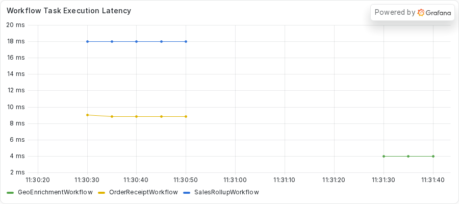

# Exercise 2: Sleeping between heartbeats in an async Activity

During this exercise, you will

- Run a polling Activity that heartbeats, and watch the server fail it on a Heartbeat timeout anyway
- Use the Worker log to see the failed attempt keep running
- Use `python -m asyncio ps` and `py-spy dump` to find the sleep that holds the event loop
- Write a test that counts heartbeats during one poll wait
- Replace the single sleep with awaited ticks, then verify the fix

Make your changes to the code in the `practice` subdirectory.
Look for the `TODO PART C` and `TODO PART D` comments, which mark where you make changes.
If you need a hint or want to verify your changes, look at the complete version in the `solution` subdirectory.

## Prerequisites

Finish the setup in the root [README](../../README.md#quickstart) first.
You need the `temporal` command, `uv`, and Python 3.14 or newer.
You also use `py-spy`, which the repository does not install.
You run it on demand with `uvx py-spy dump --pid <PID>`.

Part E compares a Grafana panel before and after the fix.
Start the dashboard stack once, from the repository root.

```sh
just metrics
```

Grafana serves the provisioned **Async Debug** dashboard at http://localhost:3000.
Start the dev server with `just server` so that Prometheus can read it on port 9465.
The Worker exports its own metrics on port 9464.

The practice copy here calls the public providers with the async `httpx.AsyncClient`, unlike Exercise 1.
Nothing in this exercise blocks on the network.

## Part A: Run the Workflow

Your team runs a service that looks up where a request came from.
Most lookups ask a public provider and return in well under a second.
One lookup path polls a slow job instead.
The `get_location` Activity checks the job, records a heartbeat, waits eight seconds, and checks again.
The job needs about 20 seconds to finish.

The Workflow gives that Activity a Heartbeat timeout of five seconds.
The Activity heartbeats before every wait, so you expect it to pass.
The same Worker also runs a `SalesRollupWorkflow` and an `OrderReceiptWorkflow`, which share nothing with the slow job.

Do not read the Activity code yet.
Part B asks you to find the cause from the outside.

1. Change to the `exercises/02-sleep-between-heartbeats/practice` directory.
2. Start the Worker.

   ```sh
   uv run python worker.py
   ```

   The Worker prints a banner with its PID.
   Keep this terminal open and note the PID.

3. Open another terminal in the same directory and submit the fleet.
   The `--bad 1` option sends one geo run to the slow job.

   ```sh
   uv run python starter.py --bad 1 --geo 1 --rollups 1 --receipts 2
   ```

   The command takes about 25 seconds to finish.

Here is what the starter printed in the capture for this exercise.

<!-- vale off -->
<!-- vale MasonBase.CodeLineLength = NO -->
```text
rollup rollup-e071744b-46fe-4f56-893c-36ffa679afd5 FAILED: Activity task timed out
geo geo-7d352b25-12cd-4078-ad00-32685d57a45d: GeoEnrichmentOutput(ip='256.256.256.256', location='Milky Way Galaxy')
receipt receipt-139a9639-7c45-47a7-b1b4-e9d6893e8200: OrderReceiptOutput(receipt='order order-0: 59.97 USD')
receipt receipt-bb24abb6-fcba-418c-8356-698d4fcacebb: OrderReceiptOutput(receipt='order order-1: 59.97 USD')
geo geo-49539f7f-fa16-459f-957e-2d5d755a5f80: GeoEnrichmentOutput(ip='256.256.256.256', location='Austin, Texas, United States')
```
<!-- vale MasonBase.CodeLineLength = YES -->
<!-- vale on -->

The rollup failed with `Activity task timed out`.
The geo run for the slow job finished, but only after a long wait.
The receipts also finished, and they do no I/O.
Run `temporal workflow show -w <receipt workflow ID>` for one of them.
The capture below holds the first eight Events of a receipt from the first run.
They cover the first Workflow Task and the first Activity.

<!-- vale off -->
<!-- vale MasonBase.CodeLineLength = NO -->
```text
Progress:
  ID           Time                     Type           
    1  2026-11-03T23:31:26Z  WorkflowExecutionStarted  
    2  2026-11-03T23:31:26Z  WorkflowTaskScheduled     
    3  2026-11-03T23:31:26Z  WorkflowTaskStarted       
    4  2026-11-03T23:31:36Z  WorkflowTaskTimedOut      
    5  2026-11-03T23:31:46Z  WorkflowTaskScheduled     
    6  2026-11-03T23:31:46Z  WorkflowTaskStarted       
    7  2026-11-03T23:31:49Z  WorkflowTaskCompleted     
    8  2026-11-03T23:31:49Z  ActivityTaskScheduled     
```
<!-- vale MasonBase.CodeLineLength = YES -->
<!-- vale on -->

The first Workflow Task started at 23:31:26.
At 23:31:36 the history shows `WorkflowTaskTimedOut`: the Worker never replied to that first task.
The next Workflow Task started at 23:31:46 and completed at 23:31:49.
So the receipt's first decision took about 23 seconds.
Treat the `WorkflowTaskTimedOut` event as a clue.
A receipt should not wait 23 seconds for anything, so something shared is holding the Worker.

## Part B: Diagnose the stall

You have two clues so far.
The server reports a Heartbeat timeout for an Activity that heartbeats, and unrelated Workflows stall.
You use the Python tooling to see what the Worker does, and then the Worker log and the dashboard.
Replace `<PID>` with the PID from the Worker banner.

### Step 1: Ask the server what happened

Run `temporal workflow describe -w <geo workflow ID>` while the slow job runs, about 9 seconds after you submit the fleet.
Use the ID of the geo run that takes the longest.
This is the pending Activity section from the capture.
The capture comes from a second run of the same fleet, so its IDs differ from the starter output shown earlier.

<!-- vale off -->
<!-- vale MasonBase.CodeLineLength = NO -->
```text
Pending Activities: 1

  ActivityId          2
  Type                get_location
  State               Scheduled
  Attempt             2
  MaximumAttempts     0
  ScheduledTime       1 second ago
  ExpirationTime      2 minutes from now
  LastFailure         {"message":"activity Heartbeat timeout","source":"Server","timeoutFailureInfo":{"timeoutType":"TIMEOUT_TYPE_HEARTBEAT"}}
  LastWorkerIdentity  2604231@host
```
<!-- vale MasonBase.CodeLineLength = YES -->
<!-- vale on -->

The server already failed the first attempt of `get_location` on a Heartbeat timeout.
Attempt 2 sits in the `Scheduled` state.
The Worker has not picked it up, even though attempt 1 ended seconds ago.
A Worker with a healthy loop picks up a scheduled Activity right away.

### Step 2: Read the task list

`python -m asyncio ps` reads the Worker memory from outside the process, so it answers during a freeze.
Run it from the repository root.

```sh
uv run python -m asyncio ps <PID>
```

This is the output about 10 seconds into the run.

<!-- vale off -->
<!-- vale MasonBase.CodeLineLength = NO -->
```text
tid        task id              task name            coroutine stack                                    awaiter chain                                      awaiter name    awaiter id     
------------------------------------------------------------------------------------------------------------------------------------------------------------------------------------
2604231    0x73dbf7af74d0       Task-1               Worker._run -> Worker.run -> main                                                                                     0x0            
2604231    0x73dbf7af7a70       Task-2               Event.wait -> Worker._run.<locals>.raise_on_shutdown _wait -> wait                                      Task-5          0x73dbf7a56350 
2604231    0x73dbf795af70       Task-3               _wait -> wait -> _ActivityWorker.run               _wait -> wait                                      Task-5          0x73dbf7a56350 
2604231    0x73dbf795aa00       Task-4               Worker.poll_workflow_activation -> _WorkflowWorker.run _wait -> wait                                      Task-5          0x73dbf7a56350 
2604231    0x73dbf7a56350       Task-5               _wait -> wait                                      Worker._run -> Worker.run -> main                  Task-1          0x73dbf7af74d0 
2604231    0x73dbf7a57a10       Task-6               Queue.get -> _ActivityWorker.run.<locals>.raise_from_exception_queue _wait -> wait -> _ActivityWorker.run               Task-3          0x73dbf795af70 
2604231    0x73dbf7993cd0       Task-18              sleep -> roll_up_sales -> _ActivityInboundImpl.execute_activity -> _ActivityWorker._execute_activity -> _ActivityWorker._handle_start_activity_task                                                                    0x0            
2604231    0x73dbf61805f0       Task-43              _ActivityWorker._handle_start_activity_task                                                                           0x0            
2604231    0x73dbf62dc500       Task-44              Worker.poll_activity_task                          _wait -> wait -> _ActivityWorker.run               Task-3          0x73dbf795af70 
2604231    0x73dbf7762210       Task-45              _ActivityWorker._heartbeat_async                                                                                      0x0            
```
<!-- vale MasonBase.CodeLineLength = YES -->
<!-- vale on -->

Look at Task-43.
Its stack ends at `_ActivityWorker._handle_start_activity_task` and nothing sits beneath it.
Task-18, the rollup, waits at `sleep`, as a healthy task does.
Task-45 is `_ActivityWorker._heartbeat_async`, and it also has nothing beneath it.
The SDK uses that task to send a heartbeat to the server.

The tool shows the shape, but it cannot name the line that blocks.

### Step 3: Name the line with py-spy

`py-spy dump` reads the operating system thread stack, so it sees what the main thread runs at that moment.

```sh
uvx py-spy dump --pid <PID>
```

This block keeps only the `MainThread` stack from the capture.

<!-- vale off -->
<!-- vale MasonBase.CodeLineLength = NO -->
```text
Process 2604231: /home/ziggy/temporal-async-debug/.venv/bin/python worker.py
Python v3.14.3 (/home/ziggy/.local/share/uv/python/cpython-3.14.3-linux-x86_64-gnu/bin/python3.14)

Thread 2604231 (idle): "MainThread"
    get_location (activities.py:187)
    _ActivityInboundImpl.execute_activity (temporalio/worker/_activity.py:889)
    _ActivityWorker._execute_activity (temporalio/worker/_activity.py:681)
    _ActivityWorker._handle_start_activity_task (temporalio/worker/_activity.py:351)
    Handle._run (asyncio/events.py:94)
    BaseEventLoop._run_once (asyncio/base_events.py:2046)
    BaseEventLoop.run_forever (asyncio/base_events.py:677)
    BaseEventLoop.run_until_complete (asyncio/base_events.py:706)
    Runner.run (asyncio/runners.py:127)
    run (asyncio/runners.py:204)
    <module> (worker.py:113)
```
<!-- vale MasonBase.CodeLineLength = YES -->
<!-- vale on -->

The top frame is `get_location` at `activities.py:187`.
No `httpx` frame sits on top of it, and no socket read.
The line at that number is the `time.sleep` call you meet in Part C.
The main thread runs the event loop, so the sleep holds the loop.

Check the CPU with `top -b -d 1 -n 2 -p <PID> | tail -8`.
The `-n 2` option makes `top` print two frames, so the second frame reports CPU over a real one-second interval.
This block keeps only the column header and the process row from the same moment.

<!-- vale off -->
<!-- vale MasonBase.CodeLineLength = NO -->
```text
    PID USER      PR  NI    VIRT    RES    SHR S  %CPU  %MEM     TIME+ COMMAND
2604231 ziggy     20   0  726204  77404  31660 S   0.0   0.5   0:00.77 python
```
<!-- vale MasonBase.CodeLineLength = YES -->
<!-- vale on -->

The Worker uses 0.0 percent of a CPU.
A frozen loop at near zero CPU points to a call that waits, and `time.sleep` waits.

### Step 4: Read the Worker log

The server failed attempt 1 about five seconds in.
Look at what the Worker still printed.
The Activity prints a line on every poll, with the attempt number.
This block keeps only the poll lines from the first run in the Worker log.

<!-- vale off -->
<!-- vale MasonBase.CodeLineLength = NO -->
```text
[attempt 1] poll 1: job 0s of 20s
[attempt 1] poll 2: job 8s of 20s
[attempt 1] poll 3: job 16s of 20s
[attempt 1] poll 4: job 20s of 20s
[attempt 2] poll 1: job 20s of 20s
```
<!-- vale MasonBase.CodeLineLength = YES -->
<!-- vale on -->

The first four lines come from attempt 1.
Poll 2 prints at job time 8 seconds and poll 3 at 16 seconds.
Both come after the server failed the attempt at about 5 seconds.
The attempt never stopped, so it ran to the end of the job as a zombie.
The last line comes from attempt 2, which starts after the loop thaws and finishes at once.

The SDK tried to cancel it and could not find it.
This block keeps only the two warning lines from the same log.

<!-- vale off -->
<!-- vale MasonBase.CodeLineLength = NO -->
```text
/home/ziggy/temporal-async-debug/.venv/lib/python3.14/site-packages/temporalio/worker/_activity.py:210: UserWarning: Cannot find activity to cancel for token b'\n$01a1a3af-4c64-79c6-a67e-a00f864b9a6b\x12(geo-49539f7f-fa16-459f-957e-2d5d755a5f80\x1a$01a1a3c0-d377-7a90-b56c-69c835aefbf7 \x0b(\x012\x012B\x0cget_locationJ\x08\x08\x01\x10\xbd\x99@\x18\x01'
  warnings.warn(f"Cannot find activity to cancel for token {task_token!r}")
```
<!-- vale MasonBase.CodeLineLength = YES -->
<!-- vale on -->

The SDK cancels an `async def` Activity with an asyncio cancel.
That cancel lands only at an await, and `time.sleep` is not an await.
The attempt ended only when the job did.

The text output of `temporal workflow show` lists no failure for this run, because a retried Activity writes no event for each failed attempt.
The JSON output keeps the trace.
Run `temporal workflow show -w <geo workflow ID> --output json` and look at the `ActivityTaskStarted` event for attempt 2.

<!-- vale off -->
<!-- vale MasonBase.CodeLineLength = NO -->
```text
      "eventId": "12",
      "eventTime": "2026-11-03T23:31:49.790169419Z",
      "eventType": "EVENT_TYPE_ACTIVITY_TASK_STARTED",
      "taskId": "1051895",
      "activityTaskStartedEventAttributes": {
        "scheduledEventId": "11",
        "identity": "2604231@host",
        "requestId": "85b070c8-ed2c-4009-8595-5e7f4e47a627",
        "attempt": 2,
        "lastFailure": {
          "message": "activity Heartbeat timeout",
          "source": "Server",
          "timeoutFailureInfo": {
            "timeoutType": "TIMEOUT_TYPE_HEARTBEAT"
```
<!-- vale MasonBase.CodeLineLength = YES -->
<!-- vale on -->

The capture stops after the first lines of that event.
The `lastFailure` field holds the Heartbeat timeout from attempt 1.

### Step 5: Check the dashboard

Open the **Async Debug** dashboard and find the panel named **Workflow Task Execution Latency**.
This is the fleet-wide view of what the tooling found.
It plots a 30-second rate average of Workflow Task time for each Workflow type.


The receipt and rollup lines jump to between 4 and 5 seconds in each of the two runs.
The panel averages over 30 seconds, so the real stall is longer.
Read the true length from `temporal workflow show`, as you did in Part A.

## Part C: Find the bug

Open `activities.py` in the `practice` directory and find the `TODO PART C` comment in `get_location`.

1. Find the loop under `if slow_job:`.
   It polls the job, then calls `activity.heartbeat()`, then calls `time.sleep(POLL_INTERVAL_SECONDS)`.
2. Read the comment that starts with `ANTIPATTERN (deliberate, for teaching)`.
3. Note that `get_location` is an `async def` Activity.

The call `activity.heartbeat()` does not block.
In an `async def` Activity, the SDK processes the heartbeat on the event loop, and that is the same loop that runs your Activity.
The call queues the heartbeat and returns.
The next line then calls `time.sleep` for eight seconds, which is longer than the five-second Heartbeat timeout.
The loop cannot run the queued heartbeat until the sleep ends, so the timeout fires first.

Two things follow from the same cause.
The server fails the attempt and schedules attempt 2, which waits because the loop is busy.
The cancel for attempt 1 cannot interrupt the sleep, so attempt 1 keeps polling.
The receipts and the rollup stall because they share the loop.

The fix keeps the Activity `async def` and gives the loop a chance to run between heartbeats.
Replace the one long sleep with short awaited waits.
A heartbeat then leaves the Worker on the next tick, and a cancel lands at the await.

## Part D: Write a test, then fix the bug

Write a test that fails for the right reason before you change the code.

1. From the `practice` directory, run the tests.

   ```sh
   uv run python -m pytest -o pythonpath="$PWD" tests
   ```

   One test fails on purpose.
   The stub carries a `TODO PART D` comment.
2. Open `tests/test_heartbeat.py` and read the comment in `test_a_poll_wait_heartbeats_and_does_not_starve_the_loop`.
   It describes the test you write.
   You shrink the timings in `activities.py` with `monkeypatch`, so one poll wait spans several ticks.
   You run `get_location` under `ActivityEnvironment` and count the calls to `on_heartbeat`.
   A probe coroutine beside it records a timestamp every 50 milliseconds.
   The test asserts at least two heartbeats, and no probe gap that reaches 0.2 seconds.
3. Write the test.
   If you need a hint, the finished version is in `solution/tests/test_heartbeat.py`.
4. Run the tests again.
   Your test fails while the Activity calls `time.sleep`, because the wait records one heartbeat and holds the loop.
5. Open `activities.py`.
   Replace the `time.sleep(POLL_INTERVAL_SECONDS)` line with a loop that works until the next poll is due.
   On each pass, call `activity.heartbeat()`, then `await asyncio.sleep(...)` for at most `TICK_SECONDS`.
   The `TICK_SECONDS` constant already exists in the file.
   You need `import asyncio` at the top.
   The loop in `solution/activities.py` shows one way to write it.
   Delete the `ANTIPATTERN` comment and the `TODO PART C` comment.
6. Run the tests a third time.
   They all pass.

## Part E: Redeploy and verify

Stop the old Worker with `CTRL+C`, then start it again from the `practice` directory.

```sh
uv run python worker.py
```

Submit the same fleet from your second terminal.

```sh
uv run python starter.py --bad 1 --geo 1 --rollups 1 --receipts 2
```

The captures in this part come from two runs of the same fleet, so Workflow IDs differ between them.
This is what the starter printed in the capture of the solution copy.
Every Workflow completes, and the rollup completes this time.

<!-- vale off -->
<!-- vale MasonBase.CodeLineLength = NO -->
```text
rollup rollup-d71cca00-3785-45d5-834c-15a5096c9b87: SalesRollupOutput(summary='Sales rollup for 2026-01: total 6030')
geo geo-d2a7b334-15f7-4e16-8efc-a64becbc1099: GeoEnrichmentOutput(ip='256.256.256.256', location='Milky Way Galaxy')
receipt receipt-bb3b1ee5-b78c-442d-a6c8-d1d087182dfe: OrderReceiptOutput(receipt='order order-0: 59.97 USD')
receipt receipt-2d67cebc-1f82-4738-9403-13d0eb868f26: OrderReceiptOutput(receipt='order order-1: 59.97 USD')
geo geo-edaf5b78-5cac-477f-b27c-1402e7531464: GeoEnrichmentOutput(ip='256.256.256.256', location='Austin, Texas, United States')
```
<!-- vale MasonBase.CodeLineLength = YES -->
<!-- vale on -->

Run `temporal workflow describe -w <geo workflow ID>` while the slow job runs.
This is the pending Activity section from the solution capture.

<!-- vale off -->
<!-- vale MasonBase.CodeLineLength = NO -->
```text
Pending Activities: 1

  ActivityId          2
  Type                get_location
  State               Started
  Attempt             1
  MaximumAttempts     0
  ScheduledTime       7 seconds ago
  LastStartedTime     7 seconds ago
  LastHeartbeatTime   3 seconds ago
  ExpirationTime      2 minutes from now
  LastWorkerIdentity  2615445@host
```
<!-- vale MasonBase.CodeLineLength = YES -->
<!-- vale on -->

The Activity sits in the `Started` state on attempt 1.
The server received a heartbeat, which the `LastHeartbeatTime` field shows.
Run the describe command with `--output json` a few times, about two seconds apart, and read `lastHeartbeatTime` each time.
These reads and the Event History below come from a second run of the same fleet, so the IDs differ from the starter output.
These are four of those reads from the capture.
The first column is the local time of the read.

<!-- vale off -->
<!-- vale MasonBase.CodeLineLength = NO -->
```text
2026-11-03T17:35:44.574240-06:00 get_location PENDING_ACTIVITY_STATE_STARTED attempt 1 lastHeartbeatTime 2026-11-03T23:35:41.618685233Z
2026-11-03T17:35:46.735430-06:00 get_location PENDING_ACTIVITY_STATE_STARTED attempt 1 lastHeartbeatTime 2026-11-03T23:35:45.620381649Z
2026-11-03T17:35:48.895741-06:00 get_location PENDING_ACTIVITY_STATE_STARTED attempt 1 lastHeartbeatTime 2026-11-03T23:35:45.620381649Z
2026-11-03T17:35:51.088889-06:00 get_location PENDING_ACTIVITY_STATE_STARTED attempt 1 lastHeartbeatTime 2026-11-03T23:35:49.621124742Z
```
<!-- vale MasonBase.CodeLineLength = YES -->
<!-- vale on -->

The Activity heartbeats every second, but the heartbeat time on the server advances about every four seconds.
The Worker throttles outgoing heartbeats against the Heartbeat timeout.
That is still far inside the five-second limit.

Now look at the Event History of the geo run with `temporal workflow show -w <geo workflow ID>`.

<!-- vale off -->
<!-- vale MasonBase.CodeLineLength = NO -->
```text
Progress:
  ID           Time                     Type           
    1  2026-11-03T23:35:37Z  WorkflowExecutionStarted  
    2  2026-11-03T23:35:37Z  WorkflowTaskScheduled     
    3  2026-11-03T23:35:37Z  WorkflowTaskStarted       
    4  2026-11-03T23:35:37Z  WorkflowTaskCompleted     
    5  2026-11-03T23:35:37Z  ActivityTaskScheduled     
    6  2026-11-03T23:35:37Z  ActivityTaskStarted       
    7  2026-11-03T23:35:37Z  ActivityTaskCompleted     
    8  2026-11-03T23:35:37Z  WorkflowTaskScheduled     
    9  2026-11-03T23:35:37Z  WorkflowTaskStarted       
   10  2026-11-03T23:35:37Z  WorkflowTaskCompleted     
   11  2026-11-03T23:35:37Z  ActivityTaskScheduled     
   12  2026-11-03T23:35:37Z  ActivityTaskStarted       
   13  2026-11-03T23:36:01Z  ActivityTaskCompleted     
   14  2026-11-03T23:36:01Z  WorkflowTaskScheduled     
   15  2026-11-03T23:36:01Z  WorkflowTaskStarted       
   16  2026-11-03T23:36:01Z  WorkflowTaskCompleted     
   17  2026-11-03T23:36:01Z  WorkflowExecutionCompleted

Results:
  Status          COMPLETED
  Result          {"ip":"256.256.256.256","location":"Austin, Texas, United States"}
  ResultEncoding  json/plain
```
<!-- vale MasonBase.CodeLineLength = YES -->
<!-- vale on -->

The `get_location` Activity (events 11 to 13) has one `ActivityTaskStarted` event and one `ActivityTaskCompleted` event.
It started at 23:35:37 and completed at 23:36:01.
No timeout and no second attempt appear.

Run `py-spy dump` again while the job runs.
This block keeps only the `MainThread` stack from the capture.

<!-- vale off -->
<!-- vale MasonBase.CodeLineLength = NO -->
```text
Process 2615445: /home/ziggy/temporal-async-debug/.venv/bin/python worker.py
Python v3.14.3 (/home/ziggy/.local/share/uv/python/cpython-3.14.3-linux-x86_64-gnu/bin/python3.14)

Thread 2615445 (idle): "MainThread"
    EpollSelector.select (selectors.py:452)
    BaseEventLoop._run_once (asyncio/base_events.py:2008)
    BaseEventLoop.run_forever (asyncio/base_events.py:677)
    BaseEventLoop.run_until_complete (asyncio/base_events.py:706)
    Runner.run (asyncio/runners.py:127)
    run (asyncio/runners.py:204)
    <module> (worker.py:113)
```
<!-- vale MasonBase.CodeLineLength = YES -->
<!-- vale on -->

The `MainThread` sits in `EpollSelector.select`, which is a healthy loop waiting for work.
The solution Worker log shows each poll once.
This block keeps only the four poll lines from the first run.

<!-- vale off -->
<!-- vale MasonBase.CodeLineLength = NO -->
```text
[attempt 1] poll 1: job 0s of 20s
[attempt 1] poll 2: job 8s of 20s
[attempt 1] poll 3: job 16s of 20s
[attempt 1] poll 4: job 20s of 20s
```
<!-- vale MasonBase.CodeLineLength = YES -->
<!-- vale on -->

All four poll lines come from attempt 1, and the job finishes at poll 4.

The receipts in the solution capture finish in about 3.3 seconds.
The first Workflow Task of each takes 11 to 17 milliseconds, and `validate_order` waits about 3.2 seconds for an Activity slot.
The rollup holds one of the two slots for its five-second pause, so a receipt waits for a slot.
That is a wait for a free slot and does not freeze the loop.

Last, look at the **Workflow Task Execution Latency** panel again.



Every line stays between 3 and 6 milliseconds.
The scale on the left changed from seconds to milliseconds.

## Conclusion

You replaced one blocking sleep with a loop of awaited ticks.
Each tick gives the event loop a turn.
The heartbeat reaches the server, a cancel can land, and the receipts and the rollup keep running.
The Activity still polls the job on the same schedule.

Exercise 3 blocks the loop with a calculation instead of a sleep.

### This is the end of the exercise.
