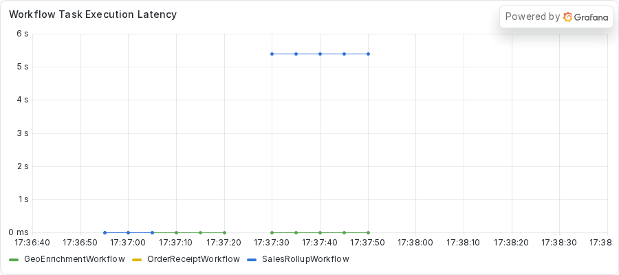
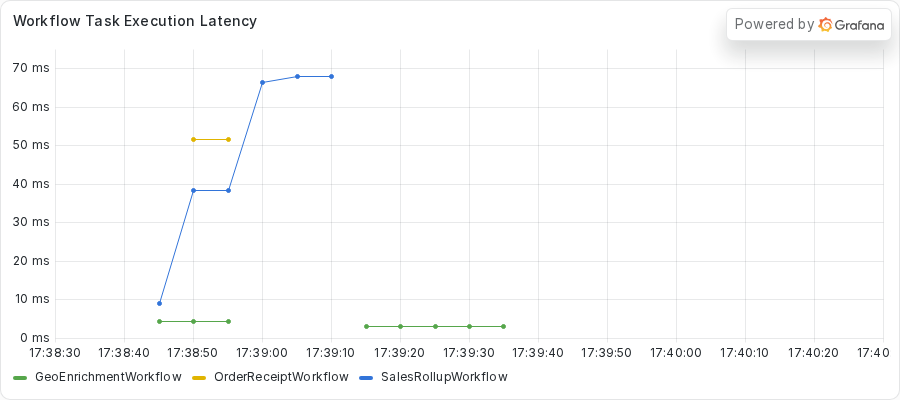

# Exercise 3: Moving CPU-bound work off the event loop

During this exercise, you will

- Run a fleet where one Activity does a long calculation and the other Workflows stall
- Use `python -m asyncio ps` and `py-spy dump` to find the calculation that holds the event loop
- Read the CPU of the Worker and compare it with a frozen loop that waits
- Write a test that fails while the calculation holds the loop
- Move the calculation to a thread, then see what that does and does not buy you

Parts A to D run one Worker with two Activity slots on purpose, as teaching code, so the failure is loud.
Part E adds a second Worker process.
To see the same bug on a fleet of Workers, read [Exercise 6](../06-finding-the-frozen-worker/README.md).

Make your changes to the code in the `practice` subdirectory.
Look for the `TODO PART C` and `TODO PART D` comments, which mark where you make changes.
If you need a hint or want to verify your changes, look at the complete version in the `solution` subdirectory.

## Prerequisites

Finish the setup in the root [README](../../README.md#quickstart) first.
You need the `temporal` command, `uv`, and Python 3.14 or newer.
You also use `py-spy`, which the repository does not install.
You run it on demand with `uvx py-spy dump --pid <PID>`.

Part E compares a Grafana panel before and after the fix.
Start the dashboard stack once, from the repository root.

```sh
just metrics
```

Grafana serves the provisioned **Async Debug** dashboard at http://localhost:3000.
Start the dev server with `just server` so that Prometheus can read it on port 9465.
The Worker exports its own metrics on port 9464.

The practice copy here calls the public providers with the async `httpx.AsyncClient`, unlike Exercise 1.
The HTTP call does not block.
The calculation that follows it does.

## Part A: Run the Workflow

Your team runs a service that looks up where a request came from.
The `get_location` Activity asks a public provider for the location and then tags the result with a short digest.
The digest comes from hashing the location text again and again in a loop.
Most lookups use a small number of rounds, and the tag takes a moment.
One run in the fleet asks for a far larger number of rounds.

The same Worker also runs a `SalesRollupWorkflow` and an `OrderReceiptWorkflow`.
Neither one hashes anything.

Do not read the Activity code yet.
Part B asks you to find the cause from the outside.

1. Change to the `exercises/03-cpu-bound/practice` directory.
2. Start the Worker.

   ```sh
   uv run python worker.py
   ```

   The Worker prints a banner with its PID.
   Keep this terminal open and note the PID.

3. Open another terminal in the same directory and submit the fleet.
   The `--bad 1` option gives one geo run the large hashing job.

   ```sh
   uv run python starter.py --bad 1 --geo 1 --rollups 1 --receipts 2
   ```

   The large job takes about 25 to 30 seconds on the machine that made the capture.
   The time scales with the speed of your CPU, so yours can differ.

Here is what the starter printed in the capture for this exercise.
In the capture, `<repo>`, `<home>`, `host`, `<ip>`, and `<city>` replace the paths, hostname, address, and city that appear in your own output.

<!-- vale off -->
<!-- vale MasonBase.CodeLineLength = NO -->
```text
rollup rollup-a318bbd3-dd9e-424b-9d12-4ed37772c0d2 FAILED: Activity task timed out
geo geo-1073bc5c-7691-420c-a02d-bb2935006248: GeoEnrichmentOutput(ip='<ip>', location='<city> (80bb60a0)')
receipt receipt-badf2910-5ee2-4b0f-a118-ac2433029c1d: OrderReceiptOutput(receipt='order order-0: 59.97 USD')
receipt receipt-aad5961f-e57e-4096-93c7-aab6789bc56f: OrderReceiptOutput(receipt='order order-1: 59.97 USD')
geo geo-66bccc79-42f1-4c89-8040-50b1d269399f: GeoEnrichmentOutput(ip='<ip>', location='<city> (0a547457)')
```
<!-- vale MasonBase.CodeLineLength = YES -->
<!-- vale on -->

The rollup failed with `Activity task timed out`.
The receipts completed.
Run `temporal workflow show -w <receipt workflow ID>` for one of them.
The capture below holds the first eight Events of a receipt.

<!-- vale off -->
<!-- vale MasonBase.CodeLineLength = NO -->
```text
Progress:
  ID           Time                     Type           
    1  2026-11-03T23:36:52Z  WorkflowExecutionStarted  
    2  2026-11-03T23:36:52Z  WorkflowTaskScheduled     
    3  2026-11-03T23:36:52Z  WorkflowTaskStarted       
    4  2026-11-03T23:37:02Z  WorkflowTaskTimedOut      
    5  2026-11-03T23:37:12Z  WorkflowTaskScheduled     
    6  2026-11-03T23:37:12Z  WorkflowTaskStarted       
    7  2026-11-03T23:37:21Z  WorkflowTaskCompleted     
    8  2026-11-03T23:37:21Z  ActivityTaskScheduled     
```
<!-- vale MasonBase.CodeLineLength = YES -->
<!-- vale on -->

The first Workflow Task started at 23:36:52.
At 23:37:02 the history shows `WorkflowTaskTimedOut`.
The Worker never replied to that first task.
The next Workflow Task started at 23:37:12 and completed at 23:37:21.
So the receipt's first decision took about 29 seconds.
Treat the `WorkflowTaskTimedOut` event as a clue.
A receipt does no hashing and no I/O, so a 29-second stall needs an explanation.

The rollup says the same thing.
Run `temporal workflow show -w <rollup workflow ID>` and read the end of the output.

<!-- vale off -->
<!-- vale MasonBase.CodeLineLength = NO -->
```text
Results:
  Status   FAILED
  Failure  
    Message: Activity task timed out
    Cause:
        Message: activity ScheduleToClose timeout
        Cause:
            Message: activity StartToClose timeout
```
<!-- vale MasonBase.CodeLineLength = YES -->
<!-- vale on -->

## Part B: Diagnose the stall

If you want the short list of symptoms first, read [Recognizing a blocked event loop](../../README.md#recognizing-a-blocked-event-loop) in the root README.

You have a stalled Worker and no cause you can see.
The first steps match Exercise 1, and one extra reading tells the two causes apart.
Replace `<PID>` with the PID from the Worker banner.
Run the commands about 10 seconds after you submit the fleet.

### Step 1: Read the task list

`python -m asyncio ps` reads the Worker memory from outside the process, so it answers during a freeze.
Run it from the repository root.

```sh
uv run python -m asyncio ps <PID>
```

<!-- vale off -->
<!-- vale MasonBase.CodeLineLength = NO -->
```text
tid        task id              task name            coroutine stack                                    awaiter chain                                      awaiter name    awaiter id     
------------------------------------------------------------------------------------------------------------------------------------------------------------------------------------
2622375    0x7d1bac31b2f0       Task-1               Worker._run -> Worker.run -> main                                                                                     0x0            
2622375    0x7d1bac31be30       Task-2               Event.wait -> Worker._run.<locals>.raise_on_shutdown _wait -> wait                                      Task-5          0x7d1bac45fa10 
2622375    0x7d1bac34f140       Task-3               _wait -> wait -> _ActivityWorker.run               _wait -> wait                                      Task-5          0x7d1bac45fa10 
2622375    0x7d1bac34ebd0       Task-4               Worker.poll_workflow_activation -> _WorkflowWorker.run _wait -> wait                                      Task-5          0x7d1bac45fa10 
2622375    0x7d1bac45fa10       Task-5               _wait -> wait                                      Worker._run -> Worker.run -> main                  Task-1          0x7d1bac31b2f0 
2622375    0x7d1bac45d550       Task-6               Queue.get -> _ActivityWorker.run.<locals>.raise_from_exception_queue _wait -> wait -> _ActivityWorker.run               Task-3          0x7d1bac34f140 
2622375    0x7d1baa994050       Task-20              sleep -> roll_up_sales -> _ActivityInboundImpl.execute_activity -> _ActivityWorker._execute_activity -> _ActivityWorker._handle_start_activity_task                                                                    0x0            
2622375    0x7d1bac1674d0       Task-43              _ActivityWorker._handle_start_activity_task                                                                           0x0            
2622375    0x7d1bac1672f0       Task-44              Worker.poll_activity_task                          _wait -> wait -> _ActivityWorker.run               Task-3          0x7d1bac34f140 
```
<!-- vale MasonBase.CodeLineLength = YES -->
<!-- vale on -->

Task-43 ends at `_ActivityWorker._handle_start_activity_task` with nothing beneath it.
Task-20, the rollup, waits at `sleep`.
The shape matches a frozen loop, but the tool cannot name the line.

### Step 2: Name the line with py-spy

```sh
uvx py-spy dump --pid <PID>
```

This block comes from a later capture of the practice copy, so its PID differs from the `asyncio ps` block.
It keeps only the `MainThread` stack.

<!-- vale off -->
<!-- vale MasonBase.CodeLineLength = NO -->
```text
Process 3333484: <repo>/.venv/bin/python worker.py
Python v3.14.3 (<home>/.local/share/uv/python/cpython-3.14.3-linux-x86_64-gnu/bin/python3.14)

Thread 3333484 (active+gil): "MainThread"
    _stretch_digest (activities.py:119)
    get_location (activities.py:178)
    _ActivityInboundImpl.execute_activity (temporalio/worker/_activity.py:889)
    _ActivityWorker._execute_activity (temporalio/worker/_activity.py:681)
    _ActivityWorker._handle_start_activity_task (temporalio/worker/_activity.py:351)
    Handle._run (asyncio/events.py:94)
    BaseEventLoop._run_once (asyncio/base_events.py:2046)
    BaseEventLoop.run_forever (asyncio/base_events.py:677)
    BaseEventLoop.run_until_complete (asyncio/base_events.py:706)
    Runner.run (asyncio/runners.py:127)
    run (asyncio/runners.py:204)
    <module> (worker.py:166)
```
<!-- vale MasonBase.CodeLineLength = YES -->
<!-- vale on -->

The top frame is `_stretch_digest` at `activities.py:119`, called by `get_location` at `activities.py:178`.
The `worker.py` line in your own dump depends on your edits, so it can differ from the capture.
The `MainThread` runs the event loop, so the hashing holds the loop.
Look at the state in the first line of the thread.
It says `active+gil`, where a waiting thread says `idle`.
The thread runs, and it holds the GIL.

### Step 3: Read the CPU

This is the reading that separates this exercise from Exercise 1.
Run `top` for the Worker PID, once when the Worker is idle and once during the freeze.

```sh
top -b -d 1 -n 2 -p <PID> | tail -8
```

The `-n 2` option makes `top` print two frames, so the second frame reports CPU over a real one-second interval.
Each block below keeps only the column header and the process row.
This is the idle reading from the capture.

<!-- vale off -->
<!-- vale MasonBase.CodeLineLength = NO -->
```text
    PID USER      PR  NI    VIRT    RES    SHR S  %CPU  %MEM     TIME+ COMMAND
2622375 ziggy     20   0  572496  65856  27116 S   0.0   0.4   0:00.55 python
```
<!-- vale MasonBase.CodeLineLength = YES -->
<!-- vale on -->

This is the reading about 9 seconds into the run, from the same later capture as the `py-spy` block.

<!-- vale off -->
<!-- vale MasonBase.CodeLineLength = NO -->
```text
    PID USER      PR  NI    VIRT    RES    SHR S  %CPU  %MEM     TIME+ COMMAND
3333484 ziggy     25   5  794556  78580  31964 R  90.9   0.5   0:08.33 python
```
<!-- vale MasonBase.CodeLineLength = YES -->
<!-- vale on -->

The state column changed from `S` to `R`, and the CPU went from 0.0 to 90.9 percent.
In Exercise 1 the frozen loop read 0.0 percent, because the Worker waited on a socket.
Here the Worker computes.
Both freezes look the same in `asyncio ps`, and the CPU number tells them apart.

The reading of 90.9 percent also tells you the process uses one core.
The loop thread holds the GIL, so adding threads inside this process cannot add CPU.

### Step 4: Check the dashboard

Open the dashboard at http://localhost:3000 and find the panel named **Workflow Task Execution Latency**.
This panel is the fleet-wide view of what the tooling found.



The rollup line jumps to about 5.4 seconds while the geo line stays near zero.
The panel averages over 30 seconds, so a 29-second stall reads as about 5 seconds.
Read the true length from `temporal workflow show`, as you did in Part A.

## Part C: Find the bug

Open `activities.py` in the `practice` directory and find the two `TODO PART C` comments.

1. Find `_stretch_digest`.
   It feeds a digest back into `hashlib.sha256` once per round.
   This is the CPU-bound work, and its length depends on `rounds`.
2. Find `get_location`.
   The function is an `async def` Activity, and it calls `_stretch_digest` directly.
3. Find the comment that starts with `ANTIPATTERN (deliberate, for teaching)`.
   It sits on the line before the call that `py-spy` named.

An `async def` Activity runs on the event loop.
A long pure-Python loop never reaches an await, so it holds the loop and the GIL for as long as it runs.
The same fix as Exercise 1 applies.
A plain `def` Activity runs on the Worker `activity_executor`, a pool of threads, so the loop thread stays free.

Because the Activity becomes a `def`, the HTTP client inside it has to change too.
A plain function cannot use `await`, so the second `TODO PART C` comment points at the client.
You switch from the async `httpx.AsyncClient` to the sync `httpx.Client`.

## Part D: Write a test, then fix the bug

Write a test that fails for the right reason before you change the code.

1. From the `practice` directory, run the tests.

   ```sh
   uv run python -m pytest -o pythonpath="$PWD" tests
   ```

   One test fails on purpose.
   The stub carries a `TODO PART D` comment.
2. Open `tests/test_probe.py` and read the comment in `test_get_location_does_not_starve_the_event_loop`.
   It describes the test you write.
   You pick a work size that hashes for about a second on your machine.
   You run `get_location` the way the Worker does, beside a small coroutine that records a timestamp every 50 milliseconds.
   The test asserts that no gap between ticks reaches 0.2 seconds.
3. Write the test.
   If you need a hint, the finished version is in `solution/tests/test_probe.py`.
4. Run the tests again.
   Your test fails while `get_location` is an `async def`, because the hashing holds the loop.
   The gap between two ticks is about as long as the hashing.
   If you copy the hinted test from `solution/tests/test_probe.py`, it stops earlier, at `assert isinstance(executor, ThreadPoolExecutor)`.
   The practice `build_worker` passes no `activity_executor` yet, so the hinted test fails on that line before the probe runs.
   Both failures point at the same fix.
5. Open `activities.py`.
   Remove the `async` keyword from `get_location`.
   Change the `async with httpx.AsyncClient(...)` line to `with httpx.Client(...)`, and remove the `await` before `client.get`.
   Delete the `ANTIPATTERN` comment and the `TODO PART C` comments.
6. Open `worker.py` and find the `TODO PART D` comment in `build_worker`.
   Pass the Worker an `activity_executor` that is a `ThreadPoolExecutor` with `max_workers` equal to `MAX_CONCURRENT_ACTIVITIES`.
   Add the import that line needs at the top of the file.
7. Run the tests a third time.
   They all pass.

## Part E: Redeploy and verify

Stop the old Worker with `CTRL+C`, then start it again from the `practice` directory.

```sh
uv run python worker.py
```

Submit the same fleet from your second terminal.

```sh
uv run python starter.py --bad 1 --geo 1 --rollups 1 --receipts 2
```

This is what the starter printed in the capture of the solution copy.
Every Workflow completes, including the rollup.

<!-- vale off -->
<!-- vale MasonBase.CodeLineLength = NO -->
```text
rollup rollup-19d1e4e0-0586-4e89-bf67-6250a044f00d: SalesRollupOutput(summary='Sales rollup for 2026-01: total 6030')
geo geo-2c45a01b-eb0c-48fa-aa32-50c3737f09d0: GeoEnrichmentOutput(ip='<ip>', location='<city> (80bb60a0)')
receipt receipt-a95a7bcd-eb87-4a25-a704-8670153f629f: OrderReceiptOutput(receipt='order order-0: 59.97 USD')
receipt receipt-d79f1c1a-58a6-40e9-9851-6d6b280b06f3: OrderReceiptOutput(receipt='order order-1: 59.97 USD')
geo geo-6f151c04-4113-47fb-83be-842fed0df268: GeoEnrichmentOutput(ip='<ip>', location='<city> (0a547457)')
```
<!-- vale MasonBase.CodeLineLength = YES -->
<!-- vale on -->

Run `py-spy` again during the job.

```sh
uvx py-spy dump --pid <PID>
```

This block comes from a later capture of the solution copy, and it keeps only the `MainThread` stack.

<!-- vale off -->
<!-- vale MasonBase.CodeLineLength = NO -->
```text
Process 3336556: <repo>/.venv/bin/python worker.py
Python v3.14.3 (<home>/.local/share/uv/python/cpython-3.14.3-linux-x86_64-gnu/bin/python3.14)

Thread 3336556 (idle): "MainThread"
    EpollSelector.select (selectors.py:452)
    BaseEventLoop._run_once (asyncio/base_events.py:2008)
    BaseEventLoop.run_forever (asyncio/base_events.py:677)
    BaseEventLoop.run_until_complete (asyncio/base_events.py:706)
    Runner.run (asyncio/runners.py:127)
    run (asyncio/runners.py:204)
    <module> (worker.py:168)
```
<!-- vale MasonBase.CodeLineLength = YES -->
<!-- vale on -->

The `MainThread` sits in `EpollSelector.select`, which is a healthy loop waiting for work.
The next block keeps only the stack of the thread that does the hashing, from the same capture.

<!-- vale off -->
<!-- vale MasonBase.CodeLineLength = NO -->
```text
Thread 3336912 (active+gil): "ThreadPoolExecutor-0_0"
    _stretch_digest (activities.py:120)
    get_location (activities.py:173)
    _execute_sync_activity (temporalio/worker/_activity.py:951)
    WorkerContext.run (concurrent/futures/thread.py:73)
    _WorkItem.run (concurrent/futures/thread.py:86)
    _worker (concurrent/futures/thread.py:119)
    Thread.run (threading.py:1024)
    Thread._bootstrap_inner (threading.py:1082)
    Thread._bootstrap (threading.py:1044)
```
<!-- vale MasonBase.CodeLineLength = YES -->
<!-- vale on -->

The hashing now runs on `ThreadPoolExecutor-0_0`, and its state is `active+gil`.
Run `top` again.
The block keeps only the column header and the process row, from that same later capture.

<!-- vale off -->
<!-- vale MasonBase.CodeLineLength = NO -->
```text
    PID USER      PR  NI    VIRT    RES    SHR S  %CPU  %MEM     TIME+ COMMAND
3336556 ziggy     25   5 1008240  79592  32068 S 100.0   0.5   0:08.25 python
```
<!-- vale MasonBase.CodeLineLength = YES -->
<!-- vale on -->

The CPU still reads 100.0 percent.
Moving the work to a thread did not make it cheaper.
The pool thread still holds the GIL while it hashes.
The difference is that the event loop gets its turns, so the Worker keeps serving everything else.

The receipts show what that means.
The repository ships a helper that reads each receipt's Event History and prints the Workflow Task time and the Activity waits.
Run it from the repository root with the receipt Workflow IDs from your run.

```sh
just receipt-gaps <receipt workflow ID> <receipt workflow ID>
```

This block comes from an earlier script with the same output format, run on the two receipts in the solution capture.
The capture predates the commit of `scripts/receipt_gaps.py`, so `just receipt-gaps` did not print it.
The helper you run prints the same columns.

<!-- vale off -->
<!-- vale MasonBase.CodeLineLength = NO -->
```text
receipt-a95a7bcd total 3559ms | WT1 started->completed 79ms | validate_order: sched->started 3194ms started->completed 21ms | compute_total: sched->started 4ms started->completed 23ms | format_receipt: sched->started 5ms started->completed 13ms
receipt-d79f1c1a total 3450ms | WT1 started->completed 110ms | validate_order: sched->started 3077ms started->completed 39ms | compute_total: sched->started 4ms started->completed 29ms | format_receipt: sched->started 20ms started->completed 30ms
```
<!-- vale MasonBase.CodeLineLength = YES -->
<!-- vale on -->

One receipt has a first Workflow Task of 79 milliseconds, and the other has 110.
That is long next to the 15 milliseconds in Exercise 1, because the thread that hashes competes with the loop thread for the GIL.
The loop is live, but the GIL is not free.
The receipts total about 3.5 seconds.
Most of that is a wait of about 3 seconds for an Activity slot behind the rollup pause.
That wait is slot occupancy and does not freeze the loop.

Last, look at the **Workflow Task Execution Latency** panel again.



The rollup line peaks near 68 milliseconds and the receipt line near 52 milliseconds.
That is milliseconds, where the practice panel showed seconds.
The small rise is the GIL contention you read in the receipts.

### Isolate the GIL with a second Worker process

The thread pool gave the event loop its turns, but it left one problem unsolved.
The pool thread still holds the GIL while it computes, so the loop is free and the process gains no CPU parallelism.
Each Worker process has its own GIL, so a second Worker process is how two calculations run at the same time.
This step shows the limit with one Worker, then lifts it with two.
The figures below come from two captures, one per step, and they depend on your CPU and on what else your machine runs.

Start with the first Worker alone, still running on port 9464, and submit two bad runs.
The two runs fill its two Activity slots.
This step does not run four bad runs on one Worker, because the third and fourth would wait for one of the two slots.

```sh
uv run python starter.py --bad 2 --geo 0 --rollups 0 --receipts 0
```

This block keeps the column header and the process row of one `top` reading, taken about 18 seconds into the run.

<!-- vale off -->
<!-- vale MasonBase.CodeLineLength = NO -->
```text
    PID USER      PR  NI    VIRT    RES    SHR S  %CPU  %MEM     TIME+ COMMAND
3317601 ziggy     25   5  940688  78344  31648 S  63.6   0.5   0:17.05 python
```
<!-- vale MasonBase.CodeLineLength = YES -->
<!-- vale on -->

This second block is the `temporal workflow describe` output for both runs at 10 seconds.
It keeps each run's Workflow ID and the identity of the Worker that held `get_location`.

<!-- vale off -->
<!-- vale MasonBase.CodeLineLength = NO -->
```text
  WorkflowId            geo-95fdc2b6-3a45-4014-8090-9bb564103d58
  LastWorkerIdentity  3317601@host
  WorkflowId            geo-a2262afb-a596-4f1d-a5e3-253ae6e734c8
  LastWorkerIdentity  3317601@host
```
<!-- vale MasonBase.CodeLineLength = YES -->
<!-- vale on -->

This third block keeps only the placement line of the summary the capture computed over the run histories.

<!-- vale off -->
<!-- vale MasonBase.CodeLineLength = NO -->
```text
get_location placement: {'3317601@host': 2} total 2
```
<!-- vale MasonBase.CodeLineLength = YES -->
<!-- vale on -->

In this capture, both `get_location` Activities ran on the one Worker.
Both runs completed on attempt 1, and they took 84.47 and 84.43 seconds.
The `top` readings at 10, 18, and 28 seconds were 81.8, 63.6, and 41.7 percent, all in state `S`.
The two pool threads share the one GIL, so the process had no second core to use.

Now add the second Worker.
In a third terminal, in the `solution` directory, start it on port 9466.
The shipped `solution/worker.py` reads its Prometheus port from `ASYNC_DEBUG_METRICS_PORT`, so the copy needs no edit.

```sh
ASYNC_DEBUG_METRICS_PORT=9466 uv run python worker.py
```

Both Workers poll the same Task Queue, and each prints its own PID in the banner.
Both Workers started fresh for the two-Worker capture.
The first Worker (port 9464) is PID 3325381 and the second Worker (port 9466) is PID 3325443.
Each Worker keeps the shipped two Activity slots, so four bad runs fill all four slots.

```sh
uv run python starter.py --bad 4 --geo 0 --rollups 0 --receipts 0
```

This block keeps the column header and the two process rows of one `top` reading, taken about 18 seconds into the run.

<!-- vale off -->
<!-- vale MasonBase.CodeLineLength = NO -->
```text
    PID USER      PR  NI    VIRT    RES    SHR S  %CPU  %MEM     TIME+ COMMAND
3325381 ziggy     25   5  873096  78720  31864 S 100.0   0.5   0:16.27 python
3325443 ziggy     25   5  873032  78876  31864 S  90.0   0.5   0:15.58 python
```
<!-- vale MasonBase.CodeLineLength = YES -->
<!-- vale on -->

This second block is the `temporal workflow describe` output for the four runs at 10 seconds, keeping each run's Workflow ID and Worker identity.

<!-- vale off -->
<!-- vale MasonBase.CodeLineLength = NO -->
```text
  WorkflowId            geo-4e46e054-ed2d-4d21-b99f-82d84b341aa3
  LastWorkerIdentity  3325443@host
  WorkflowId            geo-a5cb13a2-4e53-4b3a-a658-b8a383b98358
  LastWorkerIdentity  3325443@host
  WorkflowId            geo-ebb2cfae-932f-4f42-9354-29079c77e388
  LastWorkerIdentity  3325381@host
  WorkflowId            geo-f619a218-fe74-415c-a69c-9e9d74b8e412
  LastWorkerIdentity  3325381@host
```
<!-- vale MasonBase.CodeLineLength = YES -->
<!-- vale on -->

This third block keeps only the placement line of the summary the capture computed over the run histories.

<!-- vale off -->
<!-- vale MasonBase.CodeLineLength = NO -->
```text
get_location placement: {'3325443@host': 2, '3325381@host': 2} total 4
```
<!-- vale MasonBase.CodeLineLength = YES -->
<!-- vale on -->

In this capture, `get_location` ran twice on each Worker.
Your own placement can differ, so read the identities from your own `temporal workflow describe` output.
All four runs completed on attempt 1, and they took 84.41, 84.43, 86.97, and 86.38 seconds.
The `top` readings at 10, 18, and 28 seconds were 90.9, 100.0, and 80.0 percent for the first Worker.
The second Worker read 81.8, 90.0, and 80.0 percent.

In these captures, four bad runs on two Worker processes took about as long as two bad runs on one Worker.
Each process brings its own GIL, so the second Worker added CPU that the first Worker could not give.

## Conclusion

You moved a CPU-bound calculation off the event loop with a small change.
You made `get_location` a plain `def`, switched its HTTP client to the sync one, and gave the Worker a thread pool.
The loop stays live, but the hashing still holds the GIL, so one process still tops out at one core.
When you need more CPU, you add Worker processes, because each process has its own GIL.

Exercise 4 looks at a fix that seems right and runs the work twice.

### This is the end of the exercise.
