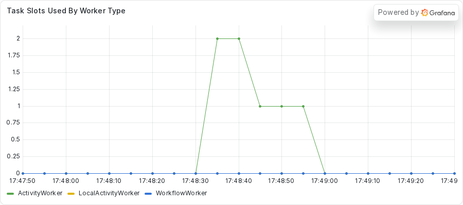
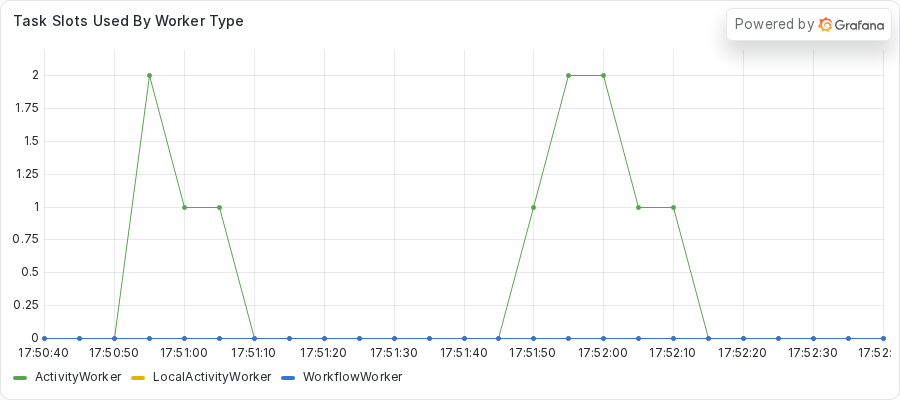

# Exercise 4: Stopping work that outlives its Activity attempt

During this exercise, you will

- Run a fleet where the Activity already moves its blocking work off the event loop, and see why it still fails
- Use the Worker log to watch one attempt keep working after the server failed it
- Use `py-spy dump` to find the orphaned threads
- Write tests that check a cancel stops the work and that the thread pool matches the Worker
- Run the work on the Worker thread pool and heartbeat from that thread, then verify the fix

Make your changes to the code in the `practice` subdirectory.
Look for the `TODO PART C` and `TODO PART D` comments, which mark where you make changes.
If you need a hint or want to verify your changes, look at the complete version in the `solution` subdirectory.

## Prerequisites

Finish the setup in the root [README](../../README.md#quickstart) first.
You need the `temporal` command, `uv`, and Python 3.14 or newer.
You also use `py-spy`, which the repository does not install.
You run it on demand with `uvx py-spy dump --pid <PID>`.

Part E compares a Grafana panel before and after the fix.
Start the dashboard stack once, from the repository root.

```sh
just metrics
```

Grafana serves the provisioned **Async Debug** dashboard at http://localhost:3000.
Start the dev server with `just server` so that Prometheus can read it on port 9465.
The Worker exports its own metrics on port 9464.

The practice copy here calls the public providers with the async `httpx.AsyncClient`, unlike Exercise 1.
The HTTP calls do not block.
The work that does block is a loop of short sleeps, and the practice copy already hands that loop to a thread.

## Part A: Run the Workflow

Your team had a freeze like the one in Exercise 1.
A teammate fixed it by moving the blocking work into `asyncio.to_thread`.
The blocking work now runs on a pool thread, so the event loop stays free.
The rollup and the receipts run fine.

The geo run does not.
Its `get_location` Activity does about ten seconds of blocking work, and the Workflow gives it a five-second Heartbeat timeout.
Someone reports that the geo run fails, and that its job seems to run more than once.

Do not read the Activity code yet.
Part B asks you to find the cause from the outside.

1. Change to the `exercises/04-zombie-thread/practice` directory.
2. Start the Worker.

   ```sh
   uv run python worker.py
   ```

   The Worker prints a banner with its PID.
   Keep this terminal open and note the PID.

3. Open another terminal in the same directory and submit the fleet.
   The `--bad 1` option gives one geo run the ten-second job.

   ```sh
   uv run python starter.py --bad 1 --geo 1 --rollups 1 --receipts 2
   ```

   The command takes about 25 seconds to finish.

Here is what the starter printed in the capture for this exercise.

<!-- vale off -->
<!-- vale MasonBase.CodeLineLength = NO -->
```text
rollup rollup-ebc46e29-4a46-46b9-ba54-121ad855df5f: SalesRollupOutput(summary='Sales rollup for 2026-01: total 6030')
geo geo-556fec5c-6c96-4943-9f44-577944a98a01: GeoEnrichmentOutput(ip='256.256.256.256', location='Milky Way Galaxy (1 steps)')
receipt receipt-fd452f34-7cf3-4fa6-b7a9-13fe4ed3c7aa: OrderReceiptOutput(receipt='order order-0: 59.97 USD')
receipt receipt-30c04b87-533e-498d-bcd9-2e09bc05dc10: OrderReceiptOutput(receipt='order order-1: 59.97 USD')
geo geo-7535f8ac-2825-456e-8df8-96583b62c3ad FAILED: Activity task timed out
```
<!-- vale MasonBase.CodeLineLength = YES -->
<!-- vale on -->

The rollup, the healthy geo run, and both receipts completed.
The bad geo run failed with `Activity task timed out`.
The Worker is healthy, and one Workflow still fails.

## Part B: Diagnose the failure

You do not expect a frozen loop here, so check that first.
Then find out why one Workflow fails.
Replace `<PID>` with the PID from the Worker banner.

### Step 1: Confirm the loop is live

`python -m asyncio ps` reads the Worker memory from outside the process.
Run it from the repository root, about 8 seconds after you submit the fleet.

```sh
uv run python -m asyncio ps <PID>
```

<!-- vale off -->
<!-- vale MasonBase.CodeLineLength = NO -->
```text
tid        task id              task name            coroutine stack                                    awaiter chain                                      awaiter name    awaiter id     
------------------------------------------------------------------------------------------------------------------------------------------------------------------------------------
2656163    0x799d28def2f0       Task-1               Worker._run -> Worker.run -> main                                                                                     0x0            
2656163    0x799d28defe30       Task-2               Event.wait -> Worker._run.<locals>.raise_on_shutdown _wait -> wait                                      Task-5          0x799d28d43d90 
2656163    0x799d28c32f70       Task-3               _wait -> wait -> _ActivityWorker.run               _wait -> wait                                      Task-5          0x799d28d43d90 
2656163    0x799d28c32a00       Task-4               Worker.poll_workflow_activation -> _WorkflowWorker.run _wait -> wait                                      Task-5          0x799d28d43d90 
2656163    0x799d28d43d90       Task-5               _wait -> wait                                      Worker._run -> Worker.run -> main                  Task-1          0x799d28def2f0 
2656163    0x799d28d43bd0       Task-6               Queue.get -> _ActivityWorker.run.<locals>.raise_from_exception_queue _wait -> wait -> _ActivityWorker.run               Task-3          0x799d28c32f70 
2656163    0x799d1af50320       Task-43              to_thread -> get_location -> _ActivityInboundImpl.execute_activity -> _ActivityWorker._execute_activity -> _ActivityWorker._handle_start_activity_task                                                                    0x0            
2656163    0x799d281ac410       Task-90              Worker.poll_activity_task                          _wait -> wait -> _ActivityWorker.run               Task-3          0x799d28c32f70 
```
<!-- vale MasonBase.CodeLineLength = YES -->
<!-- vale on -->

Look at Task-43.
Its stack is `to_thread -> get_location -> ...`, so it waits at an await.
Compare it with Exercise 1, where the stuck task ended at the SDK handler with nothing beneath it.
Here the loop runs, and the Activity waits for a thread.

The receipts say the same thing.
The next block comes from the author helper script, which reads each receipt Event History.
The script is not in the repository.

<CLAUDE_HELP>
The helper script is not committed.
A reader cannot reproduce these lines without writing it.
Commit a small script, or swap the block for `workflow show` JSON excerpts.
</CLAUDE_HELP>

<!-- vale off -->
<!-- vale MasonBase.CodeLineLength = NO -->
```text
receipt-c3961e01 total 2838ms | WT1 started->completed 13ms | validate_order: sched->started 2735ms started->completed 5ms | compute_total: sched->started 9ms started->completed 9ms | format_receipt: sched->started 4ms started->completed 6ms
receipt-76664ee7 total 2834ms | WT1 started->completed 18ms | validate_order: sched->started 2729ms started->completed 9ms | compute_total: sched->started 4ms started->completed 7ms | format_receipt: sched->started 4ms started->completed 6ms
```
<!-- vale MasonBase.CodeLineLength = YES -->
<!-- vale on -->

The first Workflow Task of each receipt takes 13 and 18 milliseconds.
Each receipt also waits about 2.7 seconds for an Activity slot.
That is slot occupancy while the Activity runs, and it does not freeze the loop.

### Step 2: Ask the server what happened

Run `temporal workflow describe -w <geo workflow ID>` for the failing geo run while it runs, about 18 seconds in.
This is the pending Activity section from the capture.

<!-- vale off -->
<!-- vale MasonBase.CodeLineLength = NO -->
```text
Pending Activities: 1

  ActivityId          2
  Type                get_location
  State               Scheduled
  Attempt             3
  MaximumAttempts     0
  ScheduledTime       1 second from now
  ExpirationTime      8 seconds from now
  LastFailure         {"message":"activity Heartbeat timeout","source":"Server","timeoutFailureInfo":{"timeoutType":"TIMEOUT_TYPE_HEARTBEAT"}}
  LastWorkerIdentity  2656163@host
```
<!-- vale MasonBase.CodeLineLength = YES -->
<!-- vale on -->

The Activity is on attempt 3, and the last failure is a Heartbeat timeout.
Nothing in the Activity code sends a heartbeat, so the server fails each attempt when the five seconds run out.
The server then starts the next attempt.

### Step 3: Read the Worker log

The Activity prints one line per step, with the attempt number.
That makes the log the best evidence you have.
The next block is from the second run in the capture, with the Worker output prefixed by the time of day.
The capture added the time prefix with a small filter, and the Worker does not print it.
The block keeps only the step lines between 17:48:35 and 17:48:39, which start with `attempt` after the time prefix.
The filter drops the other log lines from the same seconds, including the traceback you read next.

<!-- vale off -->
<!-- vale MasonBase.CodeLineLength = NO -->
```text
17:48:35 attempt 1: step 12/20 for Milky Way Galaxy
17:48:35 attempt 2: step 1/20 for Milky Way Galaxy
17:48:35 attempt 1: step 13/20 for Milky Way Galaxy
17:48:36 attempt 2: step 2/20 for Milky Way Galaxy
17:48:36 attempt 1: step 14/20 for Milky Way Galaxy
17:48:36 attempt 2: step 3/20 for Milky Way Galaxy
17:48:36 attempt 1: step 15/20 for Milky Way Galaxy
17:48:37 attempt 2: step 4/20 for Milky Way Galaxy
17:48:37 attempt 1: step 16/20 for Milky Way Galaxy
17:48:37 attempt 2: step 5/20 for Milky Way Galaxy
17:48:37 attempt 1: step 17/20 for Milky Way Galaxy
17:48:38 attempt 2: step 6/20 for Milky Way Galaxy
17:48:38 attempt 1: step 18/20 for Milky Way Galaxy
17:48:38 attempt 2: step 7/20 for Milky Way Galaxy
17:48:38 attempt 1: step 19/20 for Milky Way Galaxy
17:48:39 attempt 2: step 8/20 for Milky Way Galaxy
17:48:39 attempt 1: step 20/20 for Milky Way Galaxy
17:48:39 attempt 2: step 9/20 for Milky Way Galaxy
```
<!-- vale MasonBase.CodeLineLength = YES -->
<!-- vale on -->

Attempt 1 printed its first step at 17:48:29.
At 17:48:35, attempt 1 was on step 12 of 20 and attempt 2 started.
The two attempts then ran side by side, and each printed a step about every half second.
Attempt 1 printed its last step, 20 of 20, at 17:48:39, after attempt 2 had started.

The same log holds a traceback at the moment attempt 1 ended.
This block keeps the traceback from the `asyncio/threads.py` frame to the exception line.

<!-- vale off -->
<!-- vale MasonBase.CodeLineLength = NO -->
```text
17:48:39   File "/home/ziggy/.local/share/uv/python/cpython-3.14.3-linux-x86_64-gnu/lib/python3.14/asyncio/threads.py", line 25, in to_thread
17:48:39     return await loop.run_in_executor(None, func_call)
17:48:39            ^^^^^^^^^^^^^^^^^^^^^^^^^^^^^^^^^^^^^^^^^^^
17:48:39 asyncio.exceptions.CancelledError: Activity cancelled
```
<!-- vale MasonBase.CodeLineLength = YES -->
<!-- vale on -->

The coroutine did get cancelled.
The traceback runs out of `asyncio.to_thread` in `get_location`, about ten seconds into the attempt.
The thread did not stop, and it printed its last step in the same second.
The log cannot tell you which came first.
The cancel ended the coroutine, and the thread ran on.

The same pattern repeats for attempt 2 and attempt 3.
Each attempt runs the full ten seconds.
During the third attempt, the Activity reaches its Schedule-To-Close Timeout, and the failure reads `ScheduleToClose`, caused by `Heartbeat`.
This is the end of the Event History for the failing geo run in the second run of the capture.

<!-- vale off -->
<!-- vale MasonBase.CodeLineLength = NO -->
```text
Results:
  Status   FAILED
  Failure  
    Message: Activity task timed out
    Cause:
        Message: activity ScheduleToClose timeout
        Cause:
            Message: activity Heartbeat timeout
```
<!-- vale MasonBase.CodeLineLength = YES -->
<!-- vale on -->

The outer message names the `ScheduleToClose` timeout, and the cause beneath it names `Heartbeat`.
The Event History lists only the last attempt, so attempts 1 and 2 show up only in the Worker log and in `describe`.

### Step 4: Find the orphaned threads with py-spy

The log shows the work still running after the failure.
`py-spy dump` shows where it runs.

```sh
uvx py-spy dump --pid <PID>
```

This is the capture from the first run, taken while the attempts overlapped.
This block skips the `MainThread` and starts at the first pool thread.

<!-- vale off -->
<!-- vale MasonBase.CodeLineLength = NO -->
```text
Thread 2656572 (idle): "asyncio_0"
    _blocking_work (activities.py:123)
    WorkerContext.run (concurrent/futures/thread.py:73)
    _WorkItem.run (concurrent/futures/thread.py:86)
    _worker (concurrent/futures/thread.py:119)
    Thread.run (threading.py:1024)
    Thread._bootstrap_inner (threading.py:1082)
    Thread._bootstrap (threading.py:1044)
Thread 2657028 (idle): "asyncio_1"
    _blocking_work (activities.py:123)
    WorkerContext.run (concurrent/futures/thread.py:73)
    _WorkItem.run (concurrent/futures/thread.py:86)
    _worker (concurrent/futures/thread.py:119)
    Thread.run (threading.py:1024)
    Thread._bootstrap_inner (threading.py:1082)
    Thread._bootstrap (threading.py:1044)
```
<!-- vale MasonBase.CodeLineLength = YES -->
<!-- vale on -->

Two threads named `asyncio_0` and `asyncio_1` both sit in `_blocking_work` at `activities.py:123`.
Each overlapping attempt has its own thread.
Those threads come from the default executor that `asyncio.to_thread` uses.
The `MainThread` in the same capture sits in `EpollSelector.select`, so the event loop is healthy.

### Step 5: Check the dashboard

Open the dashboard at http://localhost:3000 and find the panel named **Task Slots Used By Worker Type**.
This panel is the fleet-wide view of what the tooling found.



The Activity slots read 2 and then 1 from about 17:48:35 to about 17:48:55.
The orphaned attempts keep their slots after the server failed them.
This panel is a weak signal on its own, because slot use also rises for healthy work.
The Worker log and the thread dump carry the real evidence.

## Part C: Find the bug

Open `activities.py` in the `practice` directory and find the `TODO PART C` comments.

1. Find `get_location`.
   The function is an `async def` Activity that ends with `return await asyncio.to_thread(...)`.
   The comment before that line starts with `ANTIPATTERN (deliberate, for teaching)`.
2. Find `_blocking_work`.
   It sleeps for one step, prints a line, and loops.
   The `TODO PART C` comment inside it says the work never tells the server that it lives.

The call `asyncio.to_thread` moves the work off the event loop, which is why the receipts and the rollup stay healthy.
It does not give the work a way to stop.
When the server fails the attempt, asyncio cancels the awaiting coroutine.
In the capture, the cancel arrives about five seconds after the failure.
Nothing stops a thread that already started.
The thread runs to the end, and the next attempt starts the same work beside it.

The work also never heartbeats.
The server cannot learn that the thread is alive, so it times the attempt out.
It also cannot deliver a cancel to a thread that never checks in.

The fix has two parts.
A plain `def` Activity runs on the Worker `activity_executor`, and the SDK raises `CancelledError` inside that thread when the attempt gets a cancel or a timeout.
The thread delivers its heartbeat from inside the work, so a cancel has a way in.

## Part D: Write tests, then fix the bug

Write the tests before you change the code.

1. From the `practice` directory, run the tests.

   ```sh
   uv run python -m pytest -o pythonpath="$PWD" tests
   ```

   Two tests fail on purpose.
   Both stubs carry a `TODO PART D` comment.
2. Open `tests/test_cancel_stops_work.py` and read the two stubs.
   The first test runs `get_location` under `ActivityEnvironment` with the timings patched down, cancels it, and checks that the work stops at the next heartbeat.
   The second test builds the Worker with `build_worker`, reads its `activity_executor`, and checks that the pool has at least as many threads as `max_concurrent_activities`.
3. Write both tests.
   If you need a hint, the finished version is in `solution/tests/test_cancel_stops_work.py`.
4. Run the tests again.
   Both fail until the fix is in.
5. Open `activities.py`.
   In `_blocking_work`, send a heartbeat after every step from the same thread.
   Log a line when the cancel arrives, and then let the error propagate so the work stops.
   The `_blocking_work` in `solution/activities.py` shows one way to write it.
6. In `get_location`, remove the `async` keyword.
   Change the `async with httpx.AsyncClient(...)` line to `with httpx.Client(...)`, and remove the `await` before `client.get`.
   Replace the `asyncio.to_thread` call with a direct call to `_blocking_work`.
   Delete the `ANTIPATTERN` comment and the `TODO PART C` comments.
7. Open `worker.py` and find the `TODO PART D` comment in `build_worker`.
   Pass the Worker an `activity_executor` that is a `ThreadPoolExecutor` with `max_workers` equal to `MAX_CONCURRENT_ACTIVITIES`.
   Add the import that line needs at the top of the file.
8. Run the tests a third time.
   They all pass.

Two mistakes in step 7 are common, and the Worker tells you about both at startup.
If you make `get_location` a `def` and forget the executor, the Worker does not start.
This is the last line of the error from the capture.

<!-- vale off -->
<!-- vale MasonBase.CodeLineLength = NO -->
```text
    raise ValueError(
        f"Activity {defn.name} is not async so an activity_executor must be present"
    )
ValueError: Activity get_location is not async so an activity_executor must be present
```
<!-- vale MasonBase.CodeLineLength = YES -->
<!-- vale on -->

If you add an executor with too small a pool, the Worker starts and prints a warning.
This block keeps only the two warning lines, for an executor with `max_workers` set to 1.

<!-- vale off -->
<!-- vale MasonBase.CodeLineLength = NO -->
```text
/home/ziggy/temporal-async-debug/.venv/lib/python3.14/site-packages/temporalio/worker/_worker.py:413: UserWarning: Worker max_concurrent_activities is 2 but activity_executor's max_workers is only 1
  self._init_from_config(client, config)
```
<!-- vale MasonBase.CodeLineLength = YES -->
<!-- vale on -->

The Worker hands the executor one task per Activity slot, even when no thread is free.
A pool smaller than `max_concurrent_activities` makes tasks wait for a thread.
The second test you wrote checks for this.

## Part E: Redeploy and verify

Stop the old Worker with `CTRL+C`, then start it again from the `practice` directory.

```sh
uv run python worker.py
```

Submit the same fleet from your second terminal.

```sh
uv run python starter.py --bad 1 --geo 1 --rollups 1 --receipts 2
```

This is what the starter printed in the capture of the solution copy.
The geo run with the ten-second job completes, and it reports 20 steps.

<!-- vale off -->
<!-- vale MasonBase.CodeLineLength = NO -->
```text
rollup rollup-98e74ab7-1e12-4cdb-8523-0212b527bab7: SalesRollupOutput(summary='Sales rollup for 2026-01: total 6030')
geo geo-c57f9c47-250d-46ee-8445-d208dda098b3: GeoEnrichmentOutput(ip='256.256.256.256', location='Milky Way Galaxy (1 steps)')
receipt receipt-dd32d462-8581-459e-88b2-052b3d723583: OrderReceiptOutput(receipt='order order-0: 59.97 USD')
receipt receipt-4c09020b-1e11-40ee-a01d-15b20e7c9089: OrderReceiptOutput(receipt='order order-1: 59.97 USD')
geo geo-cb63d923-3425-4642-bafb-5d36bbd1da29: GeoEnrichmentOutput(ip='256.256.256.256', location='Milky Way Galaxy (20 steps)')
```
<!-- vale MasonBase.CodeLineLength = YES -->
<!-- vale on -->

Now read the Worker log.
This block keeps only the first and last step lines of the bad run, from the solution capture with the time prefix.

<!-- vale off -->
<!-- vale MasonBase.CodeLineLength = NO -->
```text
17:50:52 attempt 1: step 1/20 for Milky Way Galaxy
17:51:01 attempt 1: step 20/20 for Milky Way Galaxy
```
<!-- vale MasonBase.CodeLineLength = YES -->
<!-- vale on -->

One attempt printed all 20 steps, and no second attempt appears.
Run `temporal workflow describe -w <geo workflow ID>` while the work runs, and read the pending Activity.
This is the pending Activity section from the capture.

<!-- vale off -->
<!-- vale MasonBase.CodeLineLength = NO -->
```text
Pending Activities: 1

  ActivityId            2
  Type                  get_location
  State                 Started
  Attempt               1
  MaximumAttempts       0
  ScheduledTime         3 seconds ago
  LastStartedTime       3 seconds ago
  LastHeartbeatTime     2 seconds ago
  ExpirationTime        16 seconds from now
  LastWorkerIdentity    2669340@host
  LastHeartbeatDetails  [1]
```
<!-- vale MasonBase.CodeLineLength = YES -->
<!-- vale on -->

The Activity is on attempt 1 and has a `LastHeartbeatTime`.
The `LastHeartbeatDetails` field shows the step number the thread sent with its heartbeat.
Now run `py-spy` again.
This block keeps only the stack of the `ThreadPoolExecutor-0_0` thread from the capture.

<!-- vale off -->
<!-- vale MasonBase.CodeLineLength = NO -->
```text
Thread 2669867 (idle): "ThreadPoolExecutor-0_0"
    _blocking_work (activities.py:127)
    get_location (activities.py:187)
    _execute_sync_activity (temporalio/worker/_activity.py:951)
    WorkerContext.run (concurrent/futures/thread.py:73)
    _WorkItem.run (concurrent/futures/thread.py:86)
    _worker (concurrent/futures/thread.py:119)
```
<!-- vale MasonBase.CodeLineLength = YES -->
<!-- vale on -->

The work runs on `ThreadPoolExecutor-0_0`, the pool you passed to the Worker.
The `MainThread` in the same capture sits in `EpollSelector.select`.
One thread sits in `_blocking_work`, because the work has one attempt.

Last, look at the **Task Slots Used By Worker Type** panel.



The panel shows one burst for the fleet run, from about 17:50:55 to about 17:51:10.
The second burst later in the image comes from the forced-timeout run in the optional section below.
Slot use drops back to zero soon after the ten-second job ends.
In the practice run, the slots stayed busy for about 25 seconds because the orphaned attempts kept them.

### Optional: force a timeout and watch the work stop

In the fix, the heartbeat is also how a cancel reaches the thread.
You can see that by making each step longer than the Heartbeat timeout.
The capture below came from a scratch copy of the solution, with `STEP_SECONDS` set to 6.0 in `activities.py`.
Do this only in a scratch copy, because the Workflow still ends in a failure for the run.
The block keeps only the step lines, the `time.sleep` frame of each traceback, and the last line of each exception.
It ends at the third attempt, before the Worker shutdown that the full log shows later.

<!-- vale off -->
<!-- vale MasonBase.CodeLineLength = NO -->
```text
17:51:47 attempt 1: step 1/20 for Milky Way Galaxy
17:51:53 attempt 2: step 1/20 for Milky Way Galaxy
17:51:53 attempt 1: cancelled during step 2/20, work stopped
17:51:53     time.sleep(STEP_SECONDS)
17:51:53 temporalio.exceptions.CancelledError: Cancelled
17:51:59 attempt 2: cancelled during step 2/20, work stopped
17:51:59     time.sleep(STEP_SECONDS)
17:51:59 temporalio.exceptions.CancelledError: Cancelled
17:52:00 attempt 3: step 1/20 for Milky Way Galaxy
17:52:06 attempt 3: cancelled during step 2/20, work stopped
17:52:06     time.sleep(STEP_SECONDS)
17:52:06 temporalio.exceptions.CancelledError: Cancelled
```
<!-- vale MasonBase.CodeLineLength = YES -->
<!-- vale on -->

Attempt 1 logs `cancelled during step 2/20, work stopped`, and no later line comes from attempt 1.
The traceback ends in `time.sleep` inside `_blocking_work`, with `temporalio.exceptions.CancelledError: Cancelled`.
Attempt 2 starts in the same second and stops the same way, with no overlap.
The run still fails, because a six-second step is longer than the five-second Heartbeat timeout.
That failure comes from the scratch copy and has nothing to do with the fix.

## Conclusion

You replaced a fix that looked right with one that works.
The `asyncio.to_thread` call kept the event loop free but left the work with no way to stop.
Running the work on the Worker thread pool, and heartbeating from that thread, lets a timeout or cancel reach it as `CancelledError`.
Each attempt now stops, and the work runs once.

Exercise 5 shows how to catch a blocking call before it reaches production.

### This is the end of the exercise.
