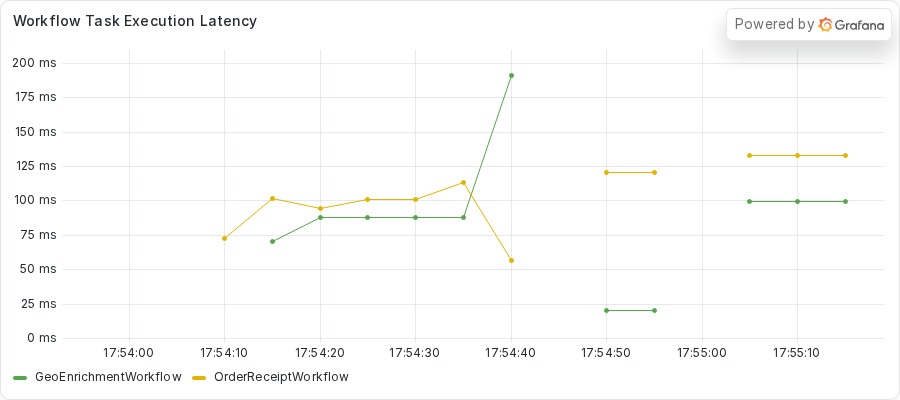
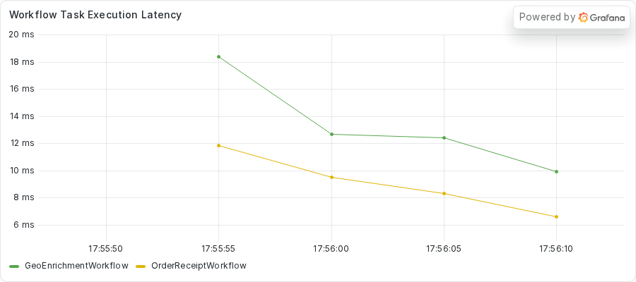

# Exercise 5: Catching a short blocking call before it ships

During this exercise, you will

- Run a fleet where every Workflow completes and nothing times out
- Compare the first Workflow Task of a receipt with and without a short blocking call on the Worker
- Turn on asyncio debug mode and read its slow-callback warning
- Use `py-spy dump` to name the line behind the warning
- Write a test that probes every `async def` Activity, then move the blocking call to a thread

This exercise runs one Worker with two Activity slots on purpose, as teaching code, so you can measure the short stall.
To see the same bug on a fleet of Workers, read [Exercise 6](../06-finding-the-frozen-worker/README.md).

Make your changes to the code in the `practice` subdirectory.
Look for the `TODO PART C` and `TODO PART D` comments, which mark where you make changes.
If you need a hint or want to verify your changes, look at the complete version in the `solution` subdirectory.

## Prerequisites

Finish the setup in the root [README](../../README.md#quickstart) first.
You need the `temporal` command, `uv`, and Python 3.14 or newer.
You also use `py-spy`, which the repository does not install.
You run it on demand with `uvx py-spy dump --pid <PID>`.

Part E compares a Grafana panel before and after the fix.
Start the dashboard stack once, from the repository root.

```sh
just metrics
```

Grafana serves the provisioned **Async Debug** dashboard at http://localhost:3000.
Start the dev server with `just server` so that Prometheus can read it on port 9465.
The Worker exports its own metrics on port 9464.

The practice copy here calls the public providers with the async `httpx.AsyncClient`, unlike Exercise 1.
The HTTP calls do not block.
The call that does block takes a little over a third of a second.

## Part A: Run the Workflow

The earlier exercises froze a Worker for half a minute, and the failures were loud.
This one is quiet.
Nothing times out and nothing fails.
Every run completes, and the receipts take a little longer than they should.
A delay this short does not show up as a failure.

The `get_location` Activity archives an audit trail for each lookup before it asks a provider for the location.
The trail is 40,000 generated audit-log lines, about five megabytes, built once when the Worker starts.
The archiving compresses those bytes with `zlib`.
A real archiver would upload the compressed bytes and return a key for them.
This one throws the bytes away, because the compression is the point.
The same Worker also runs an `OrderReceiptWorkflow`, which does nothing slow.

Do not read the Activity code yet.
Part B asks you to find the cause with tools.

1. Change to the `exercises/05-catching-blockers-early/practice` directory.
2. Start the Worker.

   ```sh
   uv run python worker.py
   ```

   The Worker prints a banner with its PID.
   Keep this terminal open and note the PID.

3. Open another terminal in the same directory and submit a fleet of receipts alone, for a reference reading.

   ```sh
   uv run python starter.py --geo 0 --receipts 3 --rollups 0
   ```

4. Submit the practice fleet, with geo runs beside the receipts.

   ```sh
   uv run python starter.py --geo 3 --receipts 3 --rollups 0
   ```

Here is what the starter printed for the practice fleet in the capture for this exercise.
In the capture, `<ip>`, `<city>`, `<repo>`, and `<home>` replace the address, city, and paths that appear in your own output.

<!-- vale off -->
<!-- vale MasonBase.CodeLineLength = NO -->
```text
receipt receipt-afa2f200-1d9e-437b-bf7f-1f8cc2b395ec: OrderReceiptOutput(receipt='order order-0: 59.97 USD')
receipt receipt-8a1ce51f-f349-4839-9faa-2600ade6eaaf: OrderReceiptOutput(receipt='order order-1: 59.97 USD')
receipt receipt-ad4ab770-ea4b-4692-b6b9-041bcb022591: OrderReceiptOutput(receipt='order order-2: 59.97 USD')
geo geo-36dd0c85-ee65-4922-a98e-6f6274f85a41: GeoEnrichmentOutput(ip='<ip>', location='<city> (40000 audit records)')
geo geo-d785f5d4-1c83-4aed-9180-2b4c34e7e152: GeoEnrichmentOutput(ip='<ip>', location='<city> (40000 audit records)')
geo geo-39537558-30f3-4e1e-a7d5-250dee96bfe9: GeoEnrichmentOutput(ip='<ip>', location='<city> (40000 audit records)')
```
<!-- vale MasonBase.CodeLineLength = YES -->
<!-- vale on -->

Every Workflow completed.
To see what changed, read the first Workflow Task of a receipt in each fleet.
Run `temporal workflow show -w <receipt workflow ID> --output json`.
Find the first `WORKFLOW_TASK_STARTED` event and the first `WORKFLOW_TASK_COMPLETED` event, and subtract their `eventTime` values.

The repository ships a helper that does that subtraction for you.
It reads each receipt's Event History and prints the Workflow Task time and the Activity waits.
Run it from the repository root with the receipt Workflow IDs from your run.

```sh
just receipt-gaps <receipt workflow ID> \
  <receipt workflow ID> <receipt workflow ID>
```

The `WT1 started->completed` field in its output is the first Workflow Task.
Each capture below starts with the command line, which this README drops, and keeps the three receipt lines.
This is what `just receipt-gaps` printed for the receipts-only fleet.

<!-- vale off -->
<!-- vale MasonBase.CodeLineLength = NO -->
```text
receipt-218b1925 total 134ms | WT1 started->completed 24ms | validate_order: sched->started 5ms started->completed 7ms | compute_total: sched->started 6ms started->completed 6ms | format_receipt: sched->started 6ms started->completed 12ms
receipt-3c60412b total 116ms | WT1 started->completed 18ms | validate_order: sched->started 5ms started->completed 10ms | compute_total: sched->started 5ms started->completed 5ms | format_receipt: sched->started 3ms started->completed 10ms
receipt-e3fec938 total 132ms | WT1 started->completed 18ms | validate_order: sched->started 4ms started->completed 9ms | compute_total: sched->started 5ms started->completed 6ms | format_receipt: sched->started 3ms started->completed 9ms
```
<!-- vale MasonBase.CodeLineLength = YES -->
<!-- vale on -->

This is what `just receipt-gaps` printed for the three receipts of the practice fleet, the same fleet as the starter output earlier.

<!-- vale off -->
<!-- vale MasonBase.CodeLineLength = NO -->
```text
receipt-8a1ce51f total 859ms | WT1 started->completed 361ms | validate_order: sched->started 25ms started->completed 7ms | compute_total: sched->started 15ms started->completed 7ms | format_receipt: sched->started 19ms started->completed 13ms
receipt-ad4ab770 total 833ms | WT1 started->completed 351ms | validate_order: sched->started 23ms started->completed 6ms | compute_total: sched->started 6ms started->completed 6ms | format_receipt: sched->started 14ms started->completed 12ms
receipt-afa2f200 total 835ms | WT1 started->completed 368ms | validate_order: sched->started 5ms started->completed 10ms | compute_total: sched->started 6ms started->completed 356ms | format_receipt: sched->started 13ms started->completed 7ms
```
<!-- vale MasonBase.CodeLineLength = YES -->
<!-- vale on -->

Without geo runs, the first Workflow Task of a receipt takes 18 to 24 milliseconds.
With them, it takes 351 to 368 milliseconds in this fleet.
Across the three practice fleets in the capture, it takes 351 to 731 milliseconds.
The 714 to 731 millisecond readings in one fleet are two archives back to back.
The Activities in the receipt still finish in milliseconds, with one 356-millisecond `compute_total` as the exception.
The slow part is the Workflow Task, before the Activities start.
The receipt code is the same in both fleets, so something on the Worker holds up the Workflow Task.

## Part B: Diagnose the delay

If you want the short list of symptoms first, read [Recognizing a blocked event loop](../../README.md#recognizing-a-blocked-event-loop) in the root README.

The delay is short, so you cannot catch it with `asyncio ps` by luck, and nothing fails to point you at it.
Two tools help here.
Asyncio debug mode reports slow callbacks, and `py-spy` names the line once you know when to look.
Replace `<PID>` with the PID from the Worker banner.

### Step 1: Turn on asyncio debug mode

Python has a debug mode for asyncio.
In that mode, the event loop logs a warning for every callback that runs longer than 0.1 seconds.
The [asyncio development guide](https://docs.python.org/3/library/asyncio-dev.html#debug-mode) describes it.

Stop the Worker with `CTRL+C` and start it again with the debug mode on.

```sh
PYTHONASYNCIODEBUG=1 uv run python worker.py
```

Submit the practice fleet again.

```sh
uv run python starter.py --geo 3 --receipts 3 --rollups 0
```

Debug mode prints a warning for each slow step.
The capture holds six archive warnings for two practice fleets.
This block keeps only the first one.

<!-- vale off -->
<!-- vale MasonBase.CodeLineLength = NO -->
```text
Executing <Task pending name='Task-37' coro=<_ActivityWorker._handle_start_activity_task() running at <repo>/.venv/lib/python3.14/site-packages/temporalio/worker/_activity.py:351> created at <home>/.local/share/uv/python/cpython-3.14.3-linux-x86_64-gnu/lib/python3.14/asyncio/tasks.py:395> took 0.397 seconds
```
<!-- vale MasonBase.CodeLineLength = YES -->
<!-- vale on -->

Read the warning from the left.
It names a task, `_ActivityWorker._handle_start_activity_task`, running at `_activity.py:351` in the SDK.
It ends with `took 0.397 seconds`.
The six warnings in the capture ran from 0.347 to 0.397 seconds.
The first debug run also logged one startup entry, `Task-1 main()`, which took 0.126 seconds in this capture.
That entry is the Worker starting and not an Activity.

The warning tells you that an Activity ran on the loop for more than a third of a second.
That matches the 351 millisecond or longer gap you measured.
The warning does not name your code, and it does not name `get_location`.
The SDK handler is the frame that calls your Activity, so the line that blocks is further down.

### Step 2: Name the line with py-spy

`py-spy dump` reads the operating system thread stack, so it can name the line.
The blocking call lasts about 350 milliseconds, so a single dump often misses it.
Run the dump several times while the fleet runs.

```sh
uvx py-spy dump --pid <PID>
```

The capture needed 9 tries before the main thread was inside the blocking call.
This block keeps only the `MainThread` stack from the capture.

<!-- vale off -->
<!-- vale MasonBase.CodeLineLength = NO -->
```text
Process 2798400: <repo>/.venv/bin/python worker.py
Python v3.14.3 (<home>/.local/share/uv/python/cpython-3.14.3-linux-x86_64-gnu/bin/python3.14)

Thread 2798400 (active): "MainThread"
    _archive_audit_trail (activities.py:182)
    get_location (activities.py:228)
    _ActivityInboundImpl.execute_activity (temporalio/worker/_activity.py:889)
    _ActivityWorker._execute_activity (temporalio/worker/_activity.py:681)
    _ActivityWorker._handle_start_activity_task (temporalio/worker/_activity.py:351)
    Handle._run (asyncio/events.py:94)
    BaseEventLoop._run_once (asyncio/base_events.py:2046)
    BaseEventLoop.run_forever (asyncio/base_events.py:677)
    BaseEventLoop.run_until_complete (asyncio/base_events.py:706)
    Runner.run (asyncio/runners.py:127)
    run (asyncio/runners.py:204)
    <module> (worker.py:122)
```
<!-- vale MasonBase.CodeLineLength = YES -->
<!-- vale on -->

The top frame is `_archive_audit_trail` at `activities.py:182`, called by `get_location` at `activities.py:228`.
The state is `active`, and the thread is the `MainThread`, which runs the event loop.
Line 182 is the `zlib.compress` call.
The loop holds one call for about 350 to 400 milliseconds each time a geo run starts.

### Step 3: Check the dashboard

Open the dashboard at http://localhost:3000 and find the panel named **Workflow Task Execution Latency**.
This panel plots Workflow Task latency for every Workflow type on the Worker.
Here the panel is almost empty.



The geo line has three points near 6 milliseconds, and the receipt line has none.
A stall of about 350 milliseconds is small next to a panel that plots a 30-second rate average.
The fleets last only seconds, so the panel has too little data to draw the 351 millisecond stall.
Nothing on the panel would alarm anyone, which is the point of this exercise.
The debug-mode warning, the thread dump, and `just receipt-gaps` found what the panel could not.

## Part C: Find the bug

Open `activities.py` in the `practice` directory and find the two `TODO PART C` comments.

1. Find `_archive_audit_trail`.
   The function takes the cached audit trail, the generated lines, and calls `zlib.compress` on it.
   Most of its time goes to that one call.
2. Find `get_location`.
   The function is an `async def` Activity, and it calls `_archive_audit_trail` directly, with no `await`.
3. Find the comment that starts with `ANTIPATTERN (deliberate, for teaching)`.
   It sits on the line before the call that `py-spy` named.

A plain call inside an `async def` Activity runs on the event loop and holds it until the call returns.
This one returns in about 350 to 400 milliseconds, so nothing times out.
Every other task on the Worker waits it out anyway.

The fix is to run the call off the loop.
The work is short and has a clear end, and `zlib.compress` releases the GIL while it works.
A thread runs it, and the event loop keeps running beside it.

Exercise 4 showed what goes wrong when you do this with long work that a timeout must stop.
Nothing stops a thread that `asyncio.to_thread` already started.
Here the work lasts a little over a third of a second and has no Heartbeat timeout, so waiting on a thread is safe.

## Part D: Write a test, then fix the bug

The delay is invisible in production.
A test can catch it before it ships.
You write one test that probes every `async def` Activity the Worker registers, so the next blocking call fails the build.

1. From the `practice` directory, run the tests.

   ```sh
   uv run python -m pytest -o pythonpath="$PWD" tests
   ```

   One test fails on purpose.
   The stub carries a `TODO PART D` comment.
2. Open `tests/test_probe_all_activities.py` and read the comment in `test_async_activities_do_not_starve_the_event_loop`.
   It describes the test you write.
   You take `worker.ACTIVITIES`, so the test can parametrize at collection time, and keep the `async def` entries.
   You run each one beside a coroutine that records a timestamp every 50 milliseconds, with the network mocked.
   You size the payload of `get_location` so that archiving it on the loop takes well over 0.2 seconds.
   The test asserts that no gap between ticks reaches 0.2 seconds, for every Activity.
3. Write the test.
   If you need a hint, the finished version is in `solution/tests/test_probe_all_activities.py`.
4. Run the tests again.
   Your test fails for `get_location`, because the archiving holds the loop.
5. Open `activities.py`.
   Add the import that moving the work off the loop needs, at the `TODO PART C` comment near the top.
   Replace the direct call in `get_location` with `await asyncio.to_thread(...)`, passing `_archive_audit_trail` and its two arguments.
   Delete the `ANTIPATTERN` comment and the `TODO PART C` comments.
6. Run the tests a third time.
   They all pass.

The capture ran the finished test against the practice Activities.
This block keeps only the failed assertion.

<!-- vale off -->
<!-- vale MasonBase.CodeLineLength = NO -->
```text
E       assert 1.1786633972078562 < 0.2
```
<!-- vale MasonBase.CodeLineLength = YES -->
<!-- vale on -->

The gap is 1.18 seconds, longer than the 0.35 to 0.40 seconds of the live archive.
The probe's payload is not cached yet, so the loop spends its time on building the trail as well as compressing it.

The test is the lasting part of this exercise.
It probes every Activity that the Worker registers, so a new `async def` Activity gets the same check without any edit.

## Part E: Redeploy and verify

Stop the old Worker with `CTRL+C`, then start it again with debug mode on, from the `practice` directory.

```sh
PYTHONASYNCIODEBUG=1 uv run python worker.py
```

Submit the same fleet from your second terminal.

```sh
uv run python starter.py --geo 3 --receipts 3 --rollups 0
```

This is what the starter printed in the capture of the solution copy, with debug mode on.
Every Workflow completes, as before.

<!-- vale off -->
<!-- vale MasonBase.CodeLineLength = NO -->
```text
receipt receipt-ece12cfb-729c-4bda-9d78-dc7d274351a1: OrderReceiptOutput(receipt='order order-0: 59.97 USD')
receipt receipt-db318a45-c83d-4ac6-8fe9-2485dd7e97e7: OrderReceiptOutput(receipt='order order-1: 59.97 USD')
receipt receipt-462e1ffe-6347-4718-9950-b3e7cb61f2b2: OrderReceiptOutput(receipt='order order-2: 59.97 USD')
geo geo-729d8515-b460-4b92-95e2-1ca18f88f14a: GeoEnrichmentOutput(ip='<ip>', location='<city> (40000 audit records)')
geo geo-dbb7dcee-cf17-496e-a348-91e19d178aa1: GeoEnrichmentOutput(ip='<ip>', location='<city> (40000 audit records)')
geo geo-126ac90f-d162-47ed-a2a4-322d4fccf6c0: GeoEnrichmentOutput(ip='<ip>', location='<city> (40000 audit records)')
```
<!-- vale MasonBase.CodeLineLength = YES -->
<!-- vale on -->

Now read the first Workflow Task of the receipts.
This is what `just receipt-gaps` printed for the three receipts of the first debug-mode solution fleet.
The block drops the command line the capture starts with.

<!-- vale off -->
<!-- vale MasonBase.CodeLineLength = NO -->
```text
receipt-462e1ffe total 820ms | WT1 started->completed 23ms | validate_order: sched->started 659ms started->completed 10ms | compute_total: sched->started 22ms started->completed 7ms | format_receipt: sched->started 9ms started->completed 12ms
receipt-db318a45 total 804ms | WT1 started->completed 30ms | validate_order: sched->started 631ms started->completed 19ms | compute_total: sched->started 12ms started->completed 14ms | format_receipt: sched->started 17ms started->completed 11ms
receipt-ece12cfb total 795ms | WT1 started->completed 24ms | validate_order: sched->started 154ms started->completed 9ms | compute_total: sched->started 474ms started->completed 16ms | format_receipt: sched->started 21ms started->completed 10ms
```
<!-- vale MasonBase.CodeLineLength = YES -->
<!-- vale on -->

The first Workflow Task takes 23, 30, and 24 milliseconds here.
Across the two debug-mode solution fleets, the six receipts read between 23 and 45 milliseconds.
With debug mode off, the two solution fleets read between 19 and 35 milliseconds.
In the three practice fleets from Part A, receipts read from 351 to 731 milliseconds, and 324 to 330 in the debug-mode practice fleet.
The loop stays free while the Worker archives the audit trail.

The debug-mode log is the other check.
This block keeps only the warning lines from the first solution fleet's Worker log, with debug mode on.

<!-- vale off -->
<!-- vale MasonBase.CodeLineLength = NO -->
```text
Executing <Task pending name='Task-1' coro=<main() running at <repo>/exercises/05-catching-blockers-early/solution/worker.py:118> wait_for=<Future pending cb=[<builtins.PyDoneCallback object at 0x73e399f43d30>(), Task.task_wakeup()] created at <home>/.local/share/uv/python/cpython-3.14.3-linux-x86_64-gnu/lib/python3.14/asyncio/base_events.py:459> cb=[_run_until_complete_cb() at <home>/.local/share/uv/python/cpython-3.14.3-linux-x86_64-gnu/lib/python3.14/asyncio/base_events.py:181] created at <home>/.local/share/uv/python/cpython-3.14.3-linux-x86_64-gnu/lib/python3.14/asyncio/runners.py:109> took 0.141 seconds
```
<!-- vale MasonBase.CodeLineLength = YES -->
<!-- vale on -->

The one entry is the Worker's own startup, `Task-1 main()`, which took 0.141 seconds.
That entry is no Activity, and the first practice debug run logged it too.
No 0.35 to 0.40 second warnings appear for the archive.
The same fleets produced six of them on the practice copy.
The second solution fleet logged one `_handle_start_activity_task` warning of 0.107 seconds, just over the 0.1 second threshold.
That warning is not the archive, which runs on a thread, and the capture did not isolate its cause.
So a clean debug run can still show a single callback near the threshold.

Last, look at the **Workflow Task Execution Latency** panel again.



The panel has no points in this window, because the fleet ran for too short a time to draw one.
The panel is a weak signal in both states.
`just receipt-gaps` and the debug-mode log carry the evidence here.

## Conclusion

You found a blocking call that no timeout would ever report.
Debug mode flagged a slow callback, `py-spy` named the line, and `asyncio.to_thread` moved the work off the loop.
The test you wrote probes every `async def` Activity on the Worker, so the next blocker fails the build and never reaches production.

### This is the end of the exercise.
