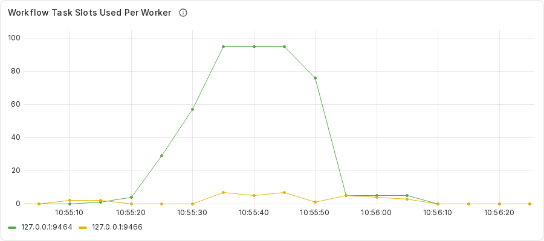
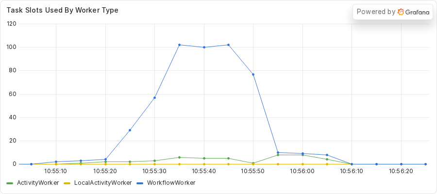
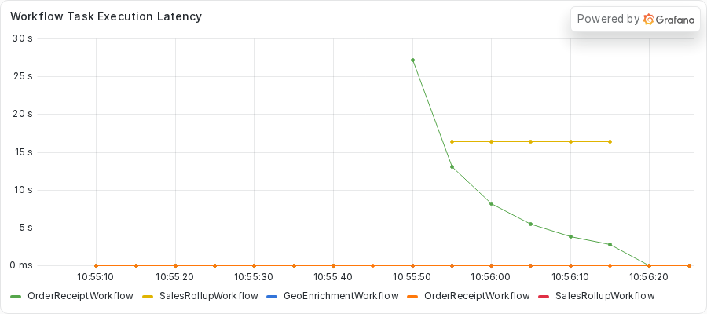
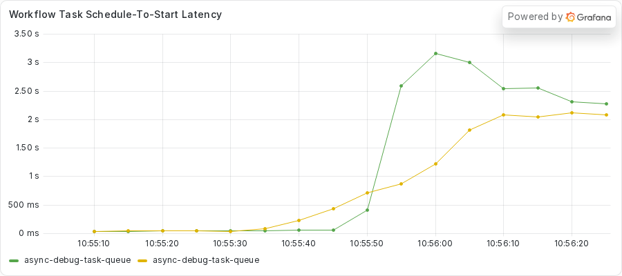
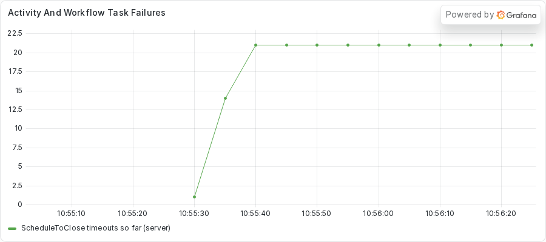
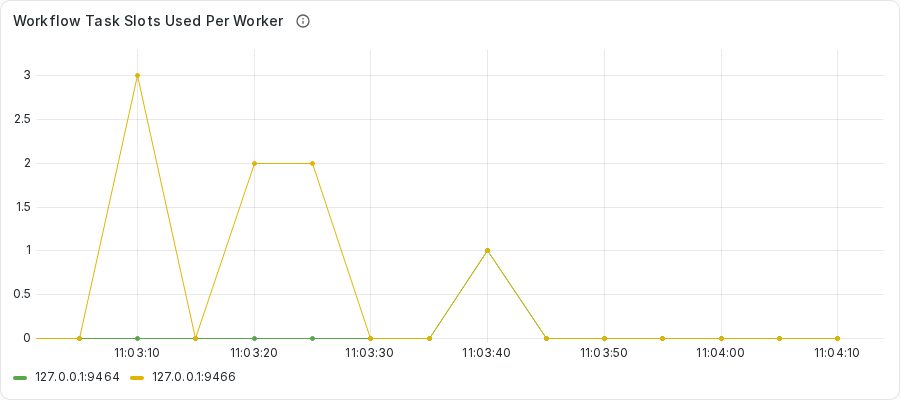
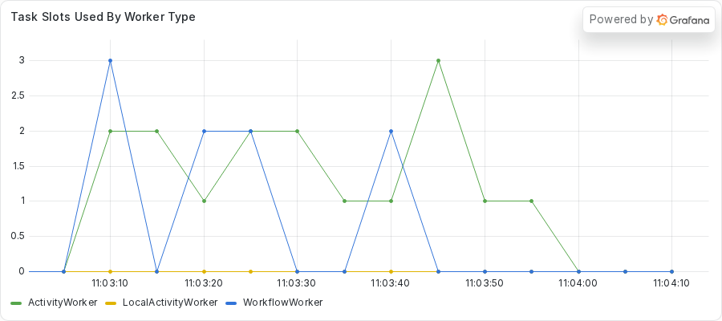
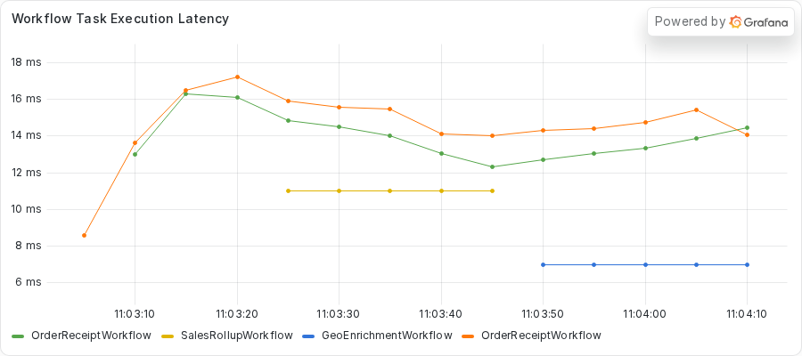
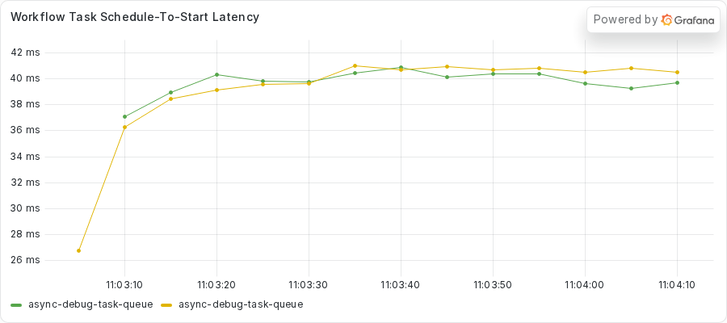

# Exercise 6: Finding the frozen Worker in a fleet

In exercises 1 to 5, one Worker carried all the traffic, so a blocking call showed up in the first thing you ran.
A failure that plain would be welcome in production.
A real fleet has more Workers, and the healthy ones mask the failure.

Exercises 1 to 5 run one Worker with two Activity slots on purpose, as teaching code, so one blocking call shows up at once.
This exercise runs two Workers, each with the SDK default of 100 Activity slots, under steady traffic.
Most Workflows still finish.
The first things you would check (the starter summary, CPU, and the fleet-wide dashboard panels) do not name the stuck Worker.

During this exercise, you will

- Run a steady flood of Workflows against two Workers and read the result the way an operator would
- Find the frozen Worker from Event Histories, before you use a process tool on it
- Use `python -m asyncio ps` and `py-spy dump` on that one process
- Check each tool you know against what it showed for a fleet
- Write a test that fails while a synchronous database call holds the event loop
- Move the call onto a thread pool, then rerun the flood on two Workers

Make your changes to the code in the `practice` subdirectory.
Look for the `TODO PART C` and `TODO PART D` comments, which mark where you make changes.
If you need a hint or want to verify your changes, look at the complete version in the `solution` subdirectory.

## Prerequisites

Finish the setup in the root [README](../../README.md#quickstart) first.
You need the `temporal` command, `uv`, and Python 3.14 or newer.
You also use `py-spy`, which the repository does not install.
You run it on demand with `uvx py-spy dump --pid <PID>`.

This exercise uses several terminals.
You need one for the dev server, one for each Worker, one for the starter, and one for the tools.
Start the dev server with `just server` so that Prometheus can read it on port 9465.

Parts B and E look at Grafana panels.
Start the dashboard stack once, from the repository root.

```sh
just metrics
```

Grafana serves the provisioned **Async Debug** dashboard at http://localhost:3000.
The first Worker exports Prometheus metrics on port 9464, and the second one on port 9466.

## Part A: Run the flood

Your team runs the same service as in exercises 1 to 5.
`GeoEnrichmentWorkflow` looks up where a request came from.
`SalesRollupWorkflow` pauses for five seconds and then sums some sales figures.
`OrderReceiptWorkflow` validates an order, totals it, and formats a receipt, all in memory.
All three run on one Task Queue.

This time the traffic is steady, and two Workers share it.
The starter submits 10 receipts per second.
After 10 seconds (the `--lead` option) it submits one rollup, waits one second, and submits one geo run that the exercise calls the bad run.
The location lookup of the bad run waits on a database lock.
The starter holds that lock for 30 seconds, set by the `--block-seconds` option.
The receipts keep coming until 10 seconds (the `--tail` option) after the bad run returns.

Do not read the code yet.
Part B asks you to find the cause from the outside.

Run each flood on a fresh dev server, as the capture did.
Before each flood, stop both Workers and the dev server, start `just server` again, and then start both Workers.
`just server` holds no data between runs, so the restart clears the old Workflows.
This matters because `--limit 600` in Part B reads the newest 600 Workflows, so it would also read receipts left from an earlier flood.

1. Change to the `exercises/06-finding-the-frozen-worker/practice` directory.
2. Start the first Worker.

   ```sh
   uv run python worker.py
   ```

   The Worker prints a banner with its process ID (PID) and its metrics port.
   Keep this terminal open and note the PID.

3. In a second terminal, start the second Worker from the same directory.
   The environment variable moves its metrics endpoint to port 9466, so the two Workers do not collide on port 9464.

   ```sh
   ASYNC_DEBUG_METRICS_PORT=9466 uv run python worker.py
   ```

   Both Workers poll the same Task Queue, and each prints its own PID.
   In the capture of the bad flood, the first Worker (port 9464) is PID 3193283 and the second Worker (port 9466) is PID 3193282.
   Both use the SDK default of 100 Activity slots.

4. In a third terminal, run the healthy flood first, from the same directory.
   The `--bad 0` option runs the same stream for the same length, with no lock held.

   ```sh
   uv run python starter.py --bad 0
   ```

   The command takes about 50 seconds.
   The starter prints one summary at the end and no line for each Workflow.

Here is what the starter printed in the capture of the healthy flood.

<!-- vale off -->
<!-- vale MasonBase.CodeLineLength = NO -->
```text
receipts submitted=500 failed=0
first failure: none
rollup rollup-f23bea64-4d53-4a03-acf7-860e47c3a102: completed
timeline by submit time, relative to the end of the lead:
submitted -10s..  -5s n=50 failed=0 slow>2s=0 p50=0.34s max=0.49s
submitted  -5s..  +0s n=50 failed=0 slow>2s=0 p50=0.35s max=0.50s
submitted  +0s..  +5s n=50 failed=0 slow>2s=0 p50=0.34s max=0.49s
submitted  +5s.. +10s n=50 failed=0 slow>2s=0 p50=0.38s max=0.54s
submitted +10s.. +15s n=50 failed=0 slow>2s=0 p50=0.38s max=0.70s
submitted +15s.. +20s n=50 failed=0 slow>2s=0 p50=0.38s max=0.49s
submitted +20s.. +25s n=50 failed=0 slow>2s=0 p50=0.34s max=0.55s
submitted +25s.. +30s n=50 failed=0 slow>2s=0 p50=0.39s max=0.49s
submitted +30s.. +35s n=50 failed=0 slow>2s=0 p50=0.38s max=0.59s
submitted +35s.. +40s n=50 failed=0 slow>2s=0 p50=0.39s max=0.65s
```
<!-- vale MasonBase.CodeLineLength = YES -->
<!-- vale on -->

All 500 receipts completed, and the rollup completed.
The timeline groups receipts by submit time, in 5-second buckets.
In each bucket the median receipt took between 0.34 and 0.39 seconds.
The slowest receipt in any bucket took 0.70 seconds.
Neither Worker printed anything beyond its startup banner.
This is the baseline: a fleet with nothing wrong in it.

The healthy flood is also the rate check for your machine.
If the slowest receipt in your own run took longer than about 1 second, lower the rate, for example with `--rate 5`.
Run the healthy flood again at that rate, and pass the same `--rate` to the bad flood.
A lower rate submits fewer receipts, so your counts are smaller than the ones quoted here.

Before the bad flood, restart everything, as the rule at the top of this part says.
Stop both Workers and the dev server, start `just server` again, and start both Workers as you did in steps 2 and 3.
The restart gives each Worker a new PID, so note the two new PIDs.
Then run the bad flood.
The defaults are `--rate 10 --lead 10 --block-seconds 30 --tail 10 --rollups 1 --bad 1`.

```sh
uv run python starter.py
```

The command takes about a minute.
Here is what the starter printed in the capture of the bad flood.
In this timeline, the zero point is the moment the starter confirmed that the Activity `get_location` of the bad run had started.

<!-- vale off -->
<!-- vale MasonBase.CodeLineLength = NO -->
```text
receipts submitted=523 failed=21
first failure: Activity task timed out caused by activity ScheduleToClose timeout caused by activity StartToClose timeout
rollup rollup-14287db2-c7cd-48a1-96d4-62d81c427cf7: completed
geo geo-f7b08b04-4eb5-4577-bb48-e085f0fa7215: completed
timeline by submit time, relative to the confirmed freeze:
submitted -15s.. -10s n=21 failed=0 slow>2s=0 p50=0.59s max=0.92s
submitted -10s..  -5s n=50 failed=0 slow>2s=0 p50=0.51s max=0.82s
submitted  -5s..  +0s n=49 failed=1 slow>2s=4 p50=0.79s max=26.03s
submitted  +0s..  +5s n=51 failed=13 slow>2s=48 p50=11.92s max=38.65s
submitted  +5s.. +10s n=50 failed=7 slow>2s=50 p50=11.51s max=37.94s
submitted +10s.. +15s n=50 failed=0 slow>2s=41 p50=13.36s max=29.45s
submitted +15s.. +20s n=50 failed=0 slow>2s=48 p50=3.94s max=19.87s
submitted +20s.. +25s n=50 failed=0 slow>2s=50 p50=8.72s max=17.55s
submitted +25s.. +30s n=49 failed=0 slow>2s=49 p50=15.04s max=18.40s
submitted +30s.. +35s n=50 failed=0 slow>2s=50 p50=13.64s max=16.22s
submitted +35s.. +40s n=50 failed=0 slow>2s=50 p50=11.69s max=13.32s
submitted +40s.. +45s n=3 failed=0 slow>2s=3 p50=9.16s max=9.30s
```
<!-- vale MasonBase.CodeLineLength = YES -->
<!-- vale on -->

Read it the way an operator would read a dashboard or a report.
Of 523 receipts, 21 failed, about 4 percent.
In this capture the rollup and the bad run both completed.
Read your own line for the rollup, because this capture does not promise the same outcome for your run.

The timeline shows where the trouble sits.
The failures fall in three buckets, from 5 seconds before the confirmed freeze to 10 seconds after it: 1, then 13, then 7.
After that no receipt fails.
The starter holds the lock for about 30 seconds, so the failures stop about 20 seconds before the freeze ends.

The slow column does not agree with the failure column.
In each bucket from +15s on, the receipts are slower than 2 seconds, or all but two of them are.
The median in those buckets runs from 3.94 to 15.04 seconds.
The slowest receipt took 38.65 seconds.
An operator who watched only the failed count would see it reach zero while the receipts were still late.

Here is one inference, and the capture does not measure it.
A frozen Worker takes a limited number of tasks before it stops asking for more, and the healthy Worker carries the rest.

Nothing in the summary names a Worker.
Part B finds it.

## Part B: Find the frozen Worker

If you want the short list of symptoms first, read [Recognizing a blocked event loop](../../README.md#recognizing-a-blocked-event-loop) in the root README.

In exercises 1 to 5, you started at the process: `asyncio ps`, then `py-spy dump`.
The process tools need a PID, and with two Workers you would have to read both processes to find the stuck one.
So the order of work changes here.
The Event Histories come first, because they name the Worker.
After an incident they are often all you have.
Then you use the process tools from exercises 1 to 5 on that one process.

The Worker that freezes can change from run to run, so this part never names one in advance.
You read it from your own histories.

### Step 1: Group the timeouts by Worker

Every Worker has an identity.
By default, the identity is the process ID, an at sign, and the hostname (`PID@hostname`).
The Event History records the identity on each `WorkflowTaskStarted` and `ActivityTaskStarted` event.
So the histories can say which Worker held each task.

The helper in the repository reads receipt histories and groups what it finds by that identity.
Run it from the repository root, after the bad flood has finished.
The `--limit 600` option reads the receipts among the newest 600 Workflows, and the flood made 523 receipts, one rollup, and one bad run.
The `--by-identity` option adds the identity to each line, and `--summary` prints only one line for each identity.

```sh
just receipt-gaps --limit 600 --by-identity --summary
```

The helper reads each receipt with `temporal workflow show`, so it took about 50 seconds for 523 receipts in the capture.
The block below shows the output of the capture, unchanged.
In the capture, `host` replaces the hostname that your own output shows.

<!-- vale off -->
<!-- vale MasonBase.CodeLineLength = NO -->
```text
uv run python scripts/receipt_gaps.py --limit 600 --by-identity --summary
3193282@host: first Workflow Tasks 294 | Workflow Task timeouts 0 | Activities failed 0 | largest WT1 977ms
3193283@host: first Workflow Tasks 229 | Workflow Task timeouts 82 | Activities failed 21 | largest WT1 29199ms
```
<!-- vale MasonBase.CodeLineLength = YES -->
<!-- vale on -->

Read the two lines.
Identity `3193282` started 294 first Workflow Tasks, holds no Workflow Task timeouts, and has no failed Activities.
Identity `3193283` started 229 first Workflow Tasks, and it holds all 82 Workflow Task timeouts and all 21 failed Activities.
Its largest first Workflow Task took 29199 milliseconds, against 977 for the other.
In this capture, one identity holds every timeout and every failure, and that is the Worker to look at.

### Step 2: See the identity in a history

The summary came from histories, so check one by hand.
Start with a receipt that stalled but did not fail.
Run `temporal workflow show -w <receipt workflow ID>` with a Workflow ID from your own run.
This block keeps the first seven events of the stalled receipt in the capture.

<!-- vale off -->
<!-- vale MasonBase.CodeLineLength = NO -->
```text
Progress:
  ID           Time                     Type           
    1  2026-11-11T16:55:30Z  WorkflowExecutionStarted  
    2  2026-11-11T16:55:30Z  WorkflowTaskScheduled     
    3  2026-11-11T16:55:30Z  WorkflowTaskStarted       
    4  2026-11-11T16:55:40Z  WorkflowTaskTimedOut      
    5  2026-11-11T16:55:40Z  WorkflowTaskScheduled     
    6  2026-11-11T16:55:47Z  WorkflowTaskStarted       
    7  2026-11-11T16:55:49Z  WorkflowTaskCompleted     
```
<!-- vale MasonBase.CodeLineLength = YES -->
<!-- vale on -->

The first Workflow Task started at 16:55:30.
At 16:55:40 the history shows `WorkflowTaskTimedOut`, 10 seconds later, because the Worker never replied.
The next Workflow Task started at 16:55:47 and completed two seconds after that.
This view prints no identity.
The identity sits on the events in the JSON form of the same history, which you get with `--output json`.

The helper prints the identity for you on the line of each receipt.
This block keeps the line for that receipt from the `--by-identity` view without `--summary`.

<!-- vale off -->
<!-- vale MasonBase.CodeLineLength = NO -->
```text
receipt-2043b67d total 28649ms | WT1 started->completed 18967ms | validate_order: sched->started 2067ms started->completed 313ms | compute_total: sched->started 798ms started->completed 213ms | format_receipt: sched->started 1972ms started->completed 214ms | wt1 on 3193283@host attempt 2 | wt timeout on 3193283@host | validate_order on 3193282@host attempt 1 | compute_total on 3193282@host attempt 1 | format_receipt on 3193282@host attempt 1
```
<!-- vale MasonBase.CodeLineLength = YES -->
<!-- vale on -->

Read the tail of the line.
The first Workflow Task, `wt1`, started on `3193283@host`, and it needed a second attempt.
The line also holds `wt timeout on 3193283@host`.
A `WorkflowTaskTimedOut` event carries no identity, so the helper gives the timeout to the identity on the `WorkflowTaskStarted` event just before it.
The three Activities of the receipt ran on `3193282@host`, and they waited 2067, 798, and 1972 milliseconds between scheduled and started.
The long wait was the first Workflow Task, which took 18967 milliseconds from started to completed.

Now look at a receipt that failed.
This block keeps the last seven events of the failed receipt, then its result.

<!-- vale off -->
<!-- vale MasonBase.CodeLineLength = NO -->
```text
   17  2026-11-11T16:55:22Z  ActivityTaskScheduled     
   18  2026-11-11T16:55:28Z  ActivityTaskStarted       
   19  2026-11-11T16:55:32Z  ActivityTaskTimedOut      
   20  2026-11-11T16:55:32Z  WorkflowTaskScheduled     
   21  2026-11-11T16:55:32Z  WorkflowTaskStarted       
   22  2026-11-11T16:55:33Z  WorkflowTaskCompleted     
   23  2026-11-11T16:55:33Z  WorkflowExecutionFailed   

Results:
  Status   FAILED
  Failure  
    Message: Activity task timed out
    Cause:
        Message: activity ScheduleToClose timeout
        Cause:
            Message: activity StartToClose timeout
```
<!-- vale MasonBase.CodeLineLength = YES -->
<!-- vale on -->

The Activity `format_receipt` started at 16:55:28 and timed out four seconds later.
This is its line from the `--by-identity` view.

<!-- vale off -->
<!-- vale MasonBase.CodeLineLength = NO -->
```text
receipt-11326fa8 total 16946ms | WT1 started->completed 27ms | validate_order: sched->started 6020ms started->completed 24ms | compute_total: sched->started 21ms started->completed 30ms | wt1 on 3193282@host attempt 1 | validate_order on 3193282@host attempt 2 | compute_total on 3193282@host attempt 1 | format_receipt TIMED OUT on 3193283@host attempt 2
```
<!-- vale MasonBase.CodeLineLength = YES -->
<!-- vale on -->

The failed Activity, `format_receipt TIMED OUT`, belongs to `3193283@host`.
The helper gives a failed Activity to the identity on the `ActivityTaskStarted` event that shares its scheduled event ID.

The same line holds a second clue, which you should not read the wrong way.
`validate_order` waited 6020 milliseconds between scheduled and started, and its identity is `3193282@host`, on attempt 2.
A retried Activity keeps only the `ActivityTaskStarted` event of its last attempt.
So a first attempt that the frozen Worker swallowed leaves no event with its identity.
That receipt is late, and it carries the identity of the healthy Worker.
A slow receipt on the healthy identity is not a second sick Worker.

The identity also appears on the bad run.
Run `temporal workflow show -w <bad geo workflow ID> --output json` and look at the `identity` field on each event.
This block keeps the three events of the bad run's `get_location` Activity from the capture.

<!-- vale off -->
<!-- vale MasonBase.CodeLineLength = NO -->
```text
   11  2026-11-11T16:55:15Z  ActivityTaskScheduled     
   12  2026-11-11T16:55:15Z  ActivityTaskStarted       
   13  2026-11-11T16:55:44Z  ActivityTaskCompleted     
```
<!-- vale MasonBase.CodeLineLength = YES -->
<!-- vale on -->

The Activity started at 16:55:15 and completed at 16:55:44, when the lock let go.
The next block keeps two events of the capture's JSON output.
Event 3 is the bad run's first `WorkflowTaskStarted`, and event 12 is the `ActivityTaskStarted` for `get_location`.

<!-- vale off -->
<!-- vale MasonBase.CodeLineLength = NO -->
```json
{
  "eventId": "3",
  "eventTime": "2026-11-11T16:55:14.574570668Z",
  "eventType": "EVENT_TYPE_WORKFLOW_TASK_STARTED",
  "taskId": "1055924",
  "workflowTaskStartedEventAttributes": {
    "scheduledEventId": "2",
    "identity": "3193282@host",
    "requestId": "b7fb9410-a483-478e-ab2d-29ae9b5943d6",
    "historySizeBytes": "394",
    "workerVersion": {
      "buildId": "77f35c7e7c731eba4aa05e0be77bc3f4"
    }
  }
},
{
  "eventId": "12",
  "eventTime": "2026-11-11T16:55:15.300277909Z",
  "eventType": "EVENT_TYPE_ACTIVITY_TASK_STARTED",
  "taskId": "1071809",
  "activityTaskStartedEventAttributes": {
    "scheduledEventId": "11",
    "identity": "3193283@host",
    "requestId": "870540ef-11d2-4224-bd25-3f24c50018a7",
    "attempt": 1,
    "workerVersion": {
      "buildId": "77f35c7e7c731eba4aa05e0be77bc3f4"
    }
  }
}
```
<!-- vale MasonBase.CodeLineLength = YES -->
<!-- vale on -->

Event 12 carries identity `3193283@host`, the same identity that holds the timeouts.
Event 3 carries the healthy identity, `3193282@host`.
In this capture, the healthy identity also started the bad run's other two Workflow Tasks (events 9 and 15).
A later flood, on 2026-11-13, went the other way: the Worker that froze had started events 3 and 9 first.
So a Workflow Task of the bad run can carry either identity.
Only the `ActivityTaskStarted` event for `get_location` names the Worker that froze.

### Step 3: Read the process

The identity is `PID@hostname`, so the number before the at sign is the PID: `3193283`.
In the capture, that is the first Worker, the one on port 9464.
Run the two process tools from exercises 1 to 5 on that process only.
Replace `<PID>` with the number before the at sign in the identity, which is the same PID the Worker banner printed.

```sh
uv run python -m asyncio ps <PID>
```

In an incident, the histories give you the PID.
By then the Worker may have thawed, or it may still hold the lock.
An exercise cannot wait for an incident, so the blocks below come from readings that the capture took during the freeze.
They come from the same flood as the histories in Step 2.
When you follow along, run the bad flood once more on a fresh dev server, as Part A says.
Read both Workers during the 30 seconds of the freeze.
Then run the by-identity summary and confirm that the identity it names is the PID whose `py-spy` dump shows the lock wait.

This is the `asyncio ps` table of the frozen Worker at the first reading, about the moment the freeze began.

<!-- vale off -->
<!-- vale MasonBase.CodeLineLength = NO -->
```text
tid        task id              task name            coroutine stack                                    awaiter chain                                      awaiter name    awaiter id     
------------------------------------------------------------------------------------------------------------------------------------------------------------------------------------
3193283    0x7facbc71f2f0       Task-1               Worker._run -> Worker.run -> main                                                                                     0x0            
3193283    0x7facbc71fe30       Task-2               Event.wait -> Worker._run.<locals>.raise_on_shutdown _wait -> wait                                      Task-5          0x7facbc86fd90 
3193283    0x7facbc74f140       Task-3               _wait -> wait -> _ActivityWorker.run               _wait -> wait                                      Task-5          0x7facbc86fd90 
3193283    0x7facbc74ebd0       Task-4               Worker.poll_workflow_activation -> _WorkflowWorker.run _wait -> wait                                      Task-5          0x7facbc86fd90 
3193283    0x7facbc86fd90       Task-5               _wait -> wait                                      Worker._run -> Worker.run -> main                  Task-1          0x7facbc71f2f0 
3193283    0x7facbc86fbd0       Task-6               Queue.get -> _ActivityWorker.run.<locals>.raise_from_exception_queue _wait -> wait -> _ActivityWorker.run               Task-3          0x7facbc74f140 
3193283    0x7facb9ebe300       Task-1159            sleep -> roll_up_sales -> _ActivityInboundImpl.execute_activity -> _ActivityWorker._execute_activity -> _ActivityWorker._handle_start_activity_task                                                                    0x0            
3193283    0x7facbc5de8a0       Task-1358            _ActivityWorker._handle_start_activity_task                                                                           0x0            
3193283    0x7facbc56bc50       Task-1359            Worker.poll_activity_task                          _wait -> wait -> _ActivityWorker.run               Task-3          0x7facbc74f140 
```
<!-- vale MasonBase.CodeLineLength = YES -->
<!-- vale on -->

Look at Task-1358.
Its stack ends at `_ActivityWorker._handle_start_activity_task`, and nothing sits beneath it.
Compare it with Task-1159, the rollup, which waits at `sleep` inside `roll_up_sales`.
You read the same shape in exercise 1: a task with no await below it runs synchronous code.
The capture took four readings, about 0, 2, 10, and 19 seconds into the freeze, and Task-1358 was in this state in all four.

`asyncio ps` does not name the line.
`py-spy dump` does.

Replace `<PID>` with the same PID.

```sh
uvx py-spy dump --pid <PID>
```

This block keeps only the `MainThread` stack from the first reading.

<!-- vale off -->
<!-- vale MasonBase.CodeLineLength = NO -->
```text
Thread 3193283 (idle): "MainThread"
    _cached_location (activities.py:120)
    get_location (activities.py:169)
    _ActivityInboundImpl.execute_activity (temporalio/worker/_activity.py:889)
    _ActivityWorker._execute_activity (temporalio/worker/_activity.py:681)
    _ActivityWorker._handle_start_activity_task (temporalio/worker/_activity.py:351)
    Handle._run (asyncio/events.py:94)
    BaseEventLoop._run_once (asyncio/base_events.py:2046)
    BaseEventLoop.run_forever (asyncio/base_events.py:677)
    BaseEventLoop.run_until_complete (asyncio/base_events.py:706)
    Runner.run (asyncio/runners.py:127)
    run (asyncio/runners.py:204)
    <module> (worker.py:157)
```
<!-- vale MasonBase.CodeLineLength = YES -->
<!-- vale on -->

Read the stack from the top.
The top frame is `_cached_location` at `activities.py:120`, called from `get_location` at `activities.py:169`.
Below it, `_ActivityWorker._handle_start_activity_task` from the SDK ran the Activity directly on the `MainThread`, which runs the event loop.
The first line says `idle`, so the thread waits and does not compute.
All four readings of this Worker show the same top two frames.

Now run the same two tools on the other Worker, PID 3193282.
This is its `asyncio ps` table at the first reading.

<!-- vale off -->
<!-- vale MasonBase.CodeLineLength = NO -->
```text
tid        task id              task name            coroutine stack                                    awaiter chain                                      awaiter name    awaiter id     
------------------------------------------------------------------------------------------------------------------------------------------------------------------------------------
3193282    0x78f23ef232f0       Task-1               Worker._run -> Worker.run -> main                                                                                     0x0            
3193282    0x78f23ef23e30       Task-2               Event.wait -> Worker._run.<locals>.raise_on_shutdown _wait -> wait                                      Task-5          0x78f23f073d90 
3193282    0x78f23ef53140       Task-3               _wait -> wait -> _ActivityWorker.run               _wait -> wait                                      Task-5          0x78f23f073d90 
3193282    0x78f23ef52bd0       Task-4               Worker.poll_workflow_activation -> _WorkflowWorker.run _wait -> wait                                      Task-5          0x78f23f073d90 
3193282    0x78f23f073d90       Task-5               _wait -> wait                                      Worker._run -> Worker.run -> main                  Task-1          0x78f23ef232f0 
3193282    0x78f23f073bd0       Task-6               Queue.get -> _ActivityWorker.run.<locals>.raise_from_exception_queue _wait -> wait -> _ActivityWorker.run               Task-3          0x78f23ef53140 
3193282    0x78f23ccd3d40       Task-1389            Worker.poll_activity_task                          _wait -> wait -> _ActivityWorker.run               Task-3          0x78f23ef53140 
3193282    0x78f23c12ac60       Task-1399            Worker.complete_workflow_activation -> _WorkflowWorker._handle_activation                                                                    0x0            
```
<!-- vale MasonBase.CodeLineLength = YES -->
<!-- vale on -->

This table has no task that ends at `_ActivityWorker._handle_start_activity_task`.
This block keeps only the `MainThread` stack of its `py-spy` dump.

<!-- vale off -->
<!-- vale MasonBase.CodeLineLength = NO -->
```text
Thread 3193282 (idle): "MainThread"
    EpollSelector.select (selectors.py:452)
    BaseEventLoop._run_once (asyncio/base_events.py:2008)
    BaseEventLoop.run_forever (asyncio/base_events.py:677)
    BaseEventLoop.run_until_complete (asyncio/base_events.py:706)
    Runner.run (asyncio/runners.py:127)
    run (asyncio/runners.py:204)
    <module> (worker.py:157)
```
<!-- vale MasonBase.CodeLineLength = YES -->
<!-- vale on -->

The `MainThread` sits in `EpollSelector.select`.
That is an event loop waiting for work, which is what a healthy loop does.
The two Workers run the same code and read differently, and only the process you picked from the histories shows the lock wait.

### Step 4: Compare the two Worker logs

The Worker log is the last place the two Workers differ.
The capture wrote each Worker's output to a file.
If you did the same, `grep -c "Task not found when completing"` and `grep -c TMPRL1104` count the lines of each kind in a log.
The frozen Worker's log held 284 lines: its 7-line banner and 277 more.
Of those, 95 said `Task not found when completing` and 82 carried the code `TMPRL1104`.
The healthy Worker's log held only its 7-line banner.

This block keeps the first of each kind of line from the frozen Worker's log.
The block drops the color codes that the terminal adds to these lines.

<!-- vale off -->
<!-- vale MasonBase.CodeLineLength = NO -->
```text
2026-11-11T16:55:44.676289Z  WARN temporalio_sdk_core::worker::workflow: Task not found when completing error=code: 'Some requested entity was not found', message: "Workflow task not found." run_id="01a1cb88-fd10-7a2f-b0f8-33bb65137ab5"
2026-11-11T16:55:44.679610Z  WARN temporalio_sdk_core::worker::workflow::managed_run: [TMPRL1104] 01a1cb88-fd10-7a2f-b0f8-33bb65137ab5:10:1 Workflow task duration exceeded 5 seconds. workflow_type=OrderReceiptWorkflow event_id=10 attempt=1 workflow_task_duration=29349 workflow_history_size=1105 payload_download_count=0 payload_download_size=0 payload_download_duration=0 payload_download_drivers=[] payload_upload_count=0 payload_upload_size=0 payload_upload_duration=0 payload_upload_drivers=[]
```
<!-- vale MasonBase.CodeLineLength = YES -->
<!-- vale on -->

The Worker tried to reply to a Workflow Task that the server had already timed out.
The server answered `Workflow task not found.`
The `TMPRL1104` line is the SDK's own note that a Workflow Task ran longer than 5 seconds.
The frozen Worker printed both at the thaw, about 16:55:44, and the healthy Worker printed none.
No log in these floods holds `TMPRL1101`, the deadlock warning.
Exercise 2 shows where it does appear.

### The tools in a fleet

You now have a reading from each tool you used in exercises 1 to 5, plus the new ones.
The table gives the capture's reading of each and says whether it separated the frozen Worker from the healthy one.
The capture took four readings of the process tools, about 0, 2, 10, and 19 seconds into the freeze.
This is one run, so treat each row as what happened here and not as a rule.

| Tool | What it read in the capture | Did it separate the Workers? |
|---|---|---|
| `asyncio ps` and `pstree` | The frozen Worker had Task-1358 dead-ended at `_ActivityWorker._handle_start_activity_task` in all four readings. The healthy Worker had no dead-ended row in the first three readings. At the last it had one, Task-4057, a task that did not exist earlier. | In part. A task that stays dead-ended across two readings marks the frozen Worker. A single reading can catch a healthy Worker in the middle of a task. |
| `py-spy dump` | The frozen Worker's `MainThread` was in `_cached_location` at `activities.py:120` in all four readings. The healthy Worker's was in `EpollSelector.select` in all four. | Yes. |
| `top` | The frozen Worker read state `S` and 0.0 percent in all four readings. The healthy Worker read `S` 0.0, `S` 18.2, `R` 9.1, and `R` 70.0. | No. Both read 0.0 at the first reading, and the busy Worker was the healthy one. |
| `temporal task-queue describe` | The backlog read 0 and 0, then 0 and 0, then 1 Workflow Task aged 47 milliseconds. At the last reading it read 39 Workflow Tasks aged 3.5 seconds and 1 Activity task aged 46 milliseconds. The pollers of both identities read `now`, 1 second ago, or 2 seconds ago until the last reading. At the last, the frozen identity's pollers read 6 and 8 seconds ago. | Only at the last reading. The first three did not. |
| Metrics endpoints | The frozen Worker answered in 1.8, 1.5, 1.5, and 2.8 milliseconds. The healthy Worker answered in 1.1, 1.6, 6.0, and 35.1 milliseconds. | No. Both answered in milliseconds. |
| Slot gauges, per Worker | The frozen Worker's `WorkflowWorker` gauge read 13, 21, 74, and 95 slots in use. The healthy Worker's read 0, 1, 1, and 5. The `ActivityWorker` gauge read 2, 2, 2, 2 and 0, 0, 1, 3. | The `WorkflowWorker` gauge did. The `ActivityWorker` gauge did not. |
| `receipt_gaps.py` without `--by-identity` | One line for each of 523 receipts, with no identity. 79 receipts had a first Workflow Task of 9 seconds or more. No line marks a failure. 14 of the 21 failed receipts print no Activity. | No. `--by-identity` did. |
| Web UI | Two later floods, on 2026-11-13, opened the rendered pages of Web UI 2.45.3. The Task Queue page listed both identities at every reading, each with a check under **Workflow Task Handler** and **Activity Handler**. Only **Last Accessed** changed. In the later of the two, the times were at most 0.14 seconds apart at about 5, 10, and 16 seconds into the freeze. At about 23 and 28 seconds, the frozen identity's time was 6.1 and 11.8 seconds behind. The bad run's **Pending Activities** tab read `Started` for `get_location`, with **Last Worker Identity** `3785696@host`, the frozen Worker. | In part. **Last Accessed** fell behind only late in the freeze. The **Pending Activities** tab named the frozen Worker at each of its four readings, but only on the bad run's page. |
| Dashboard | Only the per-Worker panel separated the two Workers. The next paragraphs describe the other four panels. | One panel did. |
| Worker log | The frozen Worker printed 95 `Task not found when completing` lines and 82 `TMPRL1104` lines at the thaw. The healthy Worker printed none. | Yes, but only after the thaw. |

The Web UI row comes from those two later floods, which had their own PIDs.
Every other row comes from the capture.
Web UI 2.45.3 has no Workers page for the Namespace.
Its Worker list is on the Task Queue page, at http://localhost:8233/namespaces/default/task-queues/async-debug-task-queue.
The same list is on the **Workers** tab of a Workflow Execution.
In the later of the two, the frozen identity's **Last Accessed** time stopped 16 seconds into the freeze.
It moved again after the thaw, when the two times were 0.04 seconds apart.
In the earlier one, the frozen identity's time was 5.6 seconds behind at 21 seconds into the freeze.
The Task Queue page has no label for a frozen Worker, so a late **Last Accessed** time is the only sign that page gives.

Four tools separated the Workers in this capture: `py-spy dump`, the helper's `--by-identity` view, the per-Worker panel, and, after the thaw, the Worker log.
`top`, the metrics endpoints, the `ActivityWorker` gauge, the other four dashboard panels, and the helper without `--by-identity` did not.
`asyncio ps`, `temporal task-queue describe`, and the Web UI did so only part of the time.
CPU is the plainest case.
Both Workers read 0.0 percent in `top` at the first reading.
The busy Worker was the healthy one.
So CPU does not pick out the frozen Worker.
It still separates a waiting blocker from a computing one after you know the Worker, as it did in exercises 1 and 3.

The last `temporal task-queue describe` reading deserves a second look.
The backlog was 39 Workflow Tasks, aged 3.5 seconds.
The pollers of the frozen identity were 6 and 8 seconds stale.
The earlier readings showed none of that.
This is one run, and the capture does not show whether it repeats.

The dashboard needs its own look.
Here are the five panels in the capture of the bad flood, in the order they matter.
The time axis reads the capture machine's clock, from the start of the flood to about 20 seconds after the flood ends.



The per-Worker panel is the one that separates the Workers.
Its legend is the scrape instance, so each line is one Worker's metrics port.
The line for port 9464 climbs to 95 Workflow Task slots in use and falls back after the thaw.
The line for port 9466 stays under 8.
This panel does not find the Worker for you.
It shows one Worker holding Workflow Tasks, after the histories have named it.
The banner pairs port 9464 with PID 3193283, which is the identity that held the timeouts.



The Task Slots Used By Worker Type panel adds the two Workers together.
Its WorkflowWorker line climbs to about 100, and its ActivityWorker line stays under 10.
It shows that something holds Workflow Tasks, and it does not show which Worker.



The Workflow Task Execution Latency panel shows the receipt line peaking near 27 seconds and the rollup line near 16 seconds.
It plots a 30-second rate average, so read the true lengths from the histories.



The Workflow Task Schedule-To-Start Latency panel rises to about 3 seconds and about 2 seconds.
Its two lines carry the same legend name, the Task Queue, so the panel cannot separate the Workers.



The Activity And Workflow Task Failures panel plots one line, the server's count of `ScheduleToClose` timeouts.
It climbs to 21, the same as the number of failed receipts, and then stays flat.
It reads like a failure report and cannot name a Worker.

### A note on production

This note is general practice, and it has no capture behind it.
After an incident, you often have the histories and not much else.
Group the Workflow Task timeouts and the Activity timeouts by time window and by the Worker identity on their `Started` events, the way `--by-identity` does here.
One identity holding every timeout in a window points at one Worker.

The default identity is `PID@hostname`.
It appears in the Event History and in the Task Queue's poller list.
In a container the process ID is often 1, and on Kubernetes the hostname is the pod name, so the identity names the pod.
The Temporal documentation recommends setting an explicit identity that maps back to the machine, the process, or the log stream when the default does not.

Remember two limits.
The Events reference says the server writes `ActivityTaskStarted` to the history when the Activity Execution closes.
For a retried Activity, the event reflects the last attempt.
So a swallowed first attempt leaves no identity behind, as Step 2 showed.
Also, in a pod, `py-spy` needs the `SYS_PTRACE` capability.
This comes from the `py-spy` README's Kubernetes note and not from a capture.
`asyncio ps` also reads another process's memory, so expect the same need, but this is an inference that was not checked.

With more Workers, the healthy ones hide more of the failure; this exercise has no capture of that.

## Part C: Find the bug

You now know the Worker, the process, and the function.
`py-spy` named `_cached_location` at `activities.py:120`, called from `get_location`.
Open `activities.py` in the `practice` directory and find the `sqlite3` call.

1. Find `_cached_location`.
   It opens a SQLite connection and runs a `SELECT`.
2. Find the `TODO PART C` comment in `get_location`.
   Below it, find the comment that starts with `ANTIPATTERN (deliberate, for teaching)`.
   It sits before the call that `py-spy` named.

This is the `sqlite3` call in `_cached_location`.

<!-- vale off -->
<!-- vale MasonBase.CodeLineLength = NO -->
```python
    with closing(sqlite3.connect(location_cache_path, timeout=LOCK_WAIT_TIMEOUT_SECONDS)) as connection:
        row: tuple[str] | None = connection.execute("SELECT location FROM locations WHERE ip = ?", (ip,)).fetchone()
```
<!-- vale MasonBase.CodeLineLength = YES -->
<!-- vale on -->

This is the call site in `get_location`, with its comments, as the practice file has them.

<!-- vale off -->
<!-- vale MasonBase.CodeLineLength = NO -->
```python
    # A cache hit is the answer; a miss, or no cache at all, falls through to the providers.
    if location_cache_path is not None:
        # TODO PART C: what does the Worker's event loop do while this lookup waits on the cache?
        # ANTIPATTERN (deliberate, for teaching): sqlite3 is a synchronous driver, so this query blocks the Worker's
        # event loop while it waits on the database lock. Correct: make this a plain def Activity and run it on the
        # Worker's ThreadPoolExecutor. Do not copy.
        cached = _cached_location(location_cache_path, ip)
```
<!-- vale MasonBase.CodeLineLength = YES -->
<!-- vale on -->

`sqlite3` is a synchronous driver.
The `connection.execute` call returns only when the database answers.
When another connection holds the lock, the `SELECT` waits for it, up to the `timeout` of 120 seconds.
In the exercise, the starter holds that lock, and it stands in for any slow or contended database call.

`get_location` is an `async def` Activity, so it runs on the event loop.
The call does not `await` anything, so nothing else on the loop runs until it returns.
The lookup waits on the lock inside the `async def`, and every other task on that Worker waits with it.
That is why `py-spy` read `idle` and `top` read 0.0 for the frozen Worker: the thread waits on a lock and does no work.
The HTTP client in the same function is `httpx.AsyncClient`, which does not block.
The bug is the database call.

The fix is the one from exercise 1.
Run the blocking work on a thread, and leave the event loop free.

## Part D: Write a test, then fix the bug

Write a test that fails for the right reason before you change the code.
Then you know the fix turned it green.

1. From the `practice` directory, run the tests.

   ```sh
   uv run python -m pytest -o pythonpath="$PWD" tests
   ```

   One test fails on purpose.
   The stub carries a `TODO PART D` comment.
2. Open `tests/test_probe.py` and read the comment in `test_get_location_does_not_starve_the_event_loop`.
   It describes the test you write, which is the probe test from exercise 1.
   Hold the cache lock with `hold_cache_lock` from `db_lock.py`, and arm it so the hold starts.
   Run `get_location` the way the Worker does, beside a small coroutine that records a timestamp every 50 milliseconds.
   Then assert that no gap between ticks reaches 0.2 seconds.
3. Write the test.
   If you need a hint, the finished version is in `solution/tests/test_probe.py`.
   It holds the lock for 0.6 seconds.
4. Run the tests again.
   Your test fails while `get_location` is an `async def`, because the probe cannot tick while the lookup holds the loop.
   One gap grows to about the length of the hold.
   If you copy the hinted test from `solution/tests/test_probe.py`, it stops earlier, at `assert isinstance(executor, ThreadPoolExecutor)`.
   The practice `build_worker` passes no `activity_executor` yet, so the hinted test fails on that line before the probe runs.
   Both failures point at the same fix.
5. Open `activities.py`.
   Remove the `async` keyword from `get_location`.
   Change `httpx.AsyncClient` to `httpx.Client`, and remove the `await` before `client.get(url)`.
   Delete the `ANTIPATTERN` comment and the `TODO PART C` and `TODO PART D` comments.
   Leave `get_ip` unchanged, because it does no blocking work.
6. Open `worker.py` and find the `TODO PART D` comment in `build_worker`.
   A `def` Activity needs somewhere to run.
   Pass the Worker an `activity_executor` that is a `ThreadPoolExecutor` with one thread for each Activity slot.
   Add the import that line needs at the top of the file.
7. Run the tests a third time.
   They all pass.

Here is the finished `get_location` in the `solution` copy, from the signature to the `with` line.

<!-- vale off -->
<!-- vale MasonBase.CodeLineLength = NO -->
```python
@activity.defn
def get_location(ip: str, location_cache_path: str | None) -> str:
```
<!-- vale MasonBase.CodeLineLength = YES -->
<!-- vale on -->

<!-- vale off -->
<!-- vale MasonBase.CodeLineLength = NO -->
```python
    # A cache hit is the answer; a miss, or no cache at all, falls through to the providers.
    if location_cache_path is not None:
        cached = _cached_location(location_cache_path, ip)
        if cached is not None:
            return cached

    errors: list[str] = []
    with httpx.Client(timeout=HTTP_TIMEOUT_SECONDS) as client:
```
<!-- vale MasonBase.CodeLineLength = YES -->
<!-- vale on -->

The function is now a plain `def`, and its lookup runs in a thread.
Here is the change to the Worker, in `solution/worker.py`.

<!-- vale off -->
<!-- vale MasonBase.CodeLineLength = NO -->
```python
MAX_CONCURRENT_ACTIVITIES: int = 100
```
<!-- vale MasonBase.CodeLineLength = YES -->
<!-- vale on -->

<!-- vale off -->
<!-- vale MasonBase.CodeLineLength = NO -->
```python
        activity_executor=ThreadPoolExecutor(max_workers=MAX_CONCURRENT_ACTIVITIES),
        max_concurrent_activities=MAX_CONCURRENT_ACTIVITIES,
```
<!-- vale MasonBase.CodeLineLength = YES -->
<!-- vale on -->

`MAX_CONCURRENT_ACTIVITIES` is 100, the SDK default, and the solution sets it only so the executor can match it.
The Worker runs a plain `def` Activity on its `activity_executor`, and it runs an `async def` Activity on the event loop.
So `activity_executor` runs only `def` Activities.
Adding an executor alone does not move an `async def` Activity off the loop, which is why the `async` keyword has to go.

## Part E: Redeploy and verify

Stop both Workers with `CTRL+C`, and stop the dev server too.
Start `just server` again first, as Part A says, so the summary below counts this flood only.
Then start both Workers again from the `practice` directory, the first one the same way as before and the second one with its metrics port.

```sh
uv run python worker.py
```

```sh
ASYNC_DEBUG_METRICS_PORT=9466 uv run python worker.py
```

Run the bad flood again from your third terminal.

```sh
uv run python starter.py
```

This is what the starter printed in the capture of the solution copy.
The capture ran against a fresh dev server, with the fixed code on both Workers.

<!-- vale off -->
<!-- vale MasonBase.CodeLineLength = NO -->
```text
receipts submitted=514 failed=0
first failure: none
rollup rollup-5edc803a-64ca-4e81-9a69-d35884bccc15: completed
geo geo-b1bb82cd-bc6b-4177-807d-49544f9a4ba3: completed
timeline by submit time, relative to the confirmed freeze:
submitted -15s.. -10s n=17 failed=0 slow>2s=0 p50=0.38s max=0.39s
submitted -10s..  -5s n=50 failed=0 slow>2s=0 p50=0.43s max=0.62s
submitted  -5s..  +0s n=50 failed=0 slow>2s=0 p50=0.49s max=0.86s
submitted  +0s..  +5s n=50 failed=0 slow>2s=0 p50=0.39s max=0.65s
submitted  +5s.. +10s n=50 failed=0 slow>2s=0 p50=0.40s max=0.55s
submitted +10s.. +15s n=50 failed=0 slow>2s=0 p50=0.39s max=0.66s
submitted +15s.. +20s n=50 failed=0 slow>2s=0 p50=0.42s max=0.74s
submitted +20s.. +25s n=50 failed=0 slow>2s=0 p50=0.41s max=0.68s
submitted +25s.. +30s n=50 failed=0 slow>2s=0 p50=0.43s max=0.65s
submitted +30s.. +35s n=50 failed=0 slow>2s=0 p50=0.43s max=0.68s
submitted +35s.. +40s n=47 failed=0 slow>2s=0 p50=0.39s max=0.59s
```
<!-- vale MasonBase.CodeLineLength = YES -->
<!-- vale on -->

No receipt failed, and the rollup and the bad run both completed.
No bucket has a receipt slower than 2 seconds, and no bucket median is over 0.49 seconds.
The slowest receipt in the timeline took 0.86 seconds, and the helper reads 0.835 seconds.
The bad run waited out the lock and completed about 30 seconds after it started, on a thread.

Now read the per-identity view again.
It comes from the same command, run on the new histories.

```sh
just receipt-gaps --limit 600 --by-identity --summary
```

<!-- vale off -->
<!-- vale MasonBase.CodeLineLength = NO -->
```text
uv run python scripts/receipt_gaps.py --limit 600 --by-identity --summary
3243675@host: first Workflow Tasks 257 | Workflow Task timeouts 0 | Activities failed 0 | largest WT1 111ms
3243678@host: first Workflow Tasks 257 | Workflow Task timeouts 0 | Activities failed 0 | largest WT1 181ms
```
<!-- vale MasonBase.CodeLineLength = YES -->
<!-- vale on -->

Both identities hold no Workflow Task timeouts and no failed Activities.
Each started 257 first Workflow Tasks, and the largest first Workflow Task took 111 and 181 milliseconds.
Neither log gained a line past its banner.

Last, read the process that ran the bad run's lookup.
In this capture the lookup ran on the second Worker, PID 3243678, which is the identity on the bad run's `get_location` Activity.
The Worker that runs it can change from run to run.
This block keeps the `MainThread` stack and the stack of the `ThreadPoolExecutor-0_0` thread from a `py-spy` dump taken at the start of the freeze.
The block drops the other threads.

<!-- vale off -->
<!-- vale MasonBase.CodeLineLength = NO -->
```text
Thread 3243678 (active): "MainThread"
    EpollSelector.select (selectors.py:452)
    BaseEventLoop._run_once (asyncio/base_events.py:2008)
    BaseEventLoop.run_forever (asyncio/base_events.py:677)
    BaseEventLoop.run_until_complete (asyncio/base_events.py:706)
    Runner.run (asyncio/runners.py:127)
    run (asyncio/runners.py:204)
    <module> (worker.py:164)
```
<!-- vale MasonBase.CodeLineLength = YES -->
<!-- vale on -->

<!-- vale off -->
<!-- vale MasonBase.CodeLineLength = NO -->
```text
Thread 3245089 (idle): "ThreadPoolExecutor-0_0"
    _cached_location (activities.py:122)
    get_location (activities.py:165)
    _execute_sync_activity (temporalio/worker/_activity.py:951)
    WorkerContext.run (concurrent/futures/thread.py:73)
    _WorkItem.run (concurrent/futures/thread.py:86)
    _worker (concurrent/futures/thread.py:119)
    Thread.run (threading.py:1024)
    Thread._bootstrap_inner (threading.py:1082)
    Thread._bootstrap (threading.py:1044)
```
<!-- vale MasonBase.CodeLineLength = YES -->
<!-- vale on -->

The `MainThread` sits in `EpollSelector.select`, so the event loop is free.
The lookup waits in `_cached_location` at `activities.py:122`, called from `get_location` at `activities.py:165`, on a `ThreadPoolExecutor` thread.
The line numbers differ from the practice copy for three reasons.
The solution's module docstring is two lines longer, which moves `_cached_location` down (practice 120, solution 122).
The solution drops the two `TODO PART D` comment lines above `get_location`, which cancels that shift for the code below them.
It also drops the four `TODO` and marker comment lines above the call in `get_location`, which moves that call up (practice 169, solution 165).
In the capture, `temporal task-queue describe` read a backlog of 0 for both queues at all four readings.

The dashboard agrees.
The four panels below come from the same capture.
The Activity And Workflow Task Failures panel read `No data` in this capture.
A run with no timeouts has no series to plot.
The repository has no image of that panel for this run.



The per-Worker panel stays between 0 and 3.
The line for port 9466 reaches 3, and the line for port 9464 stays at 0.



The Task Slots Used By Worker Type panel stays at 3 or less for every line.



The Workflow Task Execution Latency panel now reads 7 to 17 milliseconds.



The Workflow Task Schedule-To-Start Latency panel reads between 26 and 41 milliseconds.

## Conclusion

You ran a flood on two Workers, and the starter summary showed failures without naming the Worker behind them.
You found the frozen Worker from the Event Histories, read the PID out of its identity, and then used `asyncio ps` and `py-spy dump` on that one process.
You moved a blocking database call onto a thread pool, and the same flood finished with no failures.

Keep one idea.
In a fleet, the histories name the Worker, and then the process tools from exercises 1 to 5 apply to that one process.

### This is the end of the exercise.
